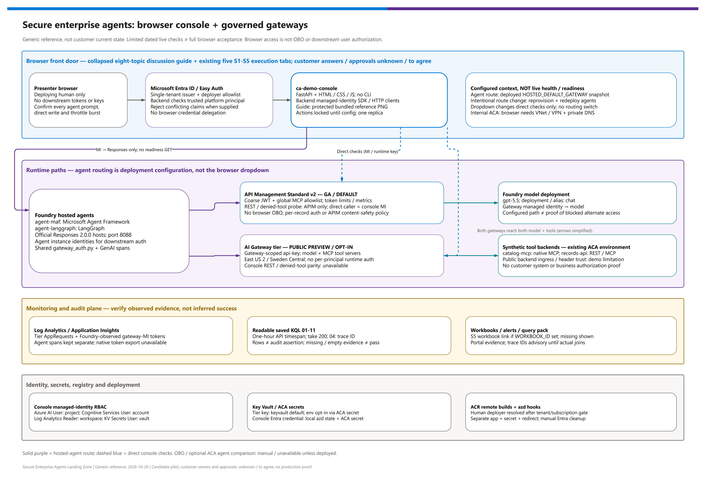
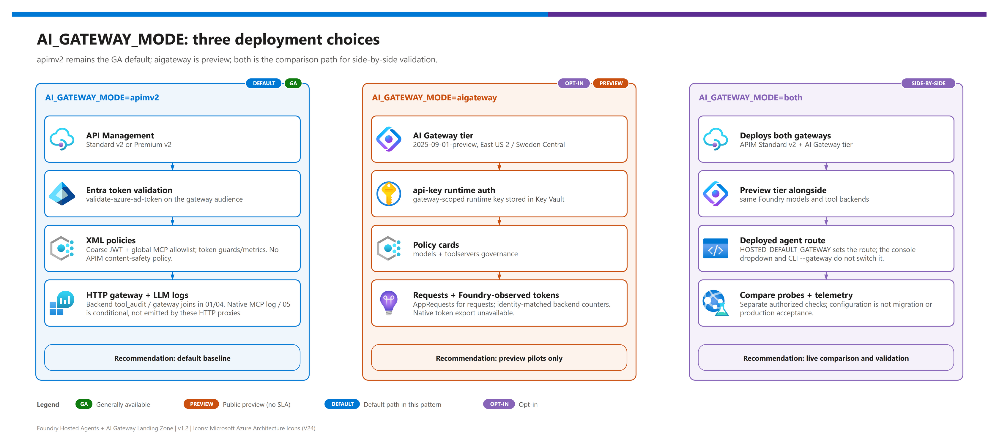
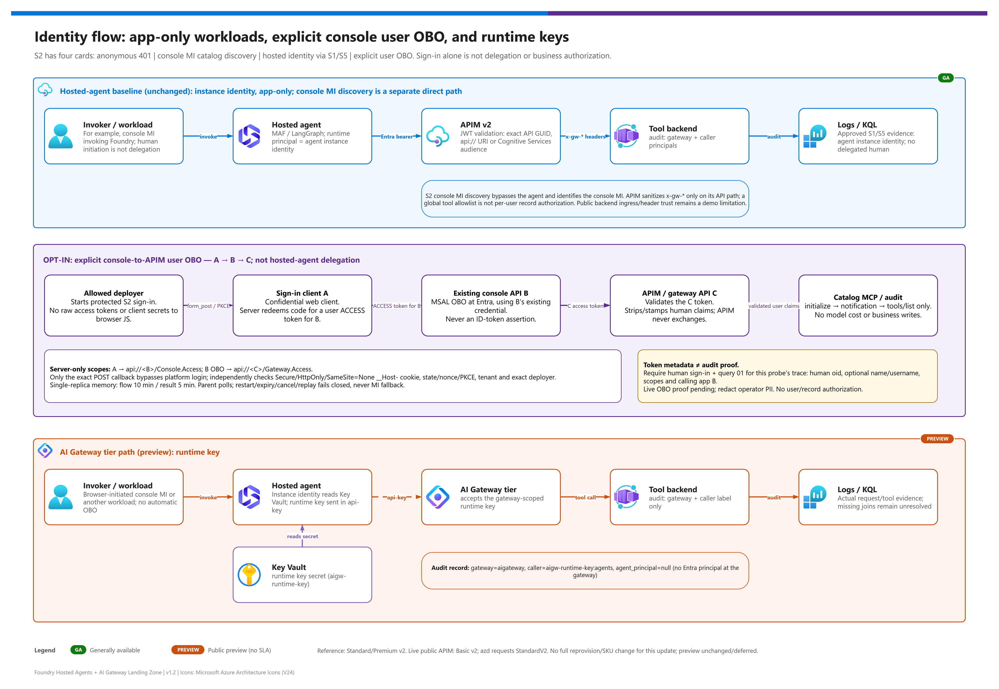

[README](../README.md) › [docs index](./00-reproduce-this-demo.md) › 01 Architecture

# 01 - Architecture

<p>
  
  
  
  
  
  
  
  
</p>

<p>
  
  
  
  
  
</p>

Architecture guide for platform engineers, solution architects, and developers who need to understand how two hosted-agent frameworks, two gateway families, tool backends, identity, and audit telemetry fit together. Read it before an architecture review or workshop so you can answer "where does this call go, who authenticated it, and where is it logged?" for every hop.

> [!IMPORTANT]
> The browser console is deployed with [limited live checks](./04-testing.md#limited-follow-up-2026-10-20); the complete browser acceptance matrix remains pending. Existing 2026-10-02 evidence covers historical script-driven paths only. This is a generic sample, not a customer's current architecture or a production administration portal. Use [doc 11's eight-item session guide](./11-demo-walkthrough.md#eight-item-customer-session-agenda) for discovery, fit, candidate pilot and closeout; customer answers and approvals are unknown / to agree.

> [!WARNING]
> The reference architecture targets Standard/Premium v2; current live APIM is **Basic v2** while azd still requests **StandardV2**. Its public-path checks do not prove private-network capabilities. Do not full-provision that environment for the OBO update, upgrade its SKU or change the deferred preview lane.

## At a glance

| | Layer | In one sentence |
|---|---|---|
|  | **Agents** | Two hosted agents (Microsoft Agent Framework, LangGraph) on the official Foundry hosts, with the same gateway-auth and telemetry contract. |
|  | **Console** | FastAPI + plain HTML/CSS/JS in `ca-demo-console`, in the existing ACA environment; deployer-only Entra sign-in, default backend MI clients and opt-in server-side console-to-APIM user OBO. |
|  | **Gateway (default)** | APIM Standard v2 validates Entra tokens, applies `llm-*` policies, allow-lists MCP tools, and logs to resource-specific tables. |
|  | **Gateway**  | AI Gateway tier fronts the same model and tools with a gateway-scoped `api-key`; its LLM and MCP telemetry lands in Application Insights `AppRequests`. |
|  | **Tools** | Container Apps catalog/records MCP adapters, plus records REST. APIM uses HTTP policy proxies; preview records uses an OpenAPI-generated tool server dispatching REST. |
|  | **Evidence** | Agent spans, gateway logs, backend `tool_audit` rows and control-plane changes; correlate only where actual `traceparent` / `x-gw-request-id` evidence exists. |

> [!NOTE]
> Direct model calls from an agent to Foundry are **out of pattern**: the sample configures model and tool clients through a gateway. This routing convention is not proof that all alternate paths are blocked. Public tool-backend ingress/trust is a demo limitation; production requires independently validated backend access, authentication and business authorization.

## Reference architecture

[](./assets/foundry-hosted-agents-ai-gateway-landing-zone-architecture.png)

<sub>Editable source: [`assets/foundry-hosted-agents-ai-gateway-landing-zone-architecture.drawio`](./assets/foundry-hosted-agents-ai-gateway-landing-zone-architecture.drawio) - regenerate with `python scripts/export_diagrams.py docs/assets`.</sub>

## Browser console boundary and request paths

The `demo-console` azd service builds `src/demo-console` remotely with **repository-root Docker context** and deploys one Container App, `ca-demo-console`; it does not create a second ACA environment. It scales to zero with **maxReplicas=1**. FastAPI serves plain HTML/CSS/JS and calls Azure APIs directly through SDK/HTTP clients: **no CLI or scripts execute in the app**.

The collapsed **session/presenter guide** frames all eight agenda topics while retaining the five S1-S5 execution tabs. It displays the maintained reference architecture at `/reference/architecture.png`, bundled with the image, not discovered live topology. Action buttons stay disabled until configuration loads. S5 has readable query labels and an optional workbook link from `WORKBOOK_ID`; missing workbook configuration is shown, not simulated.

| Hop | Identity / control | Limit of the claim |
|---|---|---|
| Browser → console | Separate single-tenant Entra console app; ACA Easy Auth requires authentication and allowlists the deploying human's object ID. Backend verifies the platform-injected principal ID and rejects conflicting owner/tenant claims when supplied. | This authenticates console access, not downstream user delegation. |
| Console → hosted MAF / LangGraph | Backend managed identity; **Azure AI User** at the Foundry **project** scope; Responses invocation only. | No readiness GET. A successful response demonstrates transport/protocol success, not selected-tool execution or trace propagation. |
| Console → APIM model / MCP / REST | Managed-identity token for `https://cognitiveservices.azure.com`; **Cognitive Services User** at the Foundry **account** scope. | These are console-identity checks, not agent-identity or OBO checks. REST list/get/create/update and the denied-tool probe are APIM-only. |
| Explicit S2 user OBO → APIM catalog MCP | Auxiliary sign-in client **A** obtains a user access token for console API **B** (`api://<B>/Console.Access`); B uses its existing confidential credential to exchange it for API **C** (`api://<C>/Gateway.Access`). | Server-side token exchange and catalog discovery only; not hosted-agent delegation, model traffic, record writes or user/record-level authorization. Real sign-in plus trace-matched audit are required for a live proof. |
| Console → AI Gateway tier model / MCP | Runtime key read from Key Vault (default `AIGW_KEY_DELIVERY=keyvault`). Opt-in `env` delivery uses an **ACA secret**, never browser JavaScript. | Key possession is not per-human/per-agent attribution; denied-tool allowlist parity is unavailable. |
| Console → Log Analytics | **Log Analytics Reader** at the **workspace** scope; fixed saved KQL 01-11, API timespan one hour, appended `take 200`. S2's “Read this identity call's audit” filters query 01 by the identity probe's trace ID. | “Passed” means rows returned, not a validated audit assertion. Empty results are `not_run`. Query 04 investigates broader trace hops; IDs are correlation hints until logs confirm the chain. |
| Console → Key Vault | **Key Vault Secrets User** at the demo vault scope. | RBAC does not bypass network policy; a reachable vault is still required. |

The browser's **direct gateway dropdown** selects only direct S2-S4 checks; it does not redeploy or switch agent routing. Hosted agents continue to use deployed `HOSTED_DEFAULT_GATEWAY`. The console displays a **provisioning snapshot**, not live-discovered agent routing: an agent-only deployment after changing `AGENT_DEFAULT_GATEWAY` can leave the display stale. Synchronize console configuration on an approved route change; full reprovisioning is blocked for the current SKU-drifted environment.

S2 keeps **four separate cards**: anonymous 401, console MI read-only catalog discovery, hosted-agent identity via S1/S5, and explicit user OBO. OBO is opt-in (`ENABLE_DEMO_OBO=false` by default). The normal Easy Auth/deployer boundary stays intact. Only `POST /api/identity/obo/callback` is excluded from platform login; it independently verifies its browser-binding cookie, MSAL state/nonce/PKCE, tenant and exact deployer before exchange/probe. Access tokens and client secrets remain server-side. Memory-only flow/result state has 10/5-minute TTLs on one replica; expiry, restart, cancellation or replay fails closed, never to MI. See [the three-app identity flow](./07-identity-auth-traceability.md#console-to-apim-user-obo-three-apps). The legacy `samples/obo-client` only signs in and invokes Foundry, without a downstream exchange; the optional ACA agent runtime remains a separate manual comparison.

All agent prompts require confirmation because an agent may invoke mutating tools. Direct `create_record` / `update_record` and REST writes require explicit write confirmation; bounded throttle bursts have a separate confirmation. Nothing auto-runs writes. Network isolation is a diagram/manual discussion, not synthetic live checks. `NETWORK_ISOLATION=true` puts the console inside the internal ACA environment, requiring VNet/VPN browser access and private DNS.

## Gateway modes

[](./assets/gateway-modes.png)

<sub>Editable source: [`assets/gateway-modes.drawio`](./assets/gateway-modes.drawio) - regenerate with `python scripts/export_diagrams.py docs/assets`.</sub>

| | Mode | Status | What it means |
|---|---|---|---|
|  | **`apimv2`** |   | Only APIM v2 is deployed. Safe baseline for shared, repeatable demos. |
|  | **`aigateway`** |   | Only the AI Gateway tier is deployed. East US 2 / Sweden Central only. |
|  | **`both`** |  | Both deployed; `AGENT_DEFAULT_GATEWAY` (passed to the agents as `HOSTED_DEFAULT_GATEWAY`) picks which one the agents call. |

## Tier → component → role

| Tier | | Component | Mode / path | Role |
|---|---|---|---|---|
| Clients |  | **Browser demo console** | `src/demo-console`; `ca-demo-console` in existing ACA environment | Deployer-only front door; MI clients, optional three-app user OBO and bounded KQL. No in-app CLI. |
| Clients |  | **Developer walkthrough, legacy user sign-in sample, validation scripts** | Manual / separate | Retained developer paths; the `obo-client` sample is not a downstream OBO implementation and is not executed by the console. |
| Hosted agents |  | **`agent-maf`** <br>  | `src/agents/maf`, protocol `responses` 2.0.0 | Microsoft Agent Framework implementation on `agent_framework_foundry_hosting.ResponsesHostServer`, using gateway-backed model and MCP clients. |
| Hosted agents |  | **`agent-langgraph`** <br>  | `src/agents/langgraph`, protocol `responses` 2.0.0 | LangGraph implementation on `langchain_azure_ai.agents.hosting.ResponsesHostServer`, using the same gateway contract. |
| Gateway |  | **APIM Standard v2** <br>   | `AI_GATEWAY_MODE=apimv2` or `both` | Default GA gateway path with XML policy, Entra validation, managed identity to model, MCP/REST governance, diagnostics. |
| Gateway |  | **AI Gateway tier** <br>  | `AI_GATEWAY_MODE=aigateway` or `both`, `AI_GATEWAY_TIER_LOCATION=eastus2\|swedencentral` | Preview dedicated AI gateway (`Microsoft.ApiManagement/service`, sku `AIGateway`) with model provider, model alias, MCP/OpenAPI tool servers, runtime keys, and telemetry in `AppRequests`. |
| Model |  | **Foundry model deployment** | APIM path `/llm/openai/v1`; AI Gateway path `/default/models/openai/v1` | Receives all model calls through a gateway; direct Foundry model calls are out of pattern. |
| Tools |  | **`catalog-mcp`, `records-api`** | APIM `/catalog-mcp/mcp`, `/records-mcp/mcp`; AI Gateway `/default/toolservers/<name>/mcp` | APIM HTTP APIs proxy backend MCP adapters; the records adapter wraps the same business functions. Preview records is OpenAPI-generated and dispatches REST. |
| Registry |  | **Container Registry** | All | Holds agent and tool images built remotely (`remoteBuild: true`). |
| Security |  | **Key Vault** | AI Gateway tier | Stores the `agents` runtime key as `AIGW_RUNTIME_KEY_SECRET_NAME`; each hosted agent's instance identity needs **Key Vault Secrets User** (granted by the `postdeploy` hook). |
| Identity |  | **Entra ID app registration** | APIM path | Gateway app (`api://<GATEWAY_APP_CLIENT_ID>`) whose audience APIM validates. |
| Identity |  | **Managed identities** | All | Gateway → Foundry model; agent instance identity → Key Vault secret read. |
| Monitoring |    | **App Insights, Log Analytics, workbook, KQL** | All | Correlates agent spans, gateway logs/telemetry, backend audit rows, and control-plane changes. |

## Request paths

Both paths start the same way: a client calls a hosted agent endpoint, and the agent (MAF or LangGraph) chooses a gateway from `HOSTED_DEFAULT_GATEWAY` (set from the azd env value `AGENT_DEFAULT_GATEWAY`).

### Path 1 - APIM Standard v2 (default) 

| Step | | What happens | Where it is recorded |
|---|---|---|---|
| **1** |  | Client calls the hosted agent (`POST /responses`; `/invocations` only when `HOSTED_PROTOCOL=invocations` locally). The agent starts a trace span. | Application Insights (agent span). |
| **2** |  | Agent acquires an Entra token and calls `<APIM_GATEWAY_URL>/<LLM_API_PATH>/openai/v1/responses`. | Entra sign-in logs (optional export). |
| **3** |  | APIM `validate-azure-ad-token` accepts the gateway-app URI, its exact client-ID GUID (v2 tokens), and the Foundry/cognitiveservices audience used by hosted-agent identities; strips client `x-gw-*` headers, then sets them from validated claims. | `ApiManagementGatewayLogs`. |
| **4** |  | `llm-token-limit` (per validated caller app, `TOKEN_LIMIT_TPM_PER_AGENT`) and `llm-emit-token-metric` run. The APIM sample does **not** implement `llm-content-safety`; the content-safety setting is wired to preview-tier cards only. | `ApiManagementGatewayLlmLog`, token metrics; actual enforcement still requires source evidence. |
| **5** |  | APIM uses its managed identity to call the Foundry model backend. | Foundry `RequestResponse` / `Audit` logs. |
| **6** |  | `catalog-mcp` and `records-mcp` are **HTTP APIs (`apiType=http`)** policy-proxying backend MCP adapters, with a global tool allowlist and caller-app rate limits. The records adapter wraps the same record business functions; the backend writes `tool_audit`. | Backend `tool_audit` + `ApiManagementGatewayLogs`; primary queries **01/04**. Native MCP logs/query 05 are conditional, not expected evidence from these HTTP proxies. |

### Path 2 - AI Gateway tier (preview) 

| Step | | What happens | Where it is recorded |
|---|---|---|---|
| **1** |  | Client calls the hosted agent; the agent starts a trace span. | Application Insights (agent span). |
| **2** |  | Agent reads the runtime key from Key Vault (`KEY_VAULT_URI` + `AIGW_RUNTIME_KEY_SECRET_NAME`) using its instance identity; with `AIGW_KEY_DELIVERY=env` it uses `AIGW_RUNTIME_KEY` instead. | Key Vault audit log. |
| **3** |  | Agent calls `<AIGW_GATEWAY_URL>/default/models/openai/v1/responses` with the `api-key` header; the gateway routes by the model alias, which must equal the request `model` (`chat`). | `AppRequests` for requests; verified token counters are **Foundry-observed**, matched to the gateway MI in `RequestResponse` logs ([09](./09-monitoring-and-audit.md#ai-gateway-tier-telemetry-preview)). |
| **4** |  | The model provider (kind Foundry, managed-identity auth; `modelName` equals the deployment name) calls the deployment. The gateway identity needs the **Foundry User** role. | Foundry logs. |
| **5** |  | Tool calls go to `AIGW_MCP_CATALOG_URL` (remote MCP tool server `catalog-mcp`) and `AIGW_MCP_RECORDS_URL` (OpenAPI-generated `records` tool server dispatching REST). | Selected fresh preview traces show `AppRequests` / `AppDependencies`, **not joined backend `tool_audit` hops**. Current end-to-end correlation proof is incomplete; native MCP logs are conditional. |
| **6** |  | The tier writes request telemetry to Application Insights; query 11 compares `AppRequests` with the APIM path. | `infra/monitoring/queries/11-ai-gateway-tier-telemetry.kql`. |

### Request-path comparison

| Path | APIM Standard v2 default  | AI Gateway tier  |
|---|---|---|
| Model call | Agent gets Entra token for `api://<GATEWAY_APP_CLIENT_ID>`, calls `<APIM_GATEWAY_URL>/<LLM_API_PATH>/openai/v1/responses`, APIM validates token and uses managed identity to Foundry. | Agent reads runtime key from Key Vault and calls `<AIGW_GATEWAY_URL>/default/models/openai/v1/responses` with `api-key`; gateway routes by the model alias. |
| Catalog MCP | Agent calls `MCP_CATALOG_URL`; APIM validates token, strips/spreads `x-gw-*`, allow-lists tools, forwards to `catalog-mcp`. | Agent calls `AIGW_MCP_CATALOG_URL`; preview gateway validates runtime key and forwards configured backend credential/header. |
| Records MCP | `MCP_RECORDS_URL` is an APIM HTTP policy proxy to the backend records MCP adapter, which wraps the same record business functions; **not** APIM-managed OpenAPI-to-MCP generation. | `AIGW_MCP_RECORDS_URL` uses an OpenAPI-generated tool server (absolute `servers[0].url`) dispatching REST and emitting `AppRequests`. |
| Audit | Tool audit can include `agent_principal` / `human_principal` from Entra-derived headers. | Tool audit is honest about preview limitation: `gateway="aigateway"`, `caller="aigw-runtime-key:agents"`, `agent_principal=null` unless another app-level identity is supplied. |

> [!NOTE]
> MCP transport is Streamable HTTP on `/mcp`. The older `/sse` and `/messages` endpoints are deprecated. APIM MCP policies are inbound-only and never read `context.Response.Body`, so streaming responses are not buffered. Learn: [Expose REST API as MCP server](https://learn.microsoft.com/en-us/azure/api-management/export-rest-mcp-server), [Expose and govern an existing MCP server](https://learn.microsoft.com/en-us/azure/api-management/expose-existing-mcp-server).

Those Learn links describe native APIM platform options, **not the resource type used here**. This sample's Standard-v2 MCP routes are HTTP APIs. Use actual `tool_audit` and HTTP gateway joins in 01/04; an empty native query 05 is not a wiring failure. Selected preview traces remain incomplete end to end ([limited follow-up](./04-testing.md#limited-follow-up-2026-10-20)).

## Trust boundaries

[](./assets/identity-token-flow.png)

| # | Boundary | | Control | What it proves | What it does **not** prove |
|---|---|---|---|---|
| **1** | Client → hosted agent |  | Foundry Agent Service authenticates callers with Microsoft Entra ID. | A caller was allowed to reach the agent. | Which tool the agent will pick. |
| **2** | Agent → gateway (`apimv2`) |  | App-only Entra bearer token validated by APIM (`azp`/`appid`, `oid`). | Which hosted-agent instance identity called on this path. | A human initiating the agent invocation does not delegate that human's identity. |
| **3** | Agent → gateway (`aigateway`) |  | `api-key` from Key Vault; gateway-scoped. | The caller holds a valid gateway key. | **Which** principal called - one key reaches every model and tool; no Entra validation at runtime. |
| **4** | Gateway → Foundry model |  | Managed identity with Foundry User role on the Foundry account. | The gateway authenticates as its own workload principal on this path. | Exclusivity of that path, blocked alternate callers, or per-user authorization. |
| **5** | Gateway → tool backend |  | APIM: sanitized `x-gw-*` headers and a global tool allowlist on the gateway path. Tier: configured backend credential/caller label; no demonstrated APIM-only denial parity. | APIM can reject an unlisted tool and replace supplied attribution headers for requests traversing that API. | Per-user/action/record entitlements or trusted backend ingress. Public backend access/trust remains a demo limitation, not production isolation. |
| **6** | Agent → Key Vault |  | The hosted agent's **instance identity** holds **Key Vault Secrets User** on the demo vault (granted by the `postdeploy` hook). | The runtime key is never baked into images; `AIGW_KEY_DELIVERY=env` is an explicit, demo-only opt-in. | Rotation policy - handle it operationally; a Key Vault network policy can still block agents running outside the VNet. |
| **7** | Backend → audit |  | `tool_audit` JSON line with `gateway`, `caller`, principals, `traceparent`. | Which gateway path served the call. | Cross-system join is DIY (see [known gaps](../README.md#known-gaps)). |
| **8** | Console API B → gateway API C (explicit OBO) |  | B exchanges the user **access token for B**, not an ID token, for delegated `Gateway.Access`; APIM validates C's token and derives human claims. | A trace-matched backend row can establish human attribution for this catalog-discovery call. | Not hosted-agent delegation, a claim that an agent acted for the user, or per-record business authorization. |

> [!IMPORTANT]
> **Live finding (2026-10-02):** the effective runtime identity of a hosted agent is its **instance identity principal** (`azd ai agent show <agent> --output json` → `instance_identity.principal_id`). It is distinct from the blueprint principal and from the Foundry project identity, is stable across agent versions, and exists only after the agent is deployed - so Bicep cannot grant it access. See [07 - Identity, authentication, and traceability](./07-identity-auth-traceability.md#the-runtime-principal-is-the-instance-identity).

> [!WARNING]
> On the AI Gateway tier, never describe `caller="aigw-runtime-key:agents"` as an agent identity. It names a **key**, not a principal. Use `apimv2` when per-principal attribution is the requirement.

## Data flow

| Data | Origin | Path | Stored where |
|---|---|---|---|
| Prompt / completion text | Client, model | Agent → gateway → model | Optional `ENABLE_LLM_MESSAGE_LOGGING` → `ApiManagementGatewayLlmLog` (APIM only); Foundry `RequestResponse` logs. |
| Token counts | Model response | Gateway policy / backend diagnostics | APIM LLM logs/metrics; **AI Gateway - Foundry-observed** counters in Foundry `AzureDiagnostics` `RequestResponse`, matched to the gateway MI object ID. Native tier request counters/export remain unavailable; keep agent spans separate. |
| Tool arguments / results | Agent, backend | Agent → gateway → tool | APIM HTTP gateway logs + backend `tool_audit`; tier `AppRequests` / `AppDependencies`. Native MCP logs are conditional; selected preview backend hops are not currently joined. |
| Runtime key | Gateway control plane | `listSecrets` → Key Vault → agent | Key Vault (or, demo-only, the azd env and agent config when `AIGW_KEY_DELIVERY=env`); never logged. |
| Trace context | Client / agent | `traceparent`, `x-gw-request-id` | Application Insights, gateway logs, `tool_audit`. |
| OBO identity context | Real signed-in deployer | Server-only A → B → C access tokens; APIM-derived user headers → backend audit | Tokens stay in console memory, not browser JavaScript. Audit contains privacy-relevant `human_principal`, `identity_type`, `delegated_scopes`; names/usernames are optional and `oid` is authoritative. Do not share unredacted rows. |
| Domain profile / sample data | `config/profiles/*.json`, `src/*/data/profiles/` | `scripts/sync-agent-profiles.ps1` synchronizes canonical profiles to both agent and both tool image contexts; backend sample data remains synthetic. | Container images (generic sample data only). |

[](./assets/trace-correlation.png)

## Decisions with rationale

### Design decisions D1-D10

| ID | Decision | Rationale | Consequence |
|---|---|---|---|
| **D1** | Gateway modes `apimv2` , `aigateway` , `both` | Teams need a low-risk way to compare the preview tier against the default gateway. | APIM outputs stay primary; AI Gateway tier outputs are additional. |
| **D2** | Hosted-agent contract: port 8088, `GET /readiness`, `POST /responses` (served by the official host); azd extension `azure.ai.agents`, `host: azure.ai.agent`, `kind: hosted` | Matches the platform contract so the same image runs anywhere hosted agents run. | `agent-maf` and `agent-langgraph` share gateway/auth/telemetry behavior but use different official host packages. |
| **D3** | Optional second runtime: the same container on Container Apps (`DEPLOY_AGENT_ON_ACA`, default false) | Makes the "Foundry vs self-hosted runtime" comparison concrete: what you keep (contract, gateway, telemetry) vs what you lose (auto-provisioned agent identity, managed sessions, Toolbox). | Off by default. |
| **D4** | APIM HTTP policy proxies to catalog/records MCP adapters; preview records uses OpenAPI-generated tool serving over REST | Distinguishes backend MCP adaptation from gateway-managed OpenAPI generation. | APIM records adapter reuses the record business functions; native APIM MCP diagnostics are not assumed. |
| **D5** | Identity: Entra validation on APIM; honest key-based identity on the tier | APIM can validate Entra tokens; AI Gateway tier runtime keys are not per-principal validation. | Docs and audit schema avoid overstating preview identity. |
| **D6** | Traceability: propagate `traceparent` and `x-gw-request-id` end to end | Needed to join agent, gateway, and backend evidence. | Cross-system correlation remains DIY. |
| **D7** | Monitoring plane: resource-specific tables, saved KQL, workbook, alerts | GA operational surface, mature policy, resource-specific diagnostics. | Shared and repeatable demos start on `apimv2`. |
| **D8** | Landing-zone network: public endpoints with Entra auth by default; `NETWORK_ISOLATION=true` adds VNet `10.40.0.0/16`, delegated subnets, 8 private endpoints and 9 private DNS zones (what-if validated, not live-deployed) | Keeps the first build fast; private is an explicit add-on. | Private build adds time (see [00](./00-reproduce-this-demo.md#time-budget)). |
| **D9** | APIM: JWT validation, `llm-token-limit` per caller app, global MCP tool allowlist and MCP rate limits. Preview tier: policy cards, including the wired `ENABLE_CONTENT_SAFETY` setting. | State controls by gateway rather than imply parity or an APIM content-safety policy. | Both frameworks use the same selected gateway contract; per-user authorization, backend trust and actual enforcement need separate validation. |
| **D10** | Known gaps listed openly | A demo that hides gaps loses credibility. | See [README known gaps](../README.md#known-gaps). |

### Change decisions C1-C10 (v1.1, updated for v1.2)

| ID | Change | Why |
|---|---|---|
| **C1** | `AI_GATEWAY_MODE=both`  | Side-by-side comparison with a single deploy. |
| **C2** | Tier location guard (`eastus2` or `swedencentral`) | Preview only exists in those regions; fail fast in `preprovision`. |
| **C3** | Tier module on `Microsoft.ApiManagement/service@2025-09-01-preview` with sku `AIGateway` (needs the `AIGatewayPreview` feature registered) | Workspace `default`, model provider, model alias, tool servers, `apiKeys/agents`. |
| **C4** | Two agents on the official hosts + shared `gateway_auth.py` | Framework swapability must be real, not prose. |
| **C5** | `azure.yaml` services `agent-maf`, `agent-langgraph`, `catalog-mcp`, `records-api` | One `azd deploy` surface. |
| **C6** | New variables and outputs | Every knob documented in [12](./12-configuration-reference.md). |
| **C7** | Audit honesty | `gateway`, `caller`, `agent_principal` reflect what each gateway can really prove. |
| **C8** | Query 11 + workbook tile | Compare tier `AppRequests` telemetry with APIM telemetry. |
| **C9** | Scripts and tests for `--target`, `--gateway`, `--query 11` | Regressions are caught offline. |
| **C10** | Live test | Static verification is not enough for a preview tier; the 2026-10-02 run passed both gateways - see [04](./04-testing.md#live-validation-2026-10-02). |

The runtime key lives in Key Vault (`KEY_VAULT_URI` + `AIGW_RUNTIME_KEY_SECRET_NAME`) because it is a gateway-scoped secret in preview; agents read it at runtime and never output the value. If a Key Vault network policy blocks the agent, the options are isolation mode (proper) or `AIGW_KEY_DELIVERY=env` (demo-only) - see [05](./05-troubleshooting.md#hosted-agent-gets-forbiddenbyconnection-from-key-vault).

## Adapting this pattern to another domain

Retargeting remains configuration-only: change `DOMAIN_PROFILE`, profile JSON, seed data, and the `workload` block in `demo-ids.local.json`. Do not rename gateway routes, audit fields, or hosted-agent protocol surfaces for a new domain.

| Step | | Action |
|---|---|---|
| **1** |  | Copy `config/profiles/manufacturing-field-ops.json` to a new profile (for example `it-service-desk` is already shipped as a second example). |
| **2** |  | Add `items.json` and `records.json` seed data under `src/catalog-mcp/data/profiles/<profile>/` and `src/records-api/data/profiles/<profile>/`. |
| **3** |  | `azd env set DOMAIN_PROFILE <profile>`; run `scripts/sync-agent-profiles.ps1`. Its back-compatible name now covers **all four image contexts**: both agents and both tools. |
| **4** |  | `azd deploy` the agents and tool services; run the walkthrough. |

<details>
<summary><b>Profile JSON shape (abridged)</b></summary>

```json
{
  "profileName": "manufacturing-field-ops",
  "displayName": "Manufacturing Field Operations",
  "agent": {
    "name": "FieldOpsGatewayAgent",
    "description": "Assists operators with parts availability and work-order coordination through governed tools.",
    "instructions": "Use governed catalog and records tools ... Do not invent inventory, work orders, people, or customer-specific facts."
  },
  "labels": { "item": "part", "items": "parts", "record": "work order", "records": "work orders" },
  "catalogTools": { "list_items": "...", "search_items": "...", "get_item": "...", "check_availability": "...", "check_availability_batch": "..." },
  "recordsTools": { "list_records": "...", "get_record": "...", "create_record": "...", "update_record": "..." },
  "seedData": { "items": "src/catalog-mcp/data/profiles/<profile>/items.json", "records": "src/records-api/data/profiles/<profile>/records.json" },
  "walkthrough": [ { "step": "S1", "segment": "Hosted agents", "prompt": "...", "expectedTool": null, "assertion": "..." } ]
}
```

Tool **names** stay `list_items`, `search_items`, ... for every domain - the gateway allow-list and audit schema depend on them. Only the descriptions, labels, and data change.

</details>

## References

> [!NOTE]
> The AI Gateway tier is a public preview; re-check these pages before a live session because resource shapes can change.

- AI Gateway tier overview: <https://learn.microsoft.com/en-us/azure/api-management/ai-gateway-overview>
- AI Gateway models and tools: <https://learn.microsoft.com/en-us/azure/api-management/ai-gateway-manage-models-tools>
- Microsoft Agent Framework hosted agents: <https://learn.microsoft.com/en-us/azure/foundry/how-to/develop/framework-hosted-agents?pivots=programming-language-python>
- LangGraph hosted agents: <https://learn.microsoft.com/en-us/azure/foundry/how-to/develop/langchain-hosted-agents>
- Hosted agents concept: <https://learn.microsoft.com/en-us/azure/foundry/agents/concepts/hosted-agents>

Next: [02 - Prerequisites](./02-prerequisites.md) →

---

*Last updated: 2026-10-20*
