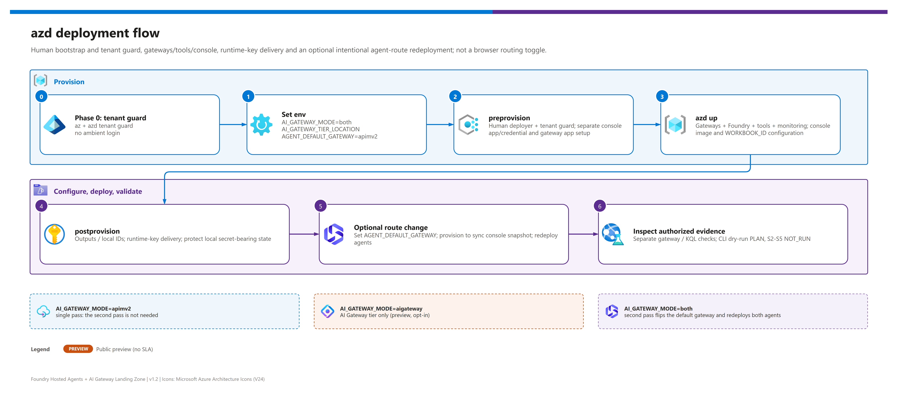

[README](../README.md) › [docs index](./00-reproduce-this-demo.md) › 03 Deployment

# 03 - Deployment

<p>
  
  
  
  
  
  
</p>

<p>
  
  
  
  
  
</p>

Deployment runbook for the primary infrastructure-as-code path. v1.2 deploys **both** APIM Standard v2 and the AI Gateway tier preview side by side for comparison - both were live-validated on 2026-10-02 - while keeping APIM v2 as the safe runtime baseline. For a no-IaC build, see [03b - Manual deployment](./03b-manual-deployment.md).

> [!IMPORTANT]
> **Console deployment has limited live checks; full browser acceptance remains pending.** See the [2026-10-20 limited follow-up](./04-testing.md#limited-follow-up-2026-10-20). Earlier badges, durations and evidence below concern the historical script-driven v1.2 deployment. The session-guide/image/link changes require the new console image and configuration; local tests are not proof of their Azure deployment. One-time provisioning still needs local CLI tools; the browser walkthrough needs no local scripts.

> [!WARNING]
> **Do not full-provision the current live environment for this update.** Live APIM is **Basic v2**, while azd requests **StandardV2**. The reference/default new build remains Standard/Premium v2, but an unreviewed `azd provision` would include SKU drift. Keep preview deferred and the SKU unchanged; use scoped app/policy/configuration updates plus separate service deployments below. The general provisioning/rotation/route-switch recipes later in this document apply only after an operator has reviewed and reconciled infrastructure drift.

## Demo console provisioning and sign-in

Run [Phase 0](#phase-0---authenticate-to-the-right-tenant) first. Use a **human** Azure CLI login, not a service principal or managed identity. `preprovision` checks `AZURE_TENANT_ID` / `AZURE_SUBSCRIPTION_ID` against the active account before setup operations; a mismatch stops the hook rather than provisioning in ambient context.

1. The hook resolves `AZURE_PRINCIPAL_ID` from the signed-in Azure CLI **user**. This deployer object ID becomes `DEMO_CONSOLE_ALLOWED_USER_ID`; it is not an app/client ID.
2. It ensures a **separate single-tenant console Entra app and service principal**, distinct from the gateway app, and sets `DEMO_CONSOLE_CLIENT_ID`. The operator needs directory permission to create/manage that app, service principal and credentials; Azure resource RBAC alone is insufficient.
3. It generates the console app credential when needed and stores `DEMO_CONSOLE_CLIENT_SECRET` in the **gitignored azd environment**. Bicep receives it as a secure parameter and stores it in an **ACA secret** for Easy Auth. Do not print `azd env get-values` into a recording, issue or build log: it can include secrets.
4. Infra parameters `demoConsoleClientId`, `demoConsoleAllowedUserId`, and secure `demoConsoleClientSecret` receive those three `DEMO_CONSOLE_*` values. Defaults are blank and setup must populate them; missing configuration fails closed, not anonymous access.
5. `postprovision` configures the console app's redirect URI using the provisioned endpoint and enables ID-token issuance for Easy Auth's hybrid callback flow. Easy Auth allows only this tenant and deployer object ID; the backend verifies ACA's trusted principal ID and rejects conflicting owner/tenant claims when supplied. Only the console HTTPS origin is allowed for Easy Auth's browser POST handling; backend origin/custom-header checks remain enabled.

For a new environment, use the existing configured flow:

```powershell
azd up
```

For an existing environment with agents/tools already deployed, select that azd environment and verify Phase 0 again. Apply only approved runtime/auth/policy changes (see [OBO setup](#optional-console-to-apim-user-obo)); an image deploy does not update missing environment variables, secrets, platform auth or APIM policies.

**Before restarting either backend, verify that the in-memory records still contain only the unchanged disposable seed state.** If any records were created/updated, stop and agree preservation/rollback before restarting `records-api`; a restart can discard those changes. The current azd CLI accepts at most **one service argument** per deploy:

```powershell
azd deploy catalog-mcp
azd deploy records-api
azd deploy demo-console
```

Redeploy the two audit backends and console separately for the OBO comparison. No agent deployment, route change, full provisioning or preview update is needed. `records-api` also accepts collection GET/POST at `/records/` without redirecting, matching the APIM facade. Canonical `/records` routes remain unchanged. The console deliberately does not follow backend redirects or forward credentials to them.

The `demo-console` service builds remotely using **repository-root Docker context** and deploys `ca-demo-console` into the **existing ACA environment**; scale-to-zero, **maxReplicas=1**. The root `.dockerignore` allowlist excludes local azd state, populated IDs, credentials and virtual environments from the remote build context. It does not need a local Docker build. Outputs are `DEMO_CONSOLE_URL` and `DEMO_CONSOLE_APP_NAME`. Open the URL as the deploying human and follow [browser S1-S5](./11-demo-walkthrough.md#browser-console-s1-s5). With `NETWORK_ISOLATION=true`, the ACA environment is internal; the browser needs VNet/VPN connectivity and private DNS.

The console's displayed hosted gateway is a **provisioning snapshot**, not live discovery. An approved `AGENT_DEFAULT_GATEWAY` change must synchronize console configuration as well as redeploying agents; an agent-only `azd deploy` can leave that snapshot stale. Full provisioning normally wires it, but is not appropriate for the current drifted environment. The direct gateway dropdown never changes actual agent routing.

### Optional console-to-APIM user OBO

`ENABLE_DEMO_OBO` is **opt-in, default `false`**. It adds an explicit S2 sign-in/catalog-discovery comparison without replacing the primary single-tenant/deployer-only Easy Auth app. It is **not** hosted-agent delegation, model traffic, record writes or user/record-level business authorization.

The server-side flow needs **three distinct app roles**; A is new, B and C already exist:

| App | Configuration | Role / server-only credential |
|---|---|---|
| **A — auxiliary confidential web/sign-in client** | `DEMO_OBO_CLIENT_ID`, `DEMO_OBO_CLIENT_SECRET` | Obtains a user **access token for B**, scope `api://<B>/Console.Access`. The new secret is delivered by ACA secret reference **`obo-signin-secret`**, never to browser JavaScript. |
| **B — existing console API / Easy Auth app** | `DEMO_CONSOLE_CLIENT_ID`, `DEMO_CONSOLE_CLIENT_SECRET` | Exposes `Console.Access` and uses its **own existing confidential credential** (ACA secret reference **`entra-client-secret`**) for MSAL `acquire_token_on_behalf_of` toward C. An ID token or self-audience assertion is not a substitute for A's user access token for B. |
| **C — existing gateway API app** | `GATEWAY_APP_CLIENT_ID` | Exposes delegated `api://<C>/Gateway.Access`; APIM accepts C's exact client-ID GUID as well as its original `api://` URI and Cognitive Services audience. No C client secret is needed for this exchange. |

After the tenant/subscription gate and a human operator login, select the intended environment and run:

```powershell
azd env select <ENV_NAME>
azd env set ENABLE_DEMO_OBO true
python scripts/configure_console_obo.py --environment <ENV_NAME> --apply
```

The helper only changes **operator-owned, single-tenant** apps/scopes. It merges unrelated permissions, persists exposed scopes **before** adding preauthorization references, adds narrow **A → B `Console.Access`** and **B → C `Gateway.Access`** preauthorizations, and configures optional `upn`/`email` access-token claims. It does **not** create tenant-wide Microsoft Graph consent grants. Missing permissions, grant failures and consent requirements remain explicit errors, not permission broadening or managed-identity fallback.

The helper saves the generated A secret **only to the ignored local azd `.env`**, never command arguments or output. That local state is secret-bearing. Never paste it, use it in a recording or commit it. Do not pass a secret on the CLI to reproduce this setup.

For a **new/reconciled environment**, optional pre/postprovision hooks run this setup when enabled; the first provisioning establishes the URL. Then set A's exact HTTPS web redirect with:

```powershell
python scripts/configure_console_obo.py --environment <ENV_NAME> --apply --redirect-only
```

The redirect is **`https://<CONSOLE_HOST>/api/identity/obo/callback`**, not Easy Auth B's `/.auth/login/aad/callback`. Entra returns the authorization code by **`form_post`** (`POST`), not in a callback URL query string. The code is redeemed server-side. Defensive access-log redaction is additional protection, not permission to capture callback bodies, codes, tokens or cookies.

For the **current existing SKU-drifted environment**, do not use full provisioning to propagate these values. Apply the approved narrow APIM audience/identity-fragment update and the console runtime environment/ACA secret references separately, preserving all unrelated settings, primary Easy Auth and CSRF controls. Local `azd env set` alone does not configure a running app. Once the exact callback is registered and runtime values are in place, deploy `catalog-mcp`, `records-api` and `demo-console` one at a time as shown above, after the record-state precheck. Do not redeploy agents or alter preview/SKU.

Only the exact OBO callback is excluded from **platform login**; it independently validates the Secure/HttpOnly/SameSite=None `__Host-` browser-binding cookie, MSAL state/nonce/PKCE, tenant and exact allowed deployer before downstream exchange/probe. Other console routes retain Easy Auth plus `X-Demo`/exact-Origin CSRF checks. Tokens stay server-side. State/results live only in one console replica's memory (10/5-minute TTLs); parent-page polling keeps the console active during sign-in. Restart/expiry/cancel/replay fails closed, never to MI.

**Acceptance:** sign in explicitly from S2, inspect the catalog `initialize` / initialized notification / `tools/list` result, then select **“Read this identity call's audit”** for query 01 filtered by this probe's trace ID. Confirm `identity_type`, `human_oid`, optional `human_name` / `human_username`, `delegated_scopes` and the calling app. Acquired-token metadata is **not** audit proof. Real human sign-in/audit acceptance remains pending until recorded in [doc 04](./04-testing.md); configured apps/callbacks or passing local tests do not establish it. Treat real operator identity fields as privacy-relevant even though business data is synthetic.

### Console managed-identity permissions

| Role | Scope | Used for |
|---|---|---|
| **Azure AI User** | Foundry project | Invoking deployed hosted agents. |
| **Cognitive Services User** | Foundry account | Console APIM token path, audience `https://cognitiveservices.azure.com`. |
| **Log Analytics Reader** | Log Analytics workspace | Executing fixed, bounded saved KQL queries 01-11. |
| **Key Vault Secrets User** | Demo Key Vault | Reading the tier runtime key in default `keyvault` mode. |

These grants belong to the **console backend managed identity**, not the signed-in browser user or the hosted agents' instance identities. They remain the default workload paths; optional user OBO is a separate explicit S2 operation using B's confidential credential, not MI or the Easy Auth ID token. `AIGW_KEY_DELIVERY=env` is an explicit demo-only opt-in: console key delivery uses an ACA secret, never browser code. Hosted-agent key delivery remains documented [below](#key-delivery-and-the-postdeploy-hook).

If Key Vault public access is disabled while the ACA environment has no VNet integration, the console cannot read the tier key even with **Key Vault Secrets User**. For an explicitly approved disposable demo, set `AIGW_KEY_DELIVERY=env` before provisioning. Provisioning stores the tier key as the console's `aigw-runtime-key` ACA secret and binds `AIGW_RUNTIME_KEY` with a secret reference; changing only the local azd setting does not update an already running console. The runtime key also resides in the gitignored local azd environment, so keep that state private. This does not open Key Vault public access or change APIM authentication.

### Console secret expiry, rotation and cleanup

An expired console Entra app credential breaks sign-in and B's OBO exchange. Generated console/sign-in credentials have a **one-year lifetime**; track expiry and rotate both B (`DEMO_CONSOLE_CLIENT_SECRET`) and optional A (`DEMO_OBO_CLIENT_SECRET`). After verifying tenant/subscription and the intended azd environment, the **new/reconciled-environment** B rotation recipe is:

```powershell
azd env set DEMO_CONSOLE_CLIENT_SECRET ""
azd provision
azd deploy demo-console
```

The hook creates an **appended** credential rather than deleting all app credentials; verify sign-in with the new one, then manually remove obsolete/expired credentials in Entra. Never paste the generated value into documentation or terminal transcripts.

For A, clear only its local secret value and rerun the OBO setup helper to append a replacement, then update the live `obo-signin-secret` reference without exposing its value. For the current drifted environment, use scoped credential/runtime updates instead of the full-provision recipe above; preserve `entra-client-secret` for B's existing Easy Auth contract. Verify both sign-in and the OBO exchange before deleting old credentials.

`azd down` deletes Azure resources, **not** Entra app registrations or their credentials. Manually retire A, B and the gateway app/credentials when no longer needed; also remove demo-only scopes/preauthorizations from any retained apps without deleting unrelated permissions. Treat retained ignored azd state as secret-bearing.

### Updating only the workbook

The workbook is an Azure resource, separate from the console image and query pack. Rebuilding the console does not update its saved layout or queries. After the [tenant/subscription gate](#phase-0---authenticate-to-the-right-tenant), deploy `infra/modules/workbook.bicep` incrementally to the existing resource group, reusing the workbook's **location, display name, tags and workspace resource ID**. Also supply `aigwPrincipalId` from the tier's live managed-identity principal/object ID for **Foundry-observed** token attribution; blank means unavailable, not all callers. Its resource name is derived from the resource group and display name, so changing that name creates a different workbook instead of updating the intended one.

A workbook-only deployment does not require redeploying the console, tool backends or hosted agents. Use the [monitoring contract](./09-monitoring-and-audit.md#workbook) and [visual acceptance checks](./04-testing.md#workbook-visual-acceptance) for the global time range, trace scope and scalar token-chart columns. Reload the saved workbook from `WORKBOOK_ID`; an unsaved portal editing session can still contain older JSON.

For the same token-source correction in the query pack, deploy `infra/modules/querypack.bicep` with that `aigwPrincipalId` and the existing pack name/location/tags. The supported full provisioning path binds both modules and outputs `AIGW_PRINCIPAL_ID` automatically; `postprovision` maps it to `aigwPrincipalId` in the ignored IDs file. Console S5 also needs the new query bundle/application image and `AIGW_PRINCIPAL_ID` environment value. No agent redeployment or route change is needed.

### Updating only the console guide and workbook link

After [Phase 0](#phase-0---authenticate-to-the-right-tenant), a narrow GUI update has **two** requirements:

1. Set the existing console Container App's **runtime `WORKBOOK_ID` environment variable** to the existing workbook resource ID (the `WORKBOOK_ID` azd output), preserving its other settings, secrets and auth boundary. A local `azd env set WORKBOOK_ID ...` alone does **not** update the running app. Full `azd provision` wires this existing output to console Settings automatically, but is not required solely to deploy the new image when runtime configuration has been updated separately.
2. Deploy the new console image with `azd deploy demo-console`. It bundles the maintained reference PNG served behind authentication at `/reference/architecture.png` and the collapsed eight-item presenter guide around the existing five workflows. An image-only deploy does not independently supply a missing runtime `WORKBOOK_ID`.

S5 shows an optional workbook link when configured, and unavailable/missing configuration otherwise; it does not create or validate a workbook. Updating the actual workbook/query pack is the separate operation above. The GUI also adds readable source-derived query labels, a configuration-load action lockout and disabled APIM-only REST/denial controls for the tier. **This guide-only update does not require hosted-agent deployment, a route change or OBO setup**; opt-in S2 OBO has the separate setup above. No customer backend or production-security acceptance is implied.

Check the [browser acceptance list](./04-testing.md#browser-console-acceptance-checks) after deployment; a local fixture pass is not a real Entra/browser acceptance pass.

## At a glance

| | | |
|---|---|---|
|  | **Tool** | `azd up` with `preprovision` / `postprovision` hooks, plus a per-agent `postdeploy` hook |
|  | **Pass 1** | Agents point at APIM v2 (`AGENT_DEFAULT_GATEWAY=apimv2`, delivered to the agents as `HOSTED_DEFAULT_GATEWAY`) |
|  | **Pass 2** | Optional preview comparison: flip to `aigateway`, then `azd deploy agent-maf`, then `azd deploy agent-langgraph` |
|  | **Agents** | `agent-maf` and `agent-langgraph` on the official hosts, `host: azure.ai.agent`, `remoteBuild: true` |
|  | **Cleanup** | `azd down --purge --force` for resources; manually remove Entra apps/credentials. Historical v1.2 teardown took about 36 minutes. |

> [!WARNING]
> **Register the `AIGatewayPreview` feature first** when you use `aigateway` or `both`: `az feature register --namespace Microsoft.ApiManagement --name AIGatewayPreview`, wait for `Registered`, then `az provider register --namespace Microsoft.ApiManagement`. Details in [02 - Prerequisites](./02-prerequisites.md#register-the-ai-gateway-preview-feature).

> [!WARNING]
> **Phase 0 is not optional.** This workstation can hold several Azure tenants and subscriptions, and `az` and `azd` keep **separate** logins. Always run `az login --tenant` **and** `azd auth login --tenant-id`, then confirm with `az account show` before any provisioning. A bare `azd up` can target the wrong tenant or subscription.

## Fast path - `azd up` with both gateways

[](./assets/azd-deployment-flow.png)

<sub>Editable source: [`assets/azd-deployment-flow.drawio`](./assets/azd-deployment-flow.drawio) - regenerate with `python scripts/export_diagrams.py docs/assets`.</sub>

| Step | | Action | Gate |
|---|---|---|---|
| **0** |  | Authenticate to the right tenant (az **and** azd) | - [ ] `az account show` matches the target |
| **1** |  | Configure deployment knobs with `azd env set` | - [ ] `azd env get-values` reviewed |
| **2** |  | `azd provision --preview`, then `azd up` | - [ ] Hooks pass (including each agent's `postdeploy`), resources created |
| **3** |  | Validate both gateway routes | - [ ] `validate_gateway.py` reports no failed checks |
| **4** |  | Switch hosted agents to the AI Gateway tier  | - [ ] Agents redeployed with `aigateway` |

### Phase 0 - Authenticate to the right tenant

 Resolve the intended tenant and subscription first (ask if unknown - never guess), then:

```powershell
$tenant = "<TENANT_ID>"
$subscription = "<SUBSCRIPTION_ID>"
$envName = "<ENV_NAME>"   # lowercase, <= 20 characters

azd auth login --tenant-id $tenant
az login --tenant $tenant
az account set --subscription $subscription
az account show --query "{tenant:tenantId, subscription:id, subName:name, user:user.name}" -o table

azd env new $envName
azd env set AZURE_TENANT_ID $tenant
azd env set AZURE_SUBSCRIPTION_ID $subscription
azd env set AZURE_LOCATION eastus2
```

> [!NOTE]
> `preprovision` re-checks that `az account show` matches the azd environment's tenant and subscription and stops if it does not. It then resolves the signed-in human deployer and configures the console Entra app/credential. See [console provisioning](#demo-console-provisioning-and-sign-in).

### Phase 1 - Configure deployment knobs

 Defaults live in `infra/azd.parameters.json`; this block sets the comparison (`both`) configuration.

```powershell
azd env set AI_GATEWAY_MODE both
azd env set AI_GATEWAY_TIER_LOCATION eastus2
azd env set AIGW_REQUEST_LIMIT_RPM 120
azd env set AIGW_RUNTIME_KEY_SECRET_NAME aigw-runtime-key
azd env set AGENT_DEFAULT_GATEWAY apimv2
azd env set APIM_SKU StandardV2
azd env set APIM_PUBLISHER_EMAIL <operator@example.test>
azd env set APIM_PUBLISHER_NAME "Demo Publisher"
azd env set MODEL_NAME gpt-5.5
azd env set MODEL_VERSION 2026-04-24
azd env set MODEL_DEPLOYMENT_NAME chat
azd env set MODEL_SKU GlobalStandard
azd env set MODEL_CAPACITY 50
azd env set DOMAIN_PROFILE manufacturing-field-ops
```

| Knob | Values | Effect |
|---|---|---|
| `AI_GATEWAY_MODE` | `apimv2` (default) · `aigateway` · `both` | Which gateway resources are deployed. |
| `AI_GATEWAY_TIER_LOCATION` | `eastus2` · `swedencentral` | AI Gateway tier region (see [02](./02-prerequisites.md#ai-gateway-tier-region-matrix)). |
| `AGENT_DEFAULT_GATEWAY` | `apimv2` · `aigateway` | Which gateway the hosted agents call (azd value; the agents see it as `HOSTED_DEFAULT_GATEWAY`). |
| `AIGW_KEY_DELIVERY` | `keyvault` (default) · `env` | How the console and agents get the AI Gateway runtime key; `env` is a demo-only opt-in (see [below](#key-delivery-and-the-postdeploy-hook)). Set with `azd env set`; provisioning maps it to console infrastructure and deployment maps it to agent configuration. |
| `APIM_SKU` | `StandardV2` (default) · `PremiumV2` | APIM v2 tier. |
| `NETWORK_ISOLATION` | `false` (default) · `true` | Adds VNet `10.40.0.0/16`, delegated subnets, 8 private endpoints and 9 private DNS zones.  |
| `DEPLOY_AGENT_ON_ACA` | `false` (default) | Optional second runtime on Container Apps. |
| `ENABLE_DEMO_OBO` | `false` (default) · `true` | Optional console A → B → C user token exchange and catalog-discovery comparison; never hosted-agent delegation. |

Full reference: [12 - Configuration reference](./12-configuration-reference.md).

### Phase 2 - Preview and deploy

 Preview first, then deploy:

```powershell
azd provision --preview
azd up
```

The console app/credential setup happens in `preprovision`; a preview invocation that runs hooks is **not** a no-side-effect dry run of directory setup. Review the selected environment and tenant before invoking it.

#### What each hook does

| | Hook | v1.2 responsibilities |
|---|---|---|
|  | `preprovision` | Validates the environment name (≤ 20 chars), tenant/subscription context, `AI_GATEWAY_MODE=apimv2\|aigateway\|both`, AI Gateway tier region (`eastus2\|swedencentral`), APIM SKU, and the network toggle. Ensures the gateway Entra app `gw-<env>` exists when `GATEWAY_APP_CLIENT_ID` is blank. Runs the soft-delete prompts for previously deleted Key Vault / Foundry / APIM names. |
|  | `postprovision` | Writes `demo-ids.local.json`. When `ENABLE_ENTRA_DIAGNOSTICS=true`, runs `scripts/Enable-EntraDiagnostics.ps1`. If the AI Gateway tier is deployed, reads the `agents` runtime key with `listSecrets` and stores it in Key Vault as `AIGW_RUNTIME_KEY_SECRET_NAME`; with `AIGW_KEY_DELIVERY=env` it also writes the key to the azd env value `AIGW_RUNTIME_KEY` (and clears it in `keyvault` mode). Reminds you to register the APIM v2 gateway in the Foundry portal (**Manage > AI Gateway > Register existing API Management gateway**). |

> [!NOTE]
> The hooks do **not** seed sample data. The tool services ship their own demo data, so no seeding step is needed.

|  | `postdeploy` (per agent service) | Grants the deployed agent's **instance identity** the **Key Vault Secrets User** role on the demo vault. See below. |

> [!TIP]
> The agent services receive their environment through `azure.yaml` with the `HOSTED_` prefix (for example `HOSTED_DEFAULT_GATEWAY` is projected from the azd value `AGENT_DEFAULT_GATEWAY`). Change the azd value, then redeploy the agents.

#### Key delivery and the postdeploy hook

The hosted agent's effective identity is its **instance identity principal**, which only exists after the agent is deployed, so Bicep cannot grant it Key Vault access. Each agent service (`agent-maf`, `agent-langgraph`) therefore runs `infra/hooks/postdeploy-agents.ps1 -AgentName <service>` after `azd deploy`.

| Step | | What the hook does |
|---|---|---|
| **1** |  | Checks the az tenant/subscription context against the azd environment. |
| **2** |  | Resolves the instance identity principal (3 tries, 10 s apart): `azd ai agent show <agent> --output json` first, then the azd env value `AGENT_<NAME>_INSTANCE_IDENTITY_PRINCIPAL_ID`, then a best-effort data-plane lookup. |
| **3** |  | Runs an idempotent `az role assignment create` for **Key Vault Secrets User** at the vault scope (retrying `PrincipalNotFound`). |
| **4** |  | Prints a summary table: `granted`, `exists`, `NOT FOUND` or `FAILED`. A missing principal or failed grant only warns and exits 0. |

The hook skips itself when `AIGW_KEY_DELIVERY=env`, when `AI_GATEWAY_MODE=apimv2` (APIM v2 needs no Key Vault access for agents), or when `AZURE_RESOURCE_GROUP` / `KEY_VAULT_NAME` is missing. azd sets `AZD_SERVICE_NAME` for service hooks, so each run handles only the agent being deployed.

> [!NOTE]
> The `postdeploy` hook is covered by offline tests but was **not** exercised live - the live run granted the role by hand. If the summary shows `NOT FOUND` or `FAILED`, run the manual equivalent:
> ```powershell
> $principal = (azd ai agent show <agent-name> --output json | ConvertFrom-Json).instance_identity.principal_id
> az role assignment create --assignee-object-id $principal --assignee-principal-type ServicePrincipal `
>   --role "Key Vault Secrets User" --scope <KEY_VAULT_RESOURCE_ID>
> ```

> [!WARNING]
> **Key Vault network policy.** Under a policy that forces Key Vault public access off (for example, an organization policy that sets Key Vault `publicNetworkAccess` to `Disabled`), hosted agents - which run outside your VNet - get `ForbiddenByConnection` even with the role granted. The proper fix is `NETWORK_ISOLATION=true` (Key Vault private endpoint plus agent subnet injection; not yet live-validated). The demo-only compromise is:
> ```powershell
> azd env set AIGW_KEY_DELIVERY env
> azd provision   # postprovision writes the key into the azd env
> azd deploy agent-maf
> azd deploy agent-langgraph
> ```
> That stores the runtime key in **plaintext** in `.azure/<env>/.env` and in the hosted-agent configuration. Never use it outside a disposable demo, and see [05](./05-troubleshooting.md#hosted-agent-gets-forbiddenbyconnection-from-key-vault). In `keyvault` mode the agent also falls back to a non-empty `AIGW_RUNTIME_KEY` when the Key Vault read fails, logging the WARNING `aigw_runtime_key_source`.

### Phase 3 - Validate both gateway routes

 

```powershell
python scripts/validate_gateway.py --ids demo-ids.local.json --target apimv2
python scripts/validate_gateway.py --ids demo-ids.local.json --target aigateway
```

- [ ] `apimv2` target reports no failed checks.
- [ ] `aigateway` target reports no failed checks (the model alias in the request must equal the alias name, `chat`).

> [!NOTE]
> APIM accepts the gateway app's `api://` URI, its **exact client-ID GUID** (needed for v2 delegated tokens), and `https://cognitiveservices.azure.com`, which is used by hosted-agent identities. This is an explicit audience set, not permission to accept arbitrary applications.

### Phase 4 - Switch hosted agents to the AI Gateway tier

 The default first `azd up` deploys agents with `AGENT_DEFAULT_GATEWAY=apimv2`. If intentionally changing that route after gateway validation, update the deployed agents and sync the console's provisioning snapshot:

```powershell
azd env set AGENT_DEFAULT_GATEWAY aigateway
azd provision
azd deploy agent-maf
azd deploy agent-langgraph
```

To return to the default path:

```powershell
azd env set AGENT_DEFAULT_GATEWAY apimv2
azd provision
azd deploy agent-maf
azd deploy agent-langgraph
```

| Pass | `AGENT_DEFAULT_GATEWAY` | Command | Agent auth to gateway |
|---|---|---|---|
|  **1** | `apimv2` | `azd up` | Entra bearer token (validated by APIM) |
|  **2** | `aigateway` | `azd deploy agent-maf`, then `azd deploy agent-langgraph` | `api-key` runtime key read from Key Vault |

- [ ] Both agents redeployed with the new value.
- [ ] The console snapshot was synchronized by provisioning; verify the actual route in logs. Its dropdown and the script's `--gateway` argument do not switch agents.
- [ ] `scripts/demo_walkthrough.py --gateway aigateway --dry-run` prints `PLAN` only (see Final validation), not live route/tool evidence.

## Gateway phase details

| | Mode | Resources / routes | Validation |
|---|---|---|---|
|  | `apimv2` | APIM v2, `/llm/openai/v1`, `/catalog-mcp/mcp`, `/records-mcp/mcp`, `/records`, XML policies, diagnostics; MCP routes are HTTP APIs (`apiType=http`) proxying backend adapters. | Actual caller/tool audit + HTTP gateway joins in **01/04**. Native MCP log/query 05 is conditional, not expected from these proxies. |
|  | `aigateway`  | `Microsoft.ApiManagement/service@2025-09-01-preview` (sku `AIGateway`, SystemAssigned identity, about 3 minutes to provision), workspace `default`, model provider + model alias, model endpoint `/default/models/openai/v1`, tool servers, runtime key. | `api-key` auth (401 without a key), Key Vault secret exists, query 11 has `AppRequests` rows after traffic. |
|   | `both` | Both sets. | Validate both with `scripts/validate_gateway.py`; choose the active agent path with `AGENT_DEFAULT_GATEWAY`. |

## Final validation

 

```powershell
python scripts/demo_walkthrough.py --ids demo-ids.local.json --agent both --gateway apimv2 --dry-run
python scripts/demo_walkthrough.py --ids demo-ids.local.json --agent both --gateway aigateway --dry-run
python scripts/run_audit_queries.py --ids demo-ids.local.json --query 01
python scripts/run_audit_queries.py --ids demo-ids.local.json --query 11
pytest
```

- [ ] Walkthrough dry runs print `PLAN` for both expected gateway labels; neither runs or validates a gateway path.
- [ ] Inspect query `01`'s actual caller/tool rows after authorized traffic; empty rows are not a pass.
- [ ] Inspect query `11`'s request and **Foundry-observed** tier token evidence; native export remains unavailable.
- [ ] Report local failures **and skips**; missing official host packages leave contract checks unverified.

> [!IMPORTANT]
> Logs and telemetry can lag several minutes behind traffic. Wait and rerun bounded queries; empty evidence is not success. Current developer-script S2-S5 are `NOT_RUN`, an incomplete live run exits 2, and only an executed completed S1 Responses payload can pass its protocol check. `--gateway` is an expected-route label, never a deployed routing change. See [04 - Testing](./04-testing.md) and [05 - Troubleshooting](./05-troubleshooting.md).

## Cleanup

 Tear down everything the environment created. `--purge` also purges soft-deleted Key Vault, Foundry, and APIM names so the same names can be reused.

```powershell
azd down --purge --force
```

> [!NOTE]
> In the live run, teardown took 36 min 33 s. The Cognitive Services account was left soft-deleted and had to be purged manually (`az cognitiveservices account purge`), and the gateway Entra app `gw-<env>` was deleted by hand.

- [ ] Resource group removed.
- [ ] Soft-deleted resources purged (or the soft-delete prompts will appear on the next `azd up`).

---

Next: [03b - Manual deployment](./03b-manual-deployment.md) or [04 - Testing](./04-testing.md) →

*Last updated: 2026-10-20*
