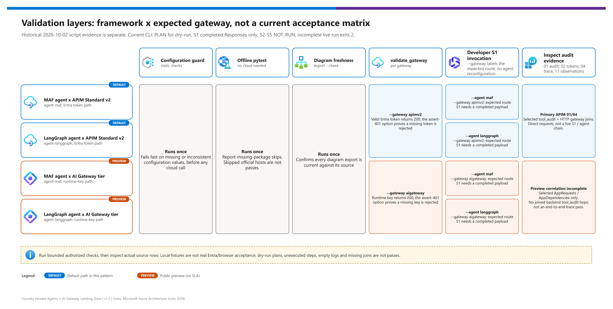

[README](../README.md) › [docs index](./00-reproduce-this-demo.md) › 04 Testing

# 04 - Testing and Validation

<p>
&nbsp;
&nbsp;
&nbsp;
&nbsp;

</p>

    

This page is for the engineer who has just deployed (or is about to deploy) the landing zone and needs to answer one question: **"is it actually working, and for which agent and gateway combination?"** It lays out the layers of verification from offline unit tests to live gateway probes, evaluations and red teaming, and shows what each layer proves and what it cannot.

## Browser console acceptance checks

**The console is deployed with limited live checks; the complete browser acceptance matrix is still pending.** The [2026-10-20 limited follow-up](#limited-follow-up-2026-10-20) and earlier dated follow-ups distinguish observed behavior from remaining checks. Do not extend the historical 2026-10-02 pass matrix to it. After deployment, run only authorized operations from the [browser walkthrough](./11-demo-walkthrough.md#browser-console-s1-s5) and record each result with its actual gateway, response details and trace ID.

| Check | Expected behavior / evidence to collect |
|---|---|
| Sign-in boundary | Anonymous access requires Easy Auth sign-in; only the deploying human's tenant + object ID can use the console. Verify another same-tenant user is denied, not merely that a login page appears. Exercise ACA's `X-MS-CLIENT-PRINCIPAL-ID` header and the optional full claims header; missing identity, wrong owner/provider, malformed claims, and conflicting owner/tenant claims must be rejected. |
| Session guide / configuration | Expand the collapsed eight-item presenter guide; discussion, synthetic scenario, pilot and closeout must be distinct from the five live S1-S5 workflows. The guide displays the maintained reference image at `/reference/architecture.png`, not discovered live topology. Action buttons remain disabled until configuration loads; a provisioning snapshot is not agent readiness. |
| Secret boundary | Browser traffic/page source contains no app credential, managed-identity token or tier runtime key. Inspect locally without publishing secret-bearing captures. The backend uses SDK/HTTP clients, not CLI/scripts. |
| Agent submissions | Choose MAF or LangGraph, enter a prompt, and explicitly confirm **every** submission. No request before confirmation; tools may mutate data even for an apparently read-only prompt. Responses invocation only, **no readiness GET**. Detailed response and trace ID are visible. A protocol success is not proof of selected-tool use. |
| Routing | Agent requests keep deployed `HOSTED_DEFAULT_GATEWAY`; changing the direct gateway selector changes only direct S2-S4 checks. Displayed agent gateway is a **provisioning snapshot**, not live discovery. Agent-only deployment can leave it stale; reprovision to sync. Confirm actual routing in logs. |
| S2 | Selected gateway returns 401 without credentials, then accepts a valid console-backend credential/model request. APIM uses console managed identity; tier uses a runtime key. Neither demonstrates OBO or agent identity. |
| S3 MCP | Initialize, list tools and invoke catalog/records tools through the chosen gateway. JSON arguments derive from live `inputSchema`; inspect/adjust before submitting. `create_record` and `update_record` require explicit write confirmation; no automatic writes. |
| S3 REST / denial | APIM-only records list/get/create/update with JSON arguments; use an ID returned by a real list before get/update and confirm writes separately. APIM denied-tool probe expects allowlist 403; distinguish that from unrelated 403s. Tier selection disables these controls; tier REST/denied-tool checks are `unavailable`, not equivalent coverage. |
| S4 | Separate burst confirmation, 1-120 requests with concurrency at most 8; dispatch window ≤90 seconds, per-request timeout ≤15 seconds. Already-started requests can finish at the deadline. A returned 429 is evidence only for the selected gateway; do not infer token-limit versus upstream/rate-limit origin without logs. No observed 429 means `not_run`, not `passed`. |
| S5 | Readable saved-query labels 01-11; API timespan one hour, appended `take 200`. Query 04 accepts trace ID. “Passed” means rows returned, not a validated audit assertion; empty results report `not_run` with ingestion/no-evidence guidance. No arbitrary KQL input. A workbook link is present only when `WORKBOOK_ID` is configured; missing configuration is shown honestly. |
| Manual / unavailable lanes | No simulated private-network checks; show topology and verify manually. OBO and optional ACA agent comparison remain manual/unavailable unless explicitly deployed. |
| Isolated browser | With `NETWORK_ISOLATION=true`, access the internal ACA console using VNet/VPN connectivity and private DNS; public browser failure is not a live network-isolation pass. |

### Console result semantics

- **`passed`**: the specific executed check met its expected transport/protocol condition; for KQL it means **rows returned**, not that an audit assertion was validated. It is not a global security, tool-selection, trace-propagation or deployment-health verdict.
- **`failed`**: the executed check returned an error or did not meet its expected condition; inspect the detailed response and gateway-specific reason.
- **`unavailable`**: the path is unsupported or not deployed/configured, such as tier denied-tool parity or an optional manual runtime.
- **`not_run`**: not executed, or evidence was not observed (including no 429 within the bounded burst and empty audit results). Do not turn missing evidence into a green check.

Trace IDs surfaced in response headers are **advisory correlation handles**. Use query 04 and the source logs to verify propagation; an agent answer alone cannot prove a specific tool ran. Allow for ingestion delay and rerun bounded queries later.

### Local console tests

Use a supported **Python 3.12** virtual environment (the console image is `python:3.12-slim`), then install the backend test baseline:

```powershell
python -m pip install -r src\demo-console\requirements.txt pytest
python -m pytest tests\test_demo_console.py tests\test_console_auth_hook.py -q
```

Backend tests use mocked services; hook tests execute mocked CLI scenarios in PowerShell. They do not create an Entra app, authenticate a real user or validate Azure deployment.

For the optional synthetic UI test, install Playwright and have **Microsoft Edge** installed:

```powershell
python -m pip install playwright==1.58.0
python -m pytest tests\test_demo_console_browser.py -q
```

The browser test uses a mocked runner and synthetic authentication context, **not Azure Easy Auth or live gateways**. It skips when Playwright is absent. The updated fixture covers all action categories, including read/REST/denial paths, the agenda/reference/workbook surfaces and initialization failure. That is still fixture evidence, not actual Entra sign-in or deployed GUI acceptance. A local UI pass is not proof of Azure RBAC, network connectivity or deployment health; the acceptance checks above still need live execution.

## Live follow-up (2026-10-16)

These are scoped follow-up checks, **not** a new all-green S1-S5 matrix:

| Surface | Observed / changed | Boundary |
|---|---|---|
| Console deployment and access | Ready Azure revision; `/healthz` returned 200; anonymous and forged-identity requests were rejected. Windows CLI setup, ID-token callback, ACA scalar headers/provider aliases and the allowed console origin were repaired. | This does not complete signed-in deployer/second-user browser acceptance or all application paths. |
| AI Gateway tier tool path | Catalog and records discovery plus read-only tool calls succeeded from inside the console container after explicitly approved ACA-secret `env` key delivery. Key Vault public network access stayed disabled. | In-container execution is not an end-to-end browser check. It does not prove hosted-agent routing, tool selection, write behavior or APIM/tier policy parity. |
| Console audit access | Bounded saved-query calls were exercised using the console managed identity. | Returned rows are evidence to inspect, not automatic audit assertions; empty sources are not passes. |
| Workbook queries | All 17 persisted panels were exercised; the selected time range filters sources before joins/aggregation, and trace input remains optional and section-specific. | Query/API success alone does not verify portal rendering. |
| Token chart contract | Workbook-style datetime expression expansion was tested; the old nested-datetime syntax error was reproduced. The corrected response schema is scalar `TimeGenerated: datetime`, `Tokens: long`, `Series: string`, not dynamic arrays. Seven days at three-hour buckets retained all **224 agent points**; 24-hour, finer-grained seven-day and empty windows preserved totals and scope. | Earlier screenshots exposed both JSON-array axes/zero metrics and parameter syntax failures. The final refreshed portal rendering after the scalar-row fix still requires visual confirmation. |
| Other surfaces | Auth restrictions, private-vault settings and the other workbook panels were preserved during targeted repairs. | Full browser S1-S5 across both frameworks/gateways, isolated networking, OBO and production readiness are not claimed. |

### Workbook visual acceptance

1. Open the saved workbook from `WORKBOOK_ID`, not an unsaved older editing session. Overview shows the selected label, actual start/end and bucket size.
2. Select **Last 24 hours**, **Last 7 days**, then a custom interval containing known requests. The time axis must show date/time ticks across that window, **not a JSON array label**. A window with no observations must show the no-data guidance.
3. Each gateway/agent has separate `/ input` and `/ output` series. Compare their numeric legend totals against the corresponding source rows in Token usage details; **do not add gateway and agent observation layers together**. Different windows can legitimately have equal totals when they contain the same traffic.
4. Inspect the chart query result schema: exactly datetime `TimeGenerated`, numeric long `Tokens`, and string `Series`. The intermediate `make-series` arrays must be expanded together before the chart receives them. Apply the 200-series limit **before** expansion, never a 200-point limit afterward.
5. Enter a trace ID under Trace investigation. Only its timeline and hosted-agent content should narrow; Overview, message samples and coverage remain governed by the global time range. Hosted content uses W3C trace IDs, while the timeline also accepts APIM correlation IDs.

The workbook and console have different time controls: the workbook defaults to 24 hours and supports presets/custom ranges; console S5 intentionally remains a fixed **one-hour** API query window. See [workbook deployment](./03-deployment.md#updating-only-the-workbook), [query/layout contract](./09-monitoring-and-audit.md#workbook), and [symptom fixes](./05-troubleshooting.md#browser-demo-console).

### AI Gateway token-source follow-up (2026-10-19)

Two bounded, non-mutating model requests (Responses and Chat Completions) returned **26 input + 21 output tokens** combined. Tier `AppRequests` emitted zero counters, and the linked native PromQL token metric returned no samples. Foundry `RequestResponse` logs independently recorded the exact response totals; their `callerObjectId` matched the tier's live managed-identity principal ID, not the APIM identity.

The corrected chart uses those **Foundry-observed** counters. Verify queries 02/11 agree with the backend totals after per-resource/request-ID deduplication; a different or blank principal ID must not select other callers. Missing counters are excluded as unavailable; a recorded numeric zero remains valid. Native `llm-request` rows must retain null counters, not overwrite the backend totals. This does **not** validate native metric export or token-limit enforcement. Keep both gateway observation layers separate from hosted-agent chat spans.

The correction was deployed to the existing workbook, query pack and console only. Read-back confirmed both saved-query identity bindings. Executing the **persisted** gateway chart for 22:20-22:40 UTC with a five-minute grain returned eight scalar points across the input/output series, totaling 26/21; the empty 22:35-22:40 UTC selection returned no tier series. Live KQL fixtures also verified deduplication, real zero counters, missing-counter exclusion, and blank/wrong identity exclusion. Inside the ready console revision, the deployed application hash matched the local source and S5 queries 02/11 independently returned 26/21 using the console's managed identity. Health remained HTTP 200 and anonymous configuration access HTTP 401. The 101 targeted regressions passed. This verifies saved query execution and runtime binding, **not** a new portal/browser visual acceptance pass; agent routing was unchanged.

## Limited follow-up (2026-10-20)

This table records the initial review checkpoint. The later [APIM-focused hosted-read validation](#apim-focused-hosted-read-validation-2026-10-20) below supersedes its unexecuted-S1 status for the two approved APIM read scenarios, not for browser sign-in, writes, throttling or preview acceptance.

The console-only `azd` deployment completed. The checks below include the console-managed-identity runner, deployed-file verification and actual loopback HTTP GET/POST requests to the updated console. Loopback requests supplied trusted platform headers **inside its container**, **not a real human Entra browser session**. This verifies the deployed revision within those boundaries, not complete real-browser S1-S5 acceptance.

| Surface | Observed | Evidence boundary / remaining check |
|---|---|---|
| Existing console | Ready deployed console retained owner-only authentication. | Not a new deployer/second-user browser sign-in pass or a multi-user authorization proof. |
| Console-only deployment | Deployment completed; **eight deployed hashes** matched the maintained source/static UI/reference PNG/canonical profile/queries 02 and 11. | Confirms deployed artifact agreement, not live hosted-agent execution or human browser authentication. |
| Workbook runtime binding | `WORKBOOK_ID` is bound to the existing verified workbook on the ready updated revision; the configured workbook URL was verified through deployed loopback HTTP. Routing, key delivery and token attribution were preserved. | Link/configuration verification does not establish a real human portal/browser session or complete S1-S5 acceptance. |
| Deployed guide and query UI | Actual loopback HTTP GET/POST verified the eight-item agenda, reference endpoint, **11 readable query labels** and configured workbook URL. | Trusted platform headers were supplied **inside the container**; this was not a real human Entra browser session. |
| Deployed records controls / reads | Loopback HTTP verified **four enabled records business tools per lane**, one disabled extra preview health tool, REST collection read and item get using an ID from the live list. | Read-only deployed API/UI evidence; not record-write acceptance or a human browser interaction. |
| Public and Entra boundaries | Public health returned **200**; anonymous configuration/reference requests returned **401**. Live Entra metadata separately confirmed single-tenant configuration, the exact callback and ID-token issuance enabled. | Configuration and unauthenticated HTTP checks do not replace a real deployer/second-user browser sign-in test. |
| Hosted-agent metadata | Both endpoints returned **200**, `state=enabled`, `configuration_state=enabled` and instance identities present. | Metadata access is not a live S1 invocation, readiness GET, completed Responses run or agent-to-gateway/tool proof. |
| Hosted-agent route configuration | Both hosted definitions independently reported `HOSTED_DEFAULT_GATEWAY=apimv2`, matching the GUI provisioning snapshot. | Confirms configured values, not a live agent request path, route switch or S1 invocation. |
| Direct MCP | `tools/list` and read operations succeeded for catalog and records through **both** APIM and the preview gateway using the console runner. | Direct credentials/protocol evidence, not a hosted-agent prompt, agent tool choice, route switch or customer integration. |
| Missing credentials | Both gateways returned exactly **401** for no-credential probes. | Proves rejection of those requests only; does not establish OBO or fine-grained authorization. |
| Direct S2 model requests | One benign console-credential model call per gateway completed **200**. Response-reported usage: APIM **13 input / 15 output**; preview **13 input / 17 output**. | These are direct S2 credential paths, **not live hosted-agent S1 approval or execution**. The saved-chart reconciliation below is separate evidence; keep today's usage distinct from the dated 2026-10-19 sample. |
| Saved workbook reconciliation | The saved workbook's current-hour **scalar** chart independently reconciled today's S2 response totals: APIM **13 input / 15 output**; tier **13 input / 17 output**, **Foundry-observed**. | Verifies those persisted chart/source totals, not native tier metric export, every preview backend trace hop or a live hosted-agent turn. |
| APIM allowlist | The denied-tool probe returned **403**. | APIM allowlist evidence only; preview-tier denial parity is not implemented. |
| APIM REST | Collection read returned **200**; item retrieval using an ID from the live list also succeeded. The earlier guessed-ID request returned **404**. | The 404 was an unknown identifier, not a routing failure. These are read-only direct-console checks; no record writes were run. |
| Advertised versus demo-enabled tools | Preview records discovery advertised five operations, including `records_healthz_healthz_get`; the console intentionally supports four records business tools. | Unsupported advertised operations remain visible but disabled / not demo-enabled; the full schema stays in discovery JSON and the backend allowlist is unchanged. |
| Saved KQL | All **11** saved queries executed without query errors. Many had no current-hour events. | Query execution is not an audit assertion. Empty sources remain `not_run` / no current evidence; do not convert them into passes. |
| Selected fresh APIM traces | Catalog and records requests joined backend `tool_audit` with `ApiManagementGatewayLogs`. | Use **APIM queries 01/04 as the primary session trace evidence**. These selected direct-request joins do not establish a live S1/agent chain or every request path. |
| Selected fresh preview traces | Returned `AppRequests` / `AppDependencies` only; backend `tool_audit` hops were not joined. | **Incomplete end-to-end correlation proof**, not a full trace pass. Do not imply every preview hop is joined. |
| Unexecuted work | **No live agent prompts, record writes or throttle bursts were authorized or executed during this review.** | No S1 completion, agent-route/tool proof, write acceptance, throttle enforcement, isolated networking or complete S1-S5 acceptance is claimed. |

The review also confirmed design limits: APIM has coarse JWT validation plus a global tool allowlist, not delegated/per-user record authorization; public backend ingress/trust is a demo limitation. `ENABLE_CONTENT_SAFETY` is wired to **preview-tier policy cards**, not an implemented APIM `llm-content-safety` policy. Error-keyword matches, model filtering and backend 403s must not be presented as proven APIM content-safety enforcement.

The Standard-v2 `catalog-mcp` and `records-mcp` resources are **HTTP APIs (`apiType=http`)**, policy-proxying the sample's backend MCP adapters. The records MCP adapter wraps the same record business functions; it is not an APIM-managed OpenAPI-generated MCP server. The **preview records tool server is OpenAPI-generated and dispatches REST**. Native `ApiManagementGatewayMCPLog` / query 05 can therefore have no events for the APIM HTTP proxies; that is not broken wiring. Keep query 05 conditional and unchanged, with no synthetic fallback.

At that initial checkpoint, local verification completed with **145 tests passed, no skips**, including all **eight official-host contract checks** after dependencies were restored. JavaScript syntax and the complete Bicep compile also passed. Those local results are separate from deployed hash/loopback HTTP evidence: no hosted-agent prompt, record write or throttle burst had yet run. The later APIM-only evidence follows; complete real-human Entra browser S1-S5 acceptance and preview backend joins remain incomplete.

## APIM-focused hosted-read validation (2026-10-20)

**Session baseline: APIM. Preview is deferred.** With approval for the bounded read-only scenario, the deployed console backend invoked each hosted framework once. No preview backend calls, gateway/SKU changes, record writes or throttle bursts were requested.

| Surface | Confirmed evidence | Boundary |
|---|---|---|
| Actual gateway tier | The live APIM service reports **BasicV2**, ready; the azd environment still requests **StandardV2**. | This is configuration drift, not Standard-tier feature acceptance. No upgrade was performed. Review the intended tier and cost before `azd provision`; it can reconcile the service to the configured target. |
| Hosted routes | Both deployed agent definitions select `apimv2`. | The direct GUI selector does not change those definitions. |
| MAF and LangGraph | Each returned HTTP **200**, a **completed** Responses payload, actual `search_items` then `check_availability` function calls, and a matching tool output for **PRT-100**, requested **2**, available **42**, `can_fulfill=true`. | Values matched a fresh direct catalog control. This is the synthetic sample, not customer inventory or a quality/load benchmark. |
| Agent identity | The selected availability audit's object ID **and** application/client ID matched the corresponding freshly read agent-instance identity, not the console principal. `human_principal` was absent. | Demonstrates those agent workload callers; not human OBO or per-record business authorization. |
| Selected trace joins | The actual console-generated trace for each invocation returned `AppRequests`, `AppDependencies`, `AppTraces`, `AppGenAIContent`, `ApiManagementGatewayLogs` and backend `tool_audit` through query 04. Both results were below the 200-row cap. | Confirms the selected agent-to-tool chains and APIM/backend correlation, not every possible path, outage case or native LLM-log correlation. |
| Model-log reconciliation | The exact validation window contained **18 APIM LLM diagnostic records for 6 distinct model requests**. Gateway counters, six Foundry request records authenticated as the APIM managed identity, and the two response-reported totals agreed on **3,612 input / 374 output tokens**. | Split log parts are not extra requests. Queries 02/11 count correlations rather than raw records; token aggregation is unchanged. Do not add the observation layers together or infer a universal per-request join. |
| Read-only evidence | Returned function-call ledgers contained only catalog reads; neither selected trace contained `create_record` / `update_record` audit events. | Record-write and throttle acceptance remain separate, approval-gated work. Prompt wording alone is not an authorization control. |
| Browser boundary | A separate real Edge session reached Entra sign-in, but deployer sign-in was not completed. The approved agent runs used the deployed console `Runner` with its managed identity. | These are real backend/agent/APIM executions, **not a human-browser acceptance pass**. No sign-in, password or MFA bypass was used. |
| Presentation labels | GUI controls and chart series use **APIM v2**, not an inferred Standard SKU. | The legacy query identifier `apim-standard-v2` is retained for compatibility; it is a lane identifier, not tier discovery. Recommended reference-architecture tiers are separate from the observed live tier. |

Use this APIM read path for the current session, with queries **01/04** for identity/tool/trace evidence and **02/11** for separately scoped token observations. Preview backend correlation remains deferred and unchanged. Keep the human-browser sign-off, optional writes, policy-attributed throttling, private networking and production authorization requirements explicitly open.

The request-count correction was published to the deployed console query bundle, saved queries **02/11**, and the four affected workbook queries; other panels and preview attribution were preserved. Read-back and execution through the console's own managed identity confirmed **6 requests / 3,612 input / 374 output tokens** for the original validation window. Live KQL fixtures additionally covered split parts with missing model names, genuine zero-usage requests and matching correlation IDs on different resources. GUI/chart labels are deployed as **APIM v2**; no APIM SKU upgrade or preview backend change was made.

## Console-to-APIM OBO implementation (2026-10-20)

S2 now separates anonymous, console managed identity, hosted-agent instance identity, and explicit **user through console (OBO)**. OBO is not inferred from a browser sign-in or a token's user claims: the backend obtains a user access token for the console API through a separate confidential sign-in client, then performs the actual OBO exchange to the gateway API. The hosted agents remain app-only.

| Surface | Verified | Boundary / remaining sign-off |
|---|---|---|
| Owned Entra setup | The single-tenant interactive client, `Console.Access` / `Gateway.Access`, exact callback, API v2 audiences, narrow client preauthorizations and ACA credential references were configured. Unrelated app permissions were preserved; no tenant-wide Graph grant was added. | Configuration is not a completed user grant or an OBO/audit pass. A real allowed-deployer sign-in is required. |
| Runtime / audit updates | Console, catalog and records audit images were deployed; the existing record set matched seed before restarting its memory-only backend. Existing identity, routes, workbook and preview key-delivery settings were preserved. | No business-data write or hosted-agent user delegation is added. APIM remains Basic v2; the configured Standard v2 drift is unchanged. |
| Authentication contract | Real MSAL initialization produced the expected tenant, separate sign-in client, console API scope, S256 PKCE and `form_post` callback. Access tokens and client secrets stay server-side; an ID token is not used as the OBO assertion. | The exact callback alone is excluded from platform login. It independently checks browser-bound state, PKCE/nonce, tenant and the allowed user before the APIM probe; other routes retain Easy Auth and same-origin checks. |
| Fail-closed behavior | Missing-cookie external callback returned **401**. Tests covered state mismatch, wrong user, replay, expiry, cancellation, missing configuration, consent failure and secret/code redaction, with no managed-identity fallback. | The short-lived flow/result state is memory-only on one replica. A restart or expired session requires a new sign-in. |
| Independent app-only comparison | The deployed managed-identity catalog-discovery probe passed and reported application identity with no delegated user. | This does **not** validate user OBO or manufacture a human audit subject. |
| User audit surface | Query 01 was published/read back with `human_oid`, optional `human_name` / `human_username`, `identity_type` and `delegated_scopes`; S2 can query that call's exact trace. Both backends derive these from APIM-stamped validated claims. | Friendly fields are optional; the object ID is authoritative. Raw token metadata in S2 must not be treated as an ingested audit pass. Operator identity metadata is real/privacy-relevant; never commit it. |
| Real interactive OBO | The live console was opened for the deployer to choose **S2 / Sign in and call as user**. | **Not yet claimed as completed:** the user grant, OBO exchange, APIM acceptance and matching human audit rows require real interactive evidence. Do not replace this with an app-only token or an impersonated header. |

The full local suite passed **164 tests** at this implementation checkpoint, including official hosting contracts, OAuth grant/state/ownership tests, ID-token-not-an-assertion/cancellation cases and browser fixtures. Fixtures are not an Entra sign-in or live-user proof. Preview remains deferred; source publication is separate from live authentication acceptance.

## At a glance

| | Layer | Needs Azure? | Typical runtime | Proves |
|---|---|---|---|---|
|  | Unit / offline tests (`pytest`) | No | seconds | Agent contract, audit schema, policy XML, KQL files, config docs coverage |
|  | Static IaC and policy checks | No | seconds | Bicep parameter plumbing, quoted azd parameters, policy controls present |
|  | Gateway validation script | Yes | under a minute | 401 on missing or wrong credentials, 200 with the right one, optional 429 probe |
|  | Developer walkthrough | Yes for S1; `--dry-run` is offline | minutes | Executed S1 checks a completed Responses payload. Dry-run prints `PLAN`; unimplemented S2-S5 are `NOT_RUN`, and an incomplete live run exits 2. |
|  | Audit queries | Yes | seconds per query | Identity and trace correlation actually landed in logs |
|  | Evaluations | Yes | minutes | Agent quality (task adherence, tool use) |
|  | AI Red Teaming Agent | Yes | minutes to hours | Attack Success Rate against the agent target |

> [!NOTE]
> Everything that does not need Azure runs in CI-friendly time. Layers that need Azure are **opt-in** and clearly separated so a laptop with no subscription can still run the full offline suite.

## Test pyramid and coverage

```text
        /\          Red teaming + evaluations   (Azure, minutes to hours)
       /--\         Audit queries                (Azure, seconds)
      /----\        Walkthrough S1..S5           (Azure or --dry-run)
     /------\       Gateway validation           (Azure, under a minute)
    /--------\      Static IaC + policy checks   (offline, seconds)
   /----------\     Unit / contract tests        (offline, seconds)
```

| | Layer | Command or artifact | Offline | Validation status |
|---|---|---|---|---|
|  **Unit / offline** | Audit record, MCP handshake, records API CRUD, hosted-agent contract (`/readiness`, `/responses`; `/invocations` for the local-only protocol), trace propagation, retarget-domain guard | `pytest` | Yes |  |
|  **Static IaC** | Policy XML well-formed and contains `validate-azure-ad-token`, `llm-token-limit`, `llm-emit-token-metric`; MCP policy is inbound-only; azd parameters quoted; `main.bicep` params all passed by `azd.bicep`; KQL files reference known tables | `pytest tests/test_policies.py tests/test_infra_static.py tests/test_kql_queries.py tests/test_configuration.py` | Yes |  |
|  **Gateway validation** | 401 without a credential, success with one, per-gateway tool names, concurrent 429 probe | `python scripts/validate_gateway.py ...` | No |  both gateways, see [Live validation](#live-validation-2026-10-02) |
|  **Walkthrough** | Current script executes S1 only; S2-S5 require separate gateway/query/manual checks | `python scripts/demo_walkthrough.py ...` | `--dry-run` only (`PLAN`) |  historical 2026-10-02 report only; not a current all-green script result |
|  **Audit queries** | KQL 01 (who called which tool), 04 (end-to-end trace), 11 (AI Gateway tier telemetry in `AppRequests`) | `python scripts/run_audit_queries.py ...` | No |  all 11 saved queries ran; see [doc 09](./09-monitoring-and-audit.md#live-evidence) |
|  **Evaluations** | Agent evaluators over a dataset | Foundry portal or SDK | No |  not run by this repo |
|  **Red teaming** | AI Red Teaming Agent scan | Foundry portal or SDK | No |  not run by this repo |

> [!IMPORTANT]
> "Static only" means the check inspects files, not deployed resources. A green offline suite proves the repo is internally consistent; it does not prove a deployment is healthy. Use the gateway validation, walkthrough and audit queries for that.

## Agent × gateway test matrix

Both agents (Microsoft Agent Framework and LangGraph, each on its official host) were exercised against both gateway lanes in the live run of 2026-10-02. ✅ preserves that **historical report**, not current browser acceptance. Offline contract tests require the official hosting packages; a skipped contract check does not establish its cell. Current `--dry-run` prints `PLAN`, never live evidence. The developer script's `--gateway` labels an expected route and does not reconfigure agents.

[](./assets/testing-matrix.png)

<sub>Editable source: [`assets/testing-matrix.drawio`](./assets/testing-matrix.drawio) - regenerate with `python scripts/export_diagrams.py docs/assets`.</sub>

| Agent (host) | Gateway | Readiness / contract (offline) | Walkthrough `--dry-run` | Gateway 401 assertion | Live S1-S5 |
|---|---|:-:|:-:|:-:|:-:|
|  Agent Framework (`maf`, `ResponsesHostServer`) | APIM v2 (`apimv2`) | ✅ | ✅ | ✅ | ✅ |
|  Agent Framework (`maf`, `ResponsesHostServer`) | AI Gateway tier (`aigateway`) | ✅ | ✅ | ✅ | ✅ |
|  LangGraph (`langgraph`, `ResponsesHostServer`) | APIM v2 (`apimv2`) | ✅ | ✅ | ✅ | ✅ |
|  LangGraph (`langgraph`, `ResponsesHostServer`) | AI Gateway tier (`aigateway`) | ✅ | ✅ | ✅ | ✅ |

The AI Gateway tier is  , so the `aigateway` rows only apply when `AI_GATEWAY_MODE` is `aigateway` or `both` (see [doc 03](./03-deployment.md)). Network isolation (`NETWORK_ISOLATION=true`) is **not** in this matrix: it is  (what-if validated only).

## Run the checks (step cards)

Run the offline steps first. Do not skip ahead to the gateway steps if an earlier gate is red.

| Step | | Action | Validation |
|---|---|---|---|
| 1 |  | `pytest` from the repository root, using the same virtual environment as the scripts. | - [ ] All tests pass or skip with a stated reason. Docs-coverage tests read [12 - Configuration reference](./12-configuration-reference.md). |
| 2 |  | `pytest tests/test_configuration.py` after any change to env vars, outputs or `demo-ids` keys. | - [ ] Every new variable is documented in doc 12. |
| 3 |  | `python scripts/export_diagrams.py docs/assets --check` | - [ ] Exit 0: every `.drawio` has a PNG at least as new as the source. |
| 4 |  | `python scripts/validate_gateway.py --ids demo-ids.local.json --target apimv2 --assert-401` | - [ ] Missing or wrong bearer returns 401. - [ ] Valid bearer for `api://<GATEWAY_APP_CLIENT_ID>` reaches the model and both MCP servers. |
| 5 |  | `python scripts/validate_gateway.py --ids demo-ids.local.json --target aigateway --assert-401` | - [ ] Missing or wrong `api-key` returns 401. - [ ] Runtime key from Key Vault (or `AIGW_RUNTIME_KEY` locally) succeeds. - [ ] The request `model` equals the model alias name (`chat`). |
| 6 |  | `python scripts/demo_walkthrough.py --ids demo-ids.local.json --agent both --gateway apimv2 --dry-run`, then repeat with `--gateway aigateway`. | - [ ] Steps print **PLAN**, never PASS. The gateway flag labels the expected route; no agent or gateway operation was executed. |
| 7 |  | `python scripts/run_audit_queries.py --ids demo-ids.local.json --query 01`, then `--query 11` (add `--trace-id <id>` with `--query 04`). | - [ ] Inspect actual caller/tool/trace rows and token sources; empty sources and missing identities/joins remain unverified, not passes. |

> [!TIP]
> S4 is optional and needs explicit authorization because it consumes model capacity. A bounded `validate_gateway.py --probe-429` probe can collect response evidence; inspect its configured attempt bound and actual logs. No observed 429 is not a pass, and a 429 alone does not prove a token-limit source or trace propagation. The 183-of-240 tier throttle result belongs to the historical 2026-10-02 run, not the current review.

### Gateway validation matrix

| Target | Credential sent | Source of credential | Expected on missing or wrong credential |
|---|---|---|---|
| `apimv2` | Entra bearer token for `api://<GATEWAY_APP_CLIENT_ID>` | `DefaultAzureCredential` / `az` (`--scope` overrides) | 401 |
| `aigateway` | `api-key` header (gateway-scoped runtime key) | Key Vault via `keyVaultUri` and `AIGW_RUNTIME_KEY_SECRET_NAME`; `--aigw-key` or `AIGW_RUNTIME_KEY` for local fallback (or `AIGW_KEY_DELIVERY=env`) | 401 |

Both lanes return 401 for a bad credential, but for different reasons: APIM v2 validates an Entra token (see [doc 07](./07-identity-auth-traceability.md)); the AI Gateway tier only checks possession of a runtime key.

## Regression checklist

> [!TIP]
> Run this before you tag a change or demo a build. Every item maps to a row in the matrix above.

- [ ] Report local test failures and skipped checks explicitly; missing official-host dependencies do not establish contract coverage.
- [ ] `python scripts/export_diagrams.py docs/assets --check` exits 0.
- [ ] `validate_gateway.py --target apimv2 --assert-401` passes (when APIM lane deployed).
- [ ] `validate_gateway.py --target aigateway --assert-401` passes (when AI Gateway tier lane deployed).
- [ ] Walkthrough `--dry-run` prints `PLAN` for both framework/expected-route labels, not live acceptance. Unimplemented S2-S5 are `NOT_RUN`; an incomplete live run exits 2.
- [ ] Audit rows identify the actual APIM caller; a human requires real delegation and direct console checks identify its MI. Tier rows show the runtime-key label without an agent principal. Missing rows/joins remain unresolved.
- [ ] Both agents' `postdeploy` summaries show the instance identity `granted` or `exists` (when `AIGW_KEY_DELIVERY=keyvault` and the tier is deployed).
- [ ] No secret, key or token appears in any log line (the audit test enforces redaction of `authorization`, `api-key` and subscription keys).
- [ ] Docs updated for any new env var, output or `demo-ids` key.

## Evaluations and AI Red Teaming Agent

<p>
&nbsp;
&nbsp;

</p>

Functional tests tell you the plumbing works. They do not tell you whether the agent gives good answers or resists abuse. Foundry provides two complementary capabilities for that.

| Capability | What it measures | Status | Learn |
|---|---|---|---|
| Foundry evaluations platform | Runs evaluators over datasets or live traffic |  | [Evaluation concepts](https://learn.microsoft.com/en-us/azure/foundry/concepts/evaluation-evaluators/agent-evaluators) |
| Agent evaluators (Task Completion, Task Adherence, Intent Resolution, Tool Use Quality and similar) | Whether the agent selected and used the right tools and finished the task |  most evaluators | [Agent evaluators](https://learn.microsoft.com/en-us/azure/foundry/concepts/evaluation-evaluators/agent-evaluators) |
| AI Red Teaming Agent (PyRIT-based, reports Attack Success Rate) | How often adversarial prompts succeed against a model or agent target |  | [AI Red Teaming Agent](https://learn.microsoft.com/en-us/azure/foundry/concepts/ai-red-teaming-agent) |
| Guardrails and controls (Azure AI Content Safety engine) | Blocks or annotates harmful content at the model or agent boundary | see [doc 10](./10-enterprise-posture-and-scale.md) | [Foundry guardrails](https://learn.microsoft.com/en-us/azure/foundry/) |

> [!CAUTION]
> Agent evaluators are mostly **preview**: names, scores and supported inputs can change. Treat scores as trend signals, not release gates, until the evaluators you rely on reach GA.

This repository does **not** ship an evaluation dataset or a red-team run; it makes the agent evaluable by emitting OpenTelemetry GenAI spans (`invoke_agent`, `execute_tool`, `chat`) and traceable audit records. Suggested loop:

1. Point an evaluation at the deployed hosted-agent endpoint using a small domain dataset derived from the profile's `walkthrough` prompts.
2. Run the AI Red Teaming Agent against the same target and record Attack Success Rate per risk category.
3. Keep results outside the repository (they contain model outputs) and note the evaluator names and versions you used.

## Live validation (2026-10-02)

   

A disposable deployment of v1.2.0 (environment `fhagl1002`) was provisioned and exercised in `eastus2` on 2026-10-02, then torn down. Both gateway paths and both agents were tested end to end. This section records what that run proved, what it did not, and what had to be fixed to get there. The earlier v1.1 run (2026-10-01, APIM v2 only; the AI Gateway tier could not be created) is kept in [`live-run-2026-10-01.json`](./assets/evidence/live-run-2026-10-01.json) for history.

| Path | Status | Evidence |
|---|---|---|
| APIM Standard v2 (`apimv2`) |  | `validate_gateway.py --assert-401`, 429 probe, `demo_walkthrough.py` S1-S5 for both agents, saved audit queries |
| AI Gateway tier (`aigateway`) |   | `Microsoft.ApiManagement/service@2025-09-01-preview` (sku `AIGateway`) deployed; 401 without a key; S1-S5 for both agents; 429 probe (183 of 240 throttled); telemetry in `AppRequests` |
| Hosted-agent hosts |  | Official `ResponsesHostServer` for Agent Framework and LangGraph (no fallback), platform-injected telemetry and identity variables |
| Network isolation (`NETWORK_ISOLATION=true`) |  | `az deployment sub what-if`: 127 resources, no errors. **Not deployed live.** |
| `postdeploy` Key Vault role hook |  | Offline tests only; the live run granted the role manually |

### Pass/fail matrix


*Source: live run 2026-10-02, eastus2. Regenerate with `python scripts/render_evidence.py` after editing [`live-run-2026-10-02.json`](./assets/evidence/live-run-2026-10-02.json).*

| Check | Result |
|---|---|
| `validate_gateway.py --target apimv2 --assert-401` | ✅ 401 without a credential; LLM, catalog and records MCP calls all succeed |
| `validate_gateway.py --target aigateway --assert-401` | ✅ 401 without an `api-key`; `/default/models/openai/v1/{chat/completions,responses}` and both tool servers (`catalog_list_items`, `records_list_records`) succeed |
| 429 probe (AI Gateway tier) | ✅ 183 of 240 concurrent requests throttled |
| `demo_walkthrough.py` (both agents x both gateways) | ✅ S1-S5 PASS in all four combinations |
| Saved audit queries 01-11 | ✅ All ran; row counts and the empty ones are explained in [09 - Live evidence](./09-monitoring-and-audit.md#live-evidence) |
| Network isolation | ⚠️ what-if only |

### Provisioning durations


| Step | Duration |
|---|---|
| `azd provision` #1 | Failed: Container Apps could not pull from ACR (defect 1) |
| `azd provision` #2 | 4 min 45 s |
| `azd provision` #3 | 3 min 04 s |
| Deploy `catalog-mcp` / `records-api` | 1 min 24 s / 1 min 19 s |
| Deploy `agent-maf` (v1, v2, v3) | 2 min 48 s / 1 min 43 s / 1 min 48 s |
| Deploy `agent-langgraph` (v1, v2, v3) | 2 min 16 s / 2 min 07 s / 1 min 59 s |
| AI Gateway tier provisioning | about 3 min |
| Walkthrough (`apimv2`) | 32 s |
| `azd down --purge --force` | 36 min 33 s |

> [!NOTE]
> The provisioning figures are from a run with a fix loop, so treat them as relative cost, not a published SLA.

### Defects found and fixed during the v1.2 live run

<details>
<summary>11 defects found live, with the file or area changed for each</summary>

| # | Symptom | Fix (file or area) |
|---|---|---|
| 1 | Container Apps could not pull images: the user-assigned identity had no `AcrPull` | Role assignment added in `infra/modules/container-apps.bicep` |
| 2 | `azd deploy` for the agents lacked project values | New outputs `AZURE_AI_PROJECT_ID`, `AZURE_AI_PROJECT_ENDPOINT`, `AIGW_RUNTIME_KEY_SECRET_NAME` |
| 3 | AI Gateway tier model calls failed: provider `modelName` did not match the Foundry deployment | `modelName` must equal the deployment **name** (`chat`) |
| 4 | `validate_gateway.py` used one tool name for both gateways and a serial 429 probe | Per-gateway tool names and a concurrent 429 probe |
| 5 | `postprovision` failed in strict mode and mis-parsed `listSecrets` | Hook fixed |
| 6 | Hosted agents could not read the runtime key from Key Vault (`ForbiddenByConnection` under policy) | `AIGW_KEY_DELIVERY=env` fallback added (demo-only), later formalised with a `postdeploy` role hook |
| 7 | Audit query 02 returned wrong or no rows | `02-*.kql` rewritten |
| 8 | Audit query 11 assumed a table the tier does not write | `11-*.kql` rewritten for `AppRequests` |
| 9 | Audit query 04 ignored `--trace-id` | Parameter substitution fixed in `run_audit_queries.py` |
| 10 | Audit query 09 referenced `ErrorMessage` | Uses `LastErrorMessage` and `LastErrorReason` |
| 11 | Evidence chart captions did not name the host | Renderer captions fixed |

</details>

> [!IMPORTANT]
> **Hosted-agent identity finding.** The effective runtime identity of a hosted agent is its **instance identity principal** (from `azd ai agent show <agent> --output json`, `instance_identity.principal_id`). It is distinct from the blueprint principal and the Foundry project identity, is stable across agent versions, and exists only after the agent is deployed - so Bicep cannot grant it access. It needs **Key Vault Secrets User** to read the AI Gateway runtime key. APIM v2 needs no role for the agent. See [07 - the runtime principal](./07-identity-auth-traceability.md#the-runtime-principal-is-the-instance-identity).

> [!WARNING]
> **Key Vault `ForbiddenByConnection`.** Under a policy that forces Key Vault public access off (an organization policy in the test subscription), hosted agents - which run outside the VNet - could not read the secret even with the role. The proper fix is network isolation mode (not live-validated); `AIGW_KEY_DELIVERY=env` is a demo-only compromise. See [05](./05-troubleshooting.md#hosted-agent-gets-forbiddenbyconnection-from-key-vault).

**Teardown.** `azd down --purge --force` took 36 min 33 s. The Cognitive Services account stayed soft-deleted and was purged manually, and the gateway Entra app was deleted by hand. Verify with `az group exists --name <rg>` rather than trusting `azd down` alone.

**Not proven.** Only the 429 policy was exercised on the AI Gateway tier (token-limit, content-safety and IP-filter policies were not triggered). Entra sign-in diagnostics were off, so audit query 07 returned no rows, and `AzureActivity` was not connected (query 08). Network isolation was not deployed.

---

Next: [05 - Troubleshooting](./05-troubleshooting.md) →

*Last updated: 2026-10-20*
