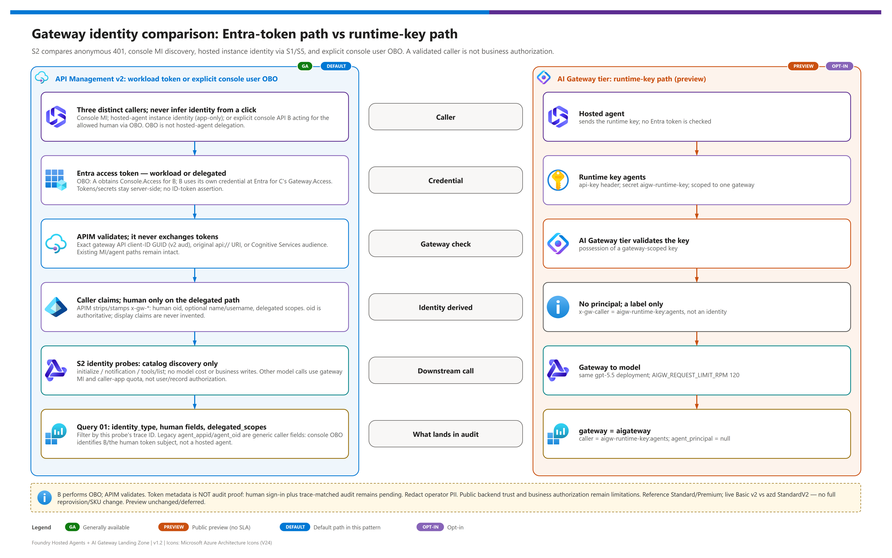

[README](../README.md) › [docs index](./00-reproduce-this-demo.md) › 07 Identity, auth and traceability

# 07 - Identity, Auth and Traceability

<p>
&nbsp;
&nbsp;
&nbsp;
&nbsp;
&nbsp;
&nbsp;

</p>

     

This is the central page of the demo. It answers the question enterprise security teams ask first: **when an agent calls a model or a tool, who is that, and can we prove it afterwards?** It explains how identity is established for a hosted agent, what the gateway can and cannot prove, how identity and trace context reach the tool backends, and how to correlate everything in Log Analytics. It closes with the five design questions you should settle before scaling to thousands of agents.

## At a glance

| | Topic | One-line answer |
|---|---|---|
|  | Agent identity | The runtime principal of a hosted agent is its **instance identity** (distinct from the blueprint and the project identity), found live on 2026-10-02 |
|  | User delegation | Opt-in **console-to-APIM user OBO** is implemented separately from the default console MI and app-only hosted-agent paths. Real user sign-in plus trace-matched audit are required for live proof. |
|  | Workload calls | An agent or console can act as its own workload principal; distinguish the actual caller even when a human clicked Submit. |
|  | APIM Standard v2 | **Validates** the token and derives `x-gw-*` headers; never exchanges tokens |
|  | AI Gateway tier |  Gateway-scoped runtime key; **no per-identity validation** |
|  | Traceability | W3C propagation is the design; verify the actual chain in source rows. Correlation is **DIY** , not guaranteed by a response header. |

## The identity model

### Browser access and downstream callers are separate boundaries

The console's existing **single-tenant Entra app** remains its primary front door. ACA Easy Auth requires sign-in and allowlists the deploying human's object ID; FastAPI independently verifies the platform-injected principal ID and rejects conflicting owner/tenant claims when supplied. This controls **browser access**, not delegation by itself. Default downstream requests use the **console backend managed identity**: Azure AI User (Foundry project), Cognitive Services User (Foundry account; APIM token audience `https://cognitiveservices.azure.com`), Log Analytics Reader (workspace), and Key Vault Secrets User (vault). On the tier, direct checks use a runtime key, not an Entra caller principal.

**Platform header contract:** [Container Apps authentication](https://learn.microsoft.com/azure/container-apps/authentication#access-user-claims-in-application-code) injects `X-MS-CLIENT-PRINCIPAL-ID` after authentication and prevents external callers from setting trusted identity headers. The console runs behind that mandatory Easy Auth boundary; it does not authenticate raw client headers on a standalone public server. If the full Base64 claims header is present, malformed or conflicting claims still fail closed. Tenant validation is enforced by the configured single-tenant Easy Auth issuer, not by assuming ACA always supplies a `tid` header.

Entra provider identifiers `aad` and `azureActiveDirectory` refer to the same configured provider. The full principal's `auth_typ` describes the claims identity's authentication type (which can be a federation authentication type); it is not a provider identifier. Access decisions use the platform-validated deployer ID and any supplied owner/tenant claims, not an assumed `auth_typ == "aad"` string.

Normal browser POSTs pass two CSRF checks: Easy Auth's session-cookie check and the backend's exact-origin plus custom-header check. The auth configuration explicitly lists only the console's HTTPS URL in `login.allowedExternalRedirectUrls`, so the platform recognizes the browser origin before forwarding the request. No other origin or wildcard CORS is enabled, and the Entra tenant/deployer allowlist still applies.

Only the exact **`POST /api/identity/obo/callback`** is excluded from **platform login**, to accept Entra's standard `form_post` authorization-code response. It has its **own** browser-binding cookie and MSAL state/nonce/PKCE checks, then validates the tenant and exact allowed deployer before the downstream exchange/probe. This is not an anonymous console API, a wildcard auth exclusion, or permission to remove CSRF on other routes. Authorization codes are not put into callback URL query strings; defensive access-log redaction remains additional protection.

The console never sends raw access tokens or client secrets to browser JavaScript and does not impersonate a hosted agent. Explicit user OBO below is a separate operation, not forwarding an Easy Auth ID token. Agent-to-gateway calls still use their deployed app-only instance identities. Header trace IDs are advisory; inspect source logs to verify propagation. See [readiness and remaining browser acceptance](./04-testing.md) and the [session boundaries](./11-demo-walkthrough.md#runtime-and-identity-fit-boundaries); customer requirements remain unknown / to agree. Credential rotation/manual Entra cleanup: [03](./03-deployment.md#console-secret-expiry-rotation-and-cleanup).

| Console direct-call path | Credential used | Key Vault dependency |
|---|---|---|
| APIM Standard/Premium v2 | Short-lived Entra access token from the console managed identity, audience `https://cognitiveservices.azure.com`; APIM validates the bearer token. | No AI Gateway runtime-key read. APIM uses its own managed identity for the Foundry model backend. |
| APIM user OBO (explicit S2 operation) | Console API B exchanges the user's **access token for B** for delegated API C `Gateway.Access`, using B's existing confidential credential. | No tier runtime-key read. A/B credentials are server-side ACA secret references, not browser tokens or hosted-agent credentials. |
| AI Gateway tier | Gateway-scoped runtime key sent server-side in `api-key`. | Default `keyvault` mode reads the secret with the console identity. Explicit demo-only `env` mode reads `AIGW_RUNTIME_KEY` from an ACA secret reference instead. The key remains in secret-bearing local azd state too. |

[](./assets/identity-token-flow.png)

### Console-to-APIM user OBO (three apps)

`ENABLE_DEMO_OBO` defaults to **`false`**. With [setup enabled](./03-deployment.md#optional-console-to-apim-user-obo), S2 has **four independent cards**: anonymous 401; console MI read-only catalog MCP discovery; hosted-agent instance identity inspected via **S1/S5**; and explicit **console-to-APIM user OBO**. The last card is a real token-exchange path, but is **not hosted-agent delegation**.

| Hop | App / token contract | Boundary |
|---|---|---|
| Human → confidential web client **A** | New `DEMO_OBO_CLIENT_ID` / `DEMO_OBO_CLIENT_SECRET` (`obo-signin-secret`) requests `api://<B>/Console.Access` using authorization code + PKCE and a form-post callback. | The user signs in as the allowed deployer; A is distinct from existing console API B. |
| A → console API **B** | A obtains a **user access token whose audience is B**, not an ID token. B is existing `DEMO_CONSOLE_CLIENT_ID` with `DEMO_CONSOLE_CLIENT_SECRET` (`entra-client-secret`). | B must receive an assertion intended for B. Do not use B as both sign-in client and resource to manufacture a self-audience assertion. |
| B → gateway API **C** | B calls MSAL `acquire_token_on_behalf_of(user_assertion=<ACCESS_TOKEN_FOR_B>, scopes=["api://<C>/Gateway.Access"])` using **B's own existing confidential credential**. C is `GATEWAY_APP_CLIENT_ID`. | The downstream C token stays server-side. APIM validates it; APIM does not perform the exchange. |
| B → APIM → catalog | Delegated C token accompanies only `initialize`, `notifications/initialized` and `tools/list`, with trace context. | No hosted-agent invocation, model cost, business-tool call or record write. Not per-user/action/record authorization. |

A/B/C are roles in this **ordinary user OAuth OBO flow**, not an assertion that an Entra Agent ID actor is present. APIM can attribute this call to console API B plus the delegated human; do not label it “the agent acting for the user.” The legacy [`samples/obo-client`](../samples/obo-client/README.md) only signs in a user and invokes Foundry; it contains **no downstream OBO exchange**.

The callback requires its Secure/HttpOnly/SameSite=None **`__Host-` browser-binding cookie**, the matching in-memory MSAL flow (state/nonce/PKCE), the configured tenant and exact deployer. Flow state lives for **10 minutes**, results for **5 minutes**, only in the single console replica's memory. The parent page polls a protected result endpoint and keeps the console active while sign-in completes. Restart, expiry, cancellation or replay fails closed; grant/consent errors are explicit, and there is **no MI fallback**. Do not capture callback codes, tokens, cookies or secret-bearing azd state.

**Proof boundary:** configuration, a valid authorization URI, a successful MI check and S2's acquired-token metadata are not delegated backend audit proof. After actual human sign-in, use **“Read this identity call's audit”** to filter source query **01** by this probe's trace ID. Inspect `identity_type`, `human_oid`, optional `human_name` / `human_username`, `delegated_scopes`, and B as the calling application. Real user sign-in/audit acceptance is not claimed here; consult [doc 04](./04-testing.md) for verified facts. Names/usernames come only from actual token claims and may be absent; **`oid` is stable/authoritative**. Real operator auth metadata is privacy-relevant even with synthetic business data: do not screen-record or share it unredacted.

### Hosted-agent workload identity (unchanged)

Foundry integrates with **Microsoft Entra Agent ID**. A hosted agent is not just a container; it has an identity that other systems can authorize and audit. Source: [Agent identity concepts in Foundry](https://learn.microsoft.com/en-us/azure/foundry/agents/concepts/agent-identity).

| Principal | What it is | Used for |
|---|---|---|
| **Blueprint** | The Entra Agent ID blueprint created when the agent is registered | Registration; **not** the identity that calls downstream services in the live run |
| **Foundry project identity** | The managed identity of the Foundry project | Project-level operations; **not** the agent's effective runtime identity |
| **Instance identity principal** | A per-agent identity created when the agent is deployed; returned by `azd ai agent show <agent> --output json` as `instance_identity.principal_id` | The **effective runtime identity**: it obtains tokens for the model, the gateway and Key Vault. Stable across agent versions |

### The runtime principal is the instance identity

The v1.2 live run (2026-10-02) settled which identity a hosted agent really uses. Two consequences follow:

> [!IMPORTANT]
> **Bicep cannot grant the instance identity anything.** It only exists after `azd deploy`, so the grant has to happen afterwards. It needs **Key Vault Secrets User** on the demo vault to read the AI Gateway runtime key. The `postdeploy` hook (`infra/hooks/postdeploy-agents.ps1`) does this idempotently for each agent ([03](./03-deployment.md#key-delivery-and-the-postdeploy-hook)); it is covered by offline tests but was granted by hand in the live run, so treat it as not live-verified.

| Gateway lane | Role needed by the instance identity | Why |
|---|---|---|
| APIM Standard v2 | **None** | APIM validates the bearer token (audience `https://cognitiveservices.azure.com`) and reaches Foundry with its own managed identity |
| AI Gateway tier | **Key Vault Secrets User** on the vault (or `AIGW_KEY_DELIVERY=env`) | The agent reads the gateway-scoped runtime key from Key Vault |

When `FOUNDRY_HOSTING_ENVIRONMENT` is set, the agent code builds `ManagedIdentityCredential(client_id=FOUNDRY_AGENT_INSTANCE_CLIENT_ID)`; the platform injects both variables.

### Key Vault access under network policy

Granting the role is not always enough. In the live subscription, an organization policy forced Key Vault public network access off. Hosted agents run **outside your VNet**, so the vault returned `ForbiddenByConnection` even with the role in place.

| Option | What it does | Status |
|---|---|---|
| **Network isolation mode** (`NETWORK_ISOLATION=true`) | Adds a Key Vault private endpoint and agent subnet injection, so the read stays on the private network. This is the proper fix. |  what-if validated only |
| `AIGW_KEY_DELIVERY=env` | The runtime key is copied into the azd env and the agent configuration, so the agent never calls Key Vault. A demo-only compromise: the key is stored in plaintext in `.azure/<env>/.env`. |  |
| Allow public access on the vault | Opens the vault to the internet | Blocked by the policy in the test subscription; not recommended |

> [!WARNING]
> `AIGW_KEY_DELIVERY=env` makes the runtime key readable by anyone who can read the agent configuration or your local azd env. Use it only for disposable demos. In `keyvault` mode the agent also falls back to a non-empty `AIGW_RUNTIME_KEY` when the vault read fails, logging the WARNING `aigw_runtime_key_source`. Troubleshooting steps: [05](./05-troubleshooting.md#hosted-agent-gets-forbiddenbyconnection-from-key-vault).

## OBO vs client credentials

A human initiating a request does **not** automatically select OBO. Compare the explicit console user flow with the app-only workload paths below. Agent-specific OBO is a separate integration choice, not implemented by the hosted agents or legacy sign-in sample.

| | **On-behalf-of (OBO)** | **client_credentials** (autonomous) |
|---|---|---|
| Use when | Downstream user delegation is required and an OBO exchange is implemented | The workload acts as itself, whether triggered by a user, schedule, event or system |
| Acts as | The user, through **console API B** in this implementation | The authenticated workload itself: console MI or agent instance |
| Token has | Delegated `sub` + `scp`; `azp`/`appid` identifies the calling app, not necessarily an agent | App-only token; no delegated `scp`, no human subject |
| Gateway sees | `x-gw-user-oid` populated | `x-gw-user-oid` empty |
| Audit shows | `human_principal`, `identity_type`, `delegated_scopes` and legacy caller fields under `agent_principal` | Workload caller fields; no human principal |
| In this repo | Explicit opt-in S2 console-to-APIM exchange; legacy `obo-client` signs into Foundry only | Hosted agents and default console clients use their own workload credentials |
| Learn | [OAuth OBO protocol](https://learn.microsoft.com/en-us/entra/identity-platform/v2-oauth2-on-behalf-of-flow); [Agent OBO](https://learn.microsoft.com/en-us/entra/agent-id/agent-on-behalf-of-oauth-flow) is a distinct agent-specific flow | [Autonomous agent app flow](https://learn.microsoft.com/en-us/entra/agent-id/agent-autonomous-app-oauth-flow) |

> [!NOTE]
> **Neither APIM nor an API key performs OBO.** This implementation exchanges at console API B. The gateway only receives and validates the result; the hosted-agent runtime is unchanged/app-only.

## Actor facets in the token

Agent tokens can carry **actor facet** claims that say what kind of principal is acting. They are not required for ordinary console user OBO and do not make console API B an agent. Source: [Agent token claims](https://learn.microsoft.com/en-us/entra/agent-id/agent-token-claims).

| Claim | Meaning | Values this demo reads |
|---|---|---|
| `xms_act_fct` | **Actor** facets: what is acting. Multi-valued | `11` = AgentIdentity, `13` = AgentIDUser |
| `xms_sub_fct` | **Subject** facets: what the token is about | Not used for headers |
| `xms_tnt_fct` | **Tenant** facets | Not used for headers |

The APIM fragment joins the `xms_act_fct` values into the header `x-gw-actor-facets`, so a tool backend can tell an agent identity from an agent user without parsing a JWT.

## APIM validates, it does not exchange

> [!WARNING]
> **APIM validates only.** The `validate-azure-ad-token` policy checks that a token is genuine, current and meant for this gateway. It does **not** mint, exchange or downscope tokens, and an APIM **subscription key** or Foundry **API key** is a metering and entitlement mechanism, not an identity. If a downstream system needs the caller's identity, it must come from the validated token (the demo's `x-gw-*` headers), never from a key.

Why this matters: three identity patterns exist for a gateway in front of tools, and each has a different answer to "who does the backend see?"

| Pattern | Backend sees | Trade-off |
|---|---|---|
| **A. Managed identity** (gateway authenticates to the backend as itself) | The gateway workload principal | Caller attribution needs a separate trusted application-context channel |
| **B. Validated-caller attribution headers** (this demo, APIM v2 lane) | `x-gw-*` values derived from the authenticated caller token; a user only when delegation is actually present | Sample backend auth is `none`; public ingress/header trust is a demo limitation, not production caller authentication or record authorization |
| **C. Split plane** (some traffic goes around the gateway) | Whatever the direct route supplies | Direct route bypasses APIM quota and metering |

## `validate-azure-ad-token` vs `validate-jwt`

Both policies run on all APIM tiers. Source: [validate-azure-ad-token](https://learn.microsoft.com/en-us/azure/api-management/validate-azure-ad-token-policy) · [validate-jwt](https://learn.microsoft.com/en-us/azure/api-management/validate-jwt-policy).

| | `validate-azure-ad-token` | `validate-jwt` |
|---|---|---|
| Scope | Entra-specific convenience wrapper | Generic, any identity provider |
| Configuration | Tenant id, accepted client app ids, audiences | OpenID config URL, issuers, audiences, required claims |
| Entra ID for customers | Not supported ( limitation) | Use it for issuers outside the wrapper's scope |
| Used here | **Yes**, in the LLM, MCP and records API policies | Alternative if you add a non-Entra IdP |
| Backend credential | n/a (`authentication-managed-identity` is a separate policy for APIM-to-backend calls) | n/a |

The demo accepts **three exact audience forms**: the gateway app URI (`api://<GATEWAY_APP_CLIENT_ID>`, from `{{gateway-audience}}`), the **same API C client-ID GUID without `api://`** (needed for v2 access-token `aud`), and `https://cognitiveservices.azure.com` (the value `GATEWAY_AUDIENCE` carries in `azure.yaml`, so Foundry-native SDK token providers work unchanged). This does not allow arbitrary client IDs or change the existing MI/agent paths.

## Gateway identity header contract

After validation, the shared `identity-headers` policy fragment first **deletes any client-supplied `x-gw-*` header**, then sets values from token claims for requests traversing that APIM API. The agents also strip `x-gw-*` from their own outbound requests (`strip_gateway_headers`). These controls do **not** establish that every backend request came through APIM: the sample's public backend ingress/header trust remains a demo limitation. Production needs independently validated backend access and gateway authentication before treating attribution headers as authoritative.

APIM authorization here is **coarse JWT validation plus a global tool allowlist**. It does not implement OBO exchange, per-human/action/record entitlements or customer business authorization. UI confirmation of an agent submission or write is a demo safeguard, not a replacement for those controls. Customer identity and backend-authorization requirements remain unknown / to agree.

| Header | Source | When set | Used for |
|---|---|---|---|
| `x-gw-agent-appid` | Token `azp` (or `appid`) | Always after validation | Authenticated caller application; an agent only when the caller actually is that agent |
| `x-gw-agent-oid` | Token `oid` | Always after validation | Historical caller field: workload object ID on app-only calls; human object ID on a delegated token, not a separate agent actor |
| `x-gw-user-oid` | Token `oid` | **Only** when both `sub` and `scp` are present (delegated/OBO) | Authoritative delegated human object ID |
| `x-gw-user-name` | Validated optional delegated name claim | Delegated token only, when supplied | Human display name; not an authorization key |
| `x-gw-user-username` | Validated optional delegated username claim | Delegated token only, when supplied | Human username; may be absent, never inferred from browser input |
| `x-gw-delegated-scopes` | Validated `scp` | Delegated token only | Granted delegated scopes; not business-record entitlements |
| `x-gw-actor-facets` | Token `xms_act_fct`, joined | When present | Kind of actor |
| `x-gw-request-id` | `context.RequestId` | Always | Join key to APIM logs |
| `traceparent` | Caller | **Preserved** (`exists-action="skip"`), never overwritten | End-to-end correlation |
| `x-gw-caller` | AI Gateway tier | Only on the AI Gateway lane (value `aigw-runtime-key:agents`) | Label for the runtime key, **not** an identity |

> [!TIP]
> The fragment is the single place that turns a validated token into headers. When you add a new API behind the gateway, include the fragment, never copy claim logic.

## Audit record schema

Each tool backend (`catalog-mcp`, `records-api`) writes one JSON line per call. The agent and gateway fields come only from the headers above, and secrets are redacted by design.

| Field | Type | Notes |
|---|---|---|
| `event` | string | Always `tool_audit` |
| `timestamp` | ISO 8601 UTC | |
| `trace_id`, `span_id`, `traceparent` | string or null | Parsed from `traceparent`; null if absent or all-zero |
| `service` | string | `catalog-mcp` or `records-api` |
| `tool`, `operation` | string | Tool name and what it did |
| `decision`, `reason` | string | Allow/deny and why |
| `human_principal` | `{name, username, oid}` or null | From validated delegated user headers. `name`/`username` are optional; `oid` is authoritative. |
| `identity_type` | string | Backend-emitted identity classification; inspect the actual row rather than infer delegation from a UI click. |
| `delegated_scopes` | delegated scope context or null | From `x-gw-delegated-scopes`; absent on app-only paths. |
| `agent_principal` | `{appid, oid, actor_facets}` | Legacy field name for gateway-derived **caller** attribution, not always an agent. Console OBO identifies B's app ID and the token's human `oid`; this is not two independent principals. Fields null when absent. |
| `gateway_request_id` | string or null | From `x-gw-request-id` |
| **`gateway`** (v1.1) | `apimv2` · `aigateway` · null | `aigateway` when `x-gw-caller` is present; `apimv2` when any other `x-gw-*` header is present; null with no gateway headers |
| **`caller`** (v1.1) | string or null | The `x-gw-caller` value, for example `aigw-runtime-key:agents` |
| `domain_profile` | string | Active profile name |
| `latency_ms`, `status_code` | number, int | |

Source query **01** projects `identity_type`, `human_oid`, `human_name`, `human_username`, `delegated_scopes`, and historical `agent_appid` / `agent_oid` fields. Those last names mean generic calling app/token subject, **not “always a hosted agent.”** S2's trace-filtered audit action reads this query; S5 returning any rows is not an identity assertion. Protect real operator PII in query results, screenshots and recordings.

<details><summary><b>Show: schematic selected audit fields for both gateway lanes</b></summary>

APIM v2 console OBO **selected fields**, synthetic example only — not a captured row or a live acceptance claim. The probe is catalog discovery, not `tools/call`; the full row also includes the backend's emitted `identity_type` and `delegated_scopes`:

```json
{
  "event": "tool_audit",
  "trace_id": "<IDENTITY_PROBE_TRACE_ID>",
  "service": "catalog-mcp",
  "human_principal": {
    "name": "Synthetic Operator",
    "username": "operator@example.test",
    "oid": "<USER_OBJECT_ID>"
  },
  "agent_principal": {
    "appid": "<CONSOLE_API_B_CLIENT_ID>",
    "oid": "<USER_OBJECT_ID>",
    "actor_facets": null
  },
  "gateway_request_id": "<APIM_REQUEST_ID>",
  "gateway": "apimv2",
  "caller": null
}
```

AI Gateway tier (runtime key, no per-identity validation):

```json
{"event":"tool_audit","timestamp":"2026-10-01T14:05:09.102+00:00","trace_id":"4bf92f3577b34da6a3ce929d0e0e4736","span_id":"00f067aa0ba902b7","traceparent":"00-4bf92f3577b34da6a3ce929d0e0e4736-00f067aa0ba902b7-01","service":"catalog-mcp","tool":"check_availability","operation":"tools/call","decision":"allow","reason":"ok","human_principal":null,"agent_principal":{"appid":null,"oid":null,"actor_facets":null},"gateway_request_id":null,"gateway":"aigateway","caller":"aigw-runtime-key:agents","domain_profile":"manufacturing-field-ops","latency_ms":15.1,"status_code":200}
```

Values are illustrative, never identities to paste into an environment. The full audit/trace contracts are covered by `tests/test_audit_record.py` and `tests/test_trace_propagation.py`; local tests are not live delegated-user evidence.

</details>

## Standard v2 vs AI Gateway tier: what identity can you prove?

[](./assets/gateway-identity-comparison.png)

<sub>Editable source: [`assets/gateway-identity-comparison.drawio`](./assets/gateway-identity-comparison.drawio) - regenerate with `python scripts/export_diagrams.py docs/assets`.</sub>

| | Dimension |  APIM Standard v2 |  AI Gateway tier |
|---|---|---|---|
| | Status |  |   |
| | Runtime credential | Entra bearer token | Gateway-scoped `api-key` header |
| | Per-identity validation at runtime | **Yes** (`validate-azure-ad-token`) | **No** |
| | Human attribution (`human_principal`) | Yes, with OBO | No |
| | Agent attribution (`agent_principal`) | Only when the validated caller is the agent; direct console/CLI calls identify their own principal | `null` |
| | What the audit shows | `gateway=apimv2`, `caller=null`, real principals | `gateway=aigateway`, `caller=aigw-runtime-key:agents`, `agent_principal=null` |
| | Caller-app quota | `llm-token-limit` keyed per validated calling app; console OBO is not per-human quota | Gateway-level policy cards (token and request rate limits, IP filter, content safety) |
| | Telemetry | HTTP gateway logs + backend `tool_audit` are primary in 01/04; LLM logs for model calls. Native MCP log/05 is conditional: these MCP routes are HTTP APIs. | `AppRequests` / `AppDependencies`; selected fresh traces lack joined backend audit, so end-to-end correlation is incomplete. Tokens remain **Foundry-observed**, matched to the gateway MI; native token export unavailable. |
| | SLA | Per APIM tier | None (preview) |

> [!TIP]
> **Recommendation:** choose APIM Standard v2 whenever identity attribution is a requirement. Choose the AI Gateway tier when you want its managed model and tool governance and can accept that **the gateway proves possession of a key, not who is calling**. If you need both, run `AI_GATEWAY_MODE=both` and route identity-sensitive agents through the v2 lane. Learn: [AI Gateway overview](https://learn.microsoft.com/en-us/azure/api-management/ai-gateway-overview).

To obtain per-agent attribution on the AI Gateway tier you would have to add your own identity layer. The demo does not, and the audit makes the gap explicit.

> [!WARNING]
> This is the Standard/Premium reference comparison, not a live SKU claim: the current public APIM service is **Basic v2** while azd requests **StandardV2**. Do not full-provision/upgrade it for OBO or infer private-network capabilities. Preview behavior remains unchanged/deferred.

## Trace propagation and correlation

[](./assets/trace-correlation.png)

The agent/gateway design creates or preserves W3C `traceparent`; tool backends parse received context into `trace_id` and `span_id`. Verify actual spans, gateway rows and backend audit before claiming a complete chain. A completed Responses run, surfaced trace header or query returning rows does not establish propagation, tool choice or every hop; missing joins remain unresolved.

For this session, use **APIM 01/04**: selected catalog/records and [APIM-focused hosted-read evidence](./04-testing.md#apim-focused-hosted-read-validation-2026-10-20) establish only their recorded joins. For a new S2 user OBO call, inspect its own **trace-filtered query 01** after actual human sign-in; do not reuse MI/agent rows as proof. Selected preview traces have `AppRequests` / `AppDependencies` only, without joined backend audit hops; that is incomplete end-to-end proof, not a full trace pass. The direct user OBO trace intentionally has no hosted-agent hop or model/token-usage evidence.

| Question | Query | Where |
|---|---|---|
| Who called which tool? | `01-who-called-which-tool.kql` | [doc 09](./09-monitoring-and-audit.md) |
| Show everything for one trace | `04-end-to-end-trace.kql` (pass `--trace-id`) | [doc 09](./09-monitoring-and-audit.md) |
| What did AI Gateway tier telemetry record? | `11-ai-gateway-tier-telemetry.kql` (`AppRequests`) | [doc 09](./09-monitoring-and-audit.md) |

> [!CAUTION]
> **Cross-system correlation is DIY.** There is no managed service that stitches Entra sign-in logs, gateway logs, tool logs and model telemetry together for you. The join key is the W3C `traceparent` trace id (plus `x-gw-request-id` for APIM), and the glue is KQL you own. OpenTelemetry GenAI semantic conventions (`invoke_agent`, `execute_tool`, `chat`) are still at "Development" status upstream, so expect attribute names to evolve. Agent sign-ins appear as an `agentSignIn` attribute on existing Entra sign-in logs ([Learn](https://learn.microsoft.com/en-us/entra/agent-id/sign-in-audit-logs-agents)), not as a new table.

## Foundry RBAC and API keys are not enough

| Mechanism | What it does | Why it does not solve attribution |
|---|---|---|
| Foundry RBAC | Controls who can manage and invoke resources | Authorizes a principal for a resource; says nothing about which agent called which downstream tool |
| Foundry / model API keys | Authenticate possession of a secret | Shared secret; no principal, no OBO, not attributable to a person or an agent |
| APIM subscription keys | Metering, product entitlement | Same: a metering handle, not identity |
| AI Gateway tier runtime key | Authenticates a client to the gateway | Gateway-scoped; all callers holding the key look identical |
| **Validated Entra caller token** | Cryptographically identifies the workload or delegated user/application context | Supports caller attribution on APIM; console OBO is ordinary user delegation, while hosted-agent calls remain instance-identity/app-only |

## Licensing

| Capability | License needed |
|---|---|
| Base Entra Agent ID (agent identities, tokens, this demo's APIM v2 flow) | **No license** |
| Conditional Access, Identity Protection and Identity Governance **for agents** | **Microsoft Agent 365**, obtained through Microsoft 365 E7 or the Agent 365 add-on, **plus** Entra ID P1 or Microsoft 365 E3 |

Confirm current terms before purchase: [Agent ID licensing](https://learn.microsoft.com/en-us/entra/includes/licensing-agent-id).

## Runtime coverage parity

Not every agent you own runs in Foundry. The identity approach differs by where the agent runs.

| Runtime | Identity primitive | Gateway validation works? | Notes |
|---|---|---|---|
|  **Foundry hosted agent** | Agent ID blueprint plus a per-agent instance identity (the runtime principal) | Yes (APIM v2 lane) | The reference path in this repo |
|  **Self-hosted on Container Apps** | Managed identity or app registration you assign | Yes, if it obtains a token for the gateway audience | You own lifecycle and governance |
|  **Microsoft Copilot Studio** | Entra Agent ID | Yes, as an Entra principal | Exempt from the 250 limit |
|  **Non-Microsoft platforms** | App-only client credentials | Yes (app-only token), but **no OBO and no actor-facet semantics** unless the platform supports Agent ID flows | Subject to the 250 limit |
|  **Any agent via AI Gateway tier** | Runtime key | **No** per-identity validation | Anyone with the key is "the caller" |

## The 250-identity limit

> [!NOTE]
> The limit applies to non-Microsoft platforms using app-only client credentials. Foundry and Copilot Studio agents are exempt.

The documented limit of **250 agent identities** applies only to **non-Microsoft platforms that use app-only client credentials**. **Foundry** and **Microsoft Copilot Studio** are exempt. It is not a limit on how many hosted agents you can run in Foundry. Source: [Agent ID FAQ](https://learn.microsoft.com/en-us/entra/agent-id/faq). Note that separate Foundry limits exist (for example 128 tools per agent, per-region session caps; see [doc 06](./06-hosted-agents-explained.md)).

## Five design questions

Settle these before scale. Each card shows the question, the options, and how this demo helps.

### 1. Identity granularity: one identity for all agents, per agent, or per user?

| Option | Pros | Cons |
|---|---|---|
| Shared project identity | Fastest; fewest objects | No separation, cannot revoke one agent; not what a hosted agent runs as in v1.2 |
| **Dedicated instance identity per agent** | Individual authorization and revocation | More objects to govern; must be granted after deploy |
| Per-user delegated (OBO) | Real human accountability | Requires an interactive caller |

**How the demo helps:** it separates the explicit console A → B → C user OBO comparison from default console MI and hosted-agent instance-identity calls. The legacy sign-in sample does not implement OBO. Record only the mode each actual token/audit row supports; do not infer delegation from a human initiating a request or claim user/record-level business authorization.

### 2. Which principal appears in downstream audit?

| Option | Backend audit shows | Trade-off |
|---|---|---|
| Gateway managed identity | The gateway | Simple, loses attribution |
| **Derived `x-gw-*` headers from validated token** | Actual authenticated caller; human only when delegation is present | Needs independently trusted backend ingress/authentication as well as the fragment |
| Runtime key label | Key name only | AI Gateway tier today  |

**How the demo helps:** `human_principal`, `identity_type`, `delegated_scopes`, historical `agent_principal`, `gateway` and `caller` fields make the answer visible per call. Optional display claims are not authoritative IDs and real operator metadata must be redacted before sharing.

### 3. Who owns correlation?

| Option | Pros | Cons |
|---|---|---|
| **DIY with `traceparent` plus KQL join** | Works today, transparent | You maintain it |
| Single vendor trace store only | Easy in one system | Breaks across boundaries (Entra, gateway, tools) |

**How the demo helps:** queries 01, 04 and 11 provide reference joins for recorded context. Inspect source rows; a missing hop is a validation gap, not proof that propagation happened everywhere.

### 4. Lifecycle and governance at thousands of agents

| Option | Pros | Cons |
|---|---|---|
| Foundry control plane + Agent ID governance | Central inventory, lifecycle | Governance features for agents need Agent 365 licensing |
| Tag and policy conventions only | No extra license | Manual, drift-prone |

**How the demo helps:** it applies naming, a dedicated instance identity per agent, and Azure Policy posture (see [doc 10](./10-enterprise-posture-and-scale.md)); licensing is explicit above.

### 5. Runtime coverage for non-Foundry agents

| Option | Pros | Cons |
|---|---|---|
| Require Agent ID tokens everywhere | Uniform attribution | Not all platforms can do it |
| Gateway-issued runtime keys for foreign runtimes | Fast onboarding | Key possession only, no identity |

**How the demo helps:** both gateway lanes run side by side, so you can compare what each proves (table above).

---

Next: [08 - Tools, APIM and MCP topology](./08-tools-apim-mcp-topology.md) →

*Last updated: 2026-10-20*
