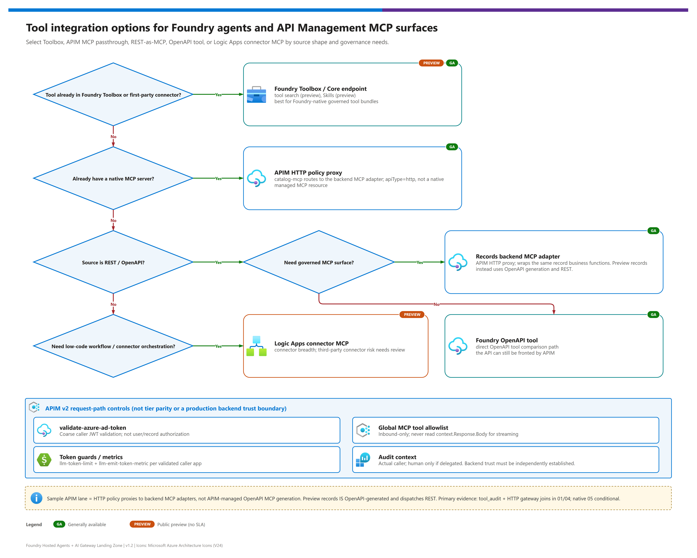

[README](../README.md) › [docs index](./00-reproduce-this-demo.md) › 08 Tools, APIM and MCP topology

# 08 - Tools, APIM and MCP Topology

<p>
&nbsp;
&nbsp;
&nbsp;
&nbsp;

</p>

   

An agent is only as useful, and only as safe, as the tools it can reach. This page shows how tools are exposed to the hosted agents through the gateway: the integration options Foundry offers, how this demo publishes two Model Context Protocol (MCP) servers and one REST API, how the two gateway lanes differ, and the policy rules that keep tool traffic governed.

## At a glance

| | Item | Summary |
|---|---|---|
|  | **APIM v2 lane** |  HTTP APIs (`apiType=http`) policy-proxy the sample's catalog/records MCP adapters; JWT validation, global allowlist and rate limits |
|  | **AI Gateway tier lane** |  Tool servers registered in the gateway under `/default/toolservers/<name>/mcp`, runtime-key access |
|  | **Tool backends** | Catalog/records MCP adapters and records REST on Container Apps. The records adapter wraps the same business functions; it is not APIM OpenAPI generation. |
|  | **Foundry Toolbox** | Core is ; tool search and Skills are . Not required by this demo |
|  | **Logic Apps connector MCP** | , third-party risk caveat; out of scope |

## How should an agent get its tools?

[](./assets/tool-integration-decision.png)

| | Option | Best when | Status | Governance |
|---|---|---|---|---|
|  **Foundry MCP tool (project connection)** | You want the Agent Service to call an MCP server using a project connection (`project_connection_id`) |  base tool | Connection-level auth; gateway optional |
|  **HTTP policy proxy to MCP adapters (this demo, v2 lane)** | You need gateway policies in front of the backend's MCP transport |  HTTP APIs | JWT/global tool/rate policies; not APIM-managed native MCP serving |
|  **Tool server in the AI Gateway tier (this demo, tier lane)** | You want managed registration and policy cards, and accept runtime-key access |  | Gateway-level cards only |
|  **Foundry Toolbox** | You want a curated, shared bundle of tools across agents | Core ; search and Skills  | Toolbox-level |
|  **OpenAPI tool** | You have a REST API with a spec | ; anonymous, API key or managed identity auth | Per-tool auth |
|  **Logic Apps connector MCP** | You need a prebuilt SaaS connector |  | Review third-party data handling first |

> [!TIP]
> **Recommendation:** for enterprise tools, use a governed gateway path **and independently enforce backend access/authentication and business authorization**. APIM validation, the global tool allowlist and rate limits apply to requests traversing that API; they do not prove every backend call used it. Public backend ingress/header trust is a limitation of this demo. The tier has different controls and no demonstrated APIM-only denial parity. Learn: [Foundry MCP tool](https://learn.microsoft.com/en-us/azure/foundry/agents/how-to/tools/model-context-protocol), [Toolbox overview](https://learn.microsoft.com/en-us/azure/foundry/agents/concepts/toolbox-overview), [OpenAPI tool](https://learn.microsoft.com/en-us/azure/foundry/agents/how-to/tools/openapi).

> [!NOTE]
> **MCP tool vs Foundry MCP Server.** The Foundry **MCP tool** is what an *agent* uses at runtime to call an MCP server. The **Foundry MCP Server** is a separate  feature that exposes Foundry capabilities to *IDE and developer tooling*. They are different things: do not use one name for the other.

## Topology: where each path goes

The [browser console S3](./11-demo-walkthrough.md#s3--discover-tools-then-invoke-explicitly) exercises these routes **directly** using its backend credentials, not the agent's tool-choice flow. It initializes MCP, lists tools, and generates editable JSON arguments from the selected tool's live `inputSchema`. Known writes `create_record` / `update_record` require an explicit confirmation checkbox; every agent submission is also confirmed because agents may mutate data.

S2's identity comparison is narrower: console MI discovery and optional **console-to-APIM user OBO** each perform only catalog `initialize`, `notifications/initialized` and `tools/list`. They do not invoke business tools, call a model or mutate records. User OBO uses the three-app server-side exchange in [doc 07](./07-identity-auth-traceability.md#console-to-apim-user-obo-three-apps); it is not hosted-agent delegation or per-user/action/record authorization. “Read this identity call's audit” filters query 01 by that probe's trace ID; token metadata alone is not downstream audit proof.

Discovery can advertise more operations than the console's supported business actions. Unsupported operations remain visible but **disabled / not demo-enabled**; full discovery JSON/schema is retained and the backend allowlist is unchanged. The preview records server, for example, advertises `records_healthz_healthz_get` alongside the four records business tools; it is not an enabled console invocation. Select an enabled tool and inspect its schema rather than assuming every advertised operation can be run.

Console REST list/get/create/update and the **403 allowlist denied-tool probe are APIM-only**. The GUI disables these controls on tier selection; the paths are `unavailable`, not equivalent denial-policy coverage. Discovery itself does not run writes. Use an identifier returned by a real list before item reads/updates. Inspect detailed responses and logs; agent response success alone does not prove a specific tool ran. The [2026-10-20 limited follow-up](./04-testing.md#limited-follow-up-2026-10-20) records direct runner reads/discovery through both gateways, not a complete signed-in browser or hosted-agent pass.

| | Lane | Tool | Gateway path | Credential |
|---|---|---|---|---|
|  | APIM v2 | Catalog MCP | `/catalog-mcp/mcp` | Entra bearer (validated) |
|  | APIM v2 | Records MCP | `/records-mcp/mcp` | Entra bearer (validated) |
|  | APIM v2 | Records REST | `/records/` (not `/records/records`) | Entra bearer (validated) |
|  | AI Gateway tier | Catalog MCP | `/default/toolservers/catalog-mcp/mcp` | `api-key` runtime key |
|  | AI Gateway tier | Records MCP | `/default/toolservers/records/mcp` | `api-key` runtime key |

Both lanes end at the same **synthetic sample** Container Apps backends; gateway-generated names/schemas and controls can differ. Neither lane is connected to a real customer's downstream systems. Use the [session discovery and pilot scaffold](./11-demo-walkthrough.md#current-state-discovery-scaffold) to identify potential interfaces, owners and required read/write authorization; all customer answers and approvals are unknown / to agree.

## APIM v2 MCP vs AI Gateway tier tool servers

API Management offers native MCP options such as [exposing REST as an MCP server](https://learn.microsoft.com/en-us/azure/api-management/export-rest-mcp-server) and [exposing an existing MCP server](https://learn.microsoft.com/en-us/azure/api-management/expose-existing-mcp-server). **Those are platform options, not the Standard-v2 resource type used in this demo.** Here `catalog-mcp` and `records-mcp` are **HTTP APIs (`apiType=http`)** applying policy and proxying the backend MCP adapters. The records adapter wraps the same record business functions; it is **not** an APIM-managed OpenAPI-generated MCP server. In contrast, the **preview records tool server is OpenAPI-generated and dispatches REST**.

| | Dimension | APIM v2 HTTP MCP proxies | AI Gateway tier tool servers |
|---|---|---|---|
| | Status |  |   |
| | Authentication to the gateway | Entra token, validated per request | Gateway-scoped `api-key` |
| | Authorization of tools | Global policy allowlist (JSON-RPC 403 `-32601`), not per-user/action/record entitlements | Gateway policy cards; the APIM-only denied-tool probe has no tier parity |
| | Rate limiting | `rate-limit-by-key` per validated calling app (120 calls per 60 s); console OBO calls share console API B's app bucket, not per-user quotas | Request rate limit card |
| | Identity to the backend | `x-gw-*` headers derived from the token | `x-gw-caller: aigw-runtime-key:agents` only |
| | Backend auth | Sample uses attribution headers with backend auth `none`; production trust/access needs separate validation | Platform options: None / API key / OAuth2 / Managed identity; do not infer deployed customer authorization |
| | Logs | `ApiManagementGatewayLogs` + backend `tool_audit`; primary **01/04**. Native `ApiManagementGatewayMCPLog` / 05 is conditional and can be empty for these HTTP APIs. | `AppRequests` / `AppDependencies`; selected fresh traces lack joined backend `tool_audit`, so end-to-end proof is incomplete |
| | Private networking | Per APIM networking options | Preview |

Learn: [Manage models and tools](https://learn.microsoft.com/en-us/azure/api-management/ai-gateway-manage-models-tools) and [Govern and secure AI assets](https://learn.microsoft.com/en-us/azure/api-management/ai-gateway-govern-secure-assets).

`ENABLE_CONTENT_SAFETY` is wired to the **preview tier's policy cards**, not an implemented APIM `llm-content-safety` policy in this sample. Query 09 and content-safety alerts surface candidate signals only; a keyword or backend 403 is not proof of APIM enforcement. The optional console user OBO probe adds no customer backend, hosted-agent delegation, business authorization or deployed agent-routing switch. Preview behavior is unchanged/deferred for the current session.

## Inbound-only policy rule

> [!WARNING]
> **MCP policies must be inbound-only.** Never read or modify `context.Response.Body` in an MCP API policy: it forces buffering and breaks Streamable HTTP responses. Put every control (validation, allow-list, rate limit, headers) in `<inbound>`. The demo's `tests/test_policies.py` fails if `context.Response.Body` appears in the MCP policy. Source: [MCP server overview](https://learn.microsoft.com/en-us/azure/api-management/mcp-server-overview).

The hardened MCP policy does, in order:

1. Validate the Entra token (`validate-azure-ad-token`): accept the gateway URI, the **exact configured gateway client-ID GUID** for v2 tokens, and `https://cognitiveservices.azure.com`; not arbitrary client IDs.
2. Include the `identity-headers` fragment (delete forged `x-gw-*`, set trusted ones). Delegated `x-gw-user-name`, `x-gw-user-username` and `x-gw-delegated-scopes` come only from validated claims; names/usernames are optional, `oid` is authoritative.
3. Preserve `traceparent` (`exists-action="skip"`).
4. Read the **request** body to find the JSON-RPC method and tool name (`preserveContent: true`).
5. For `tools/call`, return **403 JSON-RPC `-32601`** unless the tool is on the allow-list.
6. `rate-limit-by-key`: 120 calls per 60 s per validated `azp`.
7. Emit a trace entry (method, tool, agent app id).

<details><summary><b>Show: <code>infra/policies/mcp-api-policy.xml</code> (abridged)</b></summary>

```xml
<inbound>
    <base />
    <validate-azure-ad-token tenant-id="common" output-token-variable-name="validatedToken"
                             failed-validation-httpcode="401"
                             failed-validation-error-message="Missing or invalid gateway token.">
        <audiences>
            <audience>{{gateway-audience}}</audience>
            <audience>GATEWAY_APP_CLIENT_ID_GUID</audience>
            <audience>https://cognitiveservices.azure.com</audience>
        </audiences>
    </validate-azure-ad-token>
    <include-fragment fragment-id="identity-headers" />
    <set-header name="traceparent" exists-action="skip">
        <value>@(context.Request.Headers.GetValueOrDefault("traceparent", string.Empty))</value>
    </set-header>
    <!-- set-variable mcpMethod / mcpToolName: parse the request body (preserveContent: true) -->
    <choose>
        <when condition="mcpMethod == tools/call">
            <choose>
                <when condition="tool is empty or not in the allow-list">
                    <return-response>
                        <set-status code="403" reason="Forbidden" />
                        <set-body>{"jsonrpc":"2.0","error":{"code":-32601,
                                   "message":"Tool is not permitted by the gateway allow-list."},"id":null}</set-body>
                    </return-response>
                </when>
            </choose>
        </when>
    </choose>
    <rate-limit-by-key calls="120" renewal-period="60" counter-key="validatedAzp" />
</inbound>
<backend><base /></backend>
<outbound><base /></outbound>   <!-- intentionally empty: never touch context.Response.Body -->
```

Conditions are paraphrased for readability; `GATEWAY_APP_CLIENT_ID_GUID` is a placeholder for the exact configured API C client ID, not a wildcard. This is not a drop-in policy; the real file uses C# policy expressions.

</details>

## Tool catalog

Tool names and descriptions come from the synthetic domain profile (`config/profiles/manufacturing-field-ops.json`); the APIM global allowlist contains all nine. Swap the profile and the descriptions change without code changes. These parts/work-order examples are not customer requirements or real system integrations.

Run `scripts/sync-agent-profiles.ps1` after canonical profile changes and before builds: its back-compatible name now covers **all four image contexts**, both agents and both tools. The synthetic S3 availability prompt requests an explicit quantity and no writes; it is not an authorization control.

| | Server | Tool | What it does (from the profile) | Writes? |
|---|---|---|---|---|
|  | `catalog-mcp` | `list_items` | Browse the parts catalog, optionally filtered by category | No |
|  | `catalog-mcp` | `search_items` | Search parts by name, category, SKU, supplier or description | No |
|  | `catalog-mcp` | `get_item` | Full catalog record for a known part id | No |
|  | `catalog-mcp` | `check_availability` | Availability for one known part id | No |
|  | `catalog-mcp` | `check_availability_batch` | Availability for multiple part ids in one request | No |
|  | `records` | `list_records` | List work orders with optional status, priority, assignee or location filters | No |
|  | `records` | `get_record` | Retrieve one work order by id | No |
|  | `records` | `create_record` | Create a work order with title, description, priority, location and parts required | **Yes** |
|  | `records` | `update_record` | Patch mutable fields on an existing work order | **Yes** |

> [!NOTE]
> Rate limits differ by surface: MCP paths allow 120 calls per 60 s per validated calling app; the REST records API allows 240 per 60 s; model calls are limited by `llm-token-limit` (`TOKEN_LIMIT_TPM_PER_AGENT`, default 20000 tokens per minute, with prompt-token estimation). A console/user call is not automatically a separate hosted-agent or per-human quota.

## Streamable HTTP vs SSE

| | Transport | Endpoint | Status |
|---|---|---|---|
| | **Streamable HTTP** | `/mcp` | Default and recommended; used by both agents (`MCPStreamableHTTPTool`, `streamable_http`) |
| | Server-Sent Events | `/sse` + `/messages` | Deprecated; do not build new integrations on it |

Both frameworks in this repo use Streamable HTTP, which is also what the gateway paths above expose. Because streaming responses pass through APIM, the inbound-only rule above is not a style preference: response-body policies break it.

## Observability for tools

| What | Where | Learn |
|---|---|---|
| Current APIM MCP policy-proxy calls | `ApiManagementGatewayLogs` plus backend `tool_audit`; HTTP API resources, not native MCP-server diagnostics | Primary session evidence: queries 01/04 |
| Native MCP diagnostics (conditional) | `ApiManagementGatewayMCPLog` / query 05 when a native surface emits events; no events is not broken sample HTTP-proxy wiring | [Monitor MCP servers](https://learn.microsoft.com/en-us/azure/api-management/monitor-mcp-servers) |
| Backend tool audit (identity, decision, latency) | Both backends emit `human_principal` (`name`, `username`, `oid`), `identity_type` and `delegated_scopes`. Query 01 exposes human fields plus historical `agent_appid` / `agent_oid` caller fields; those names do not make a console call an agent call. Treat real operator metadata as privacy-relevant. | [doc 07](./07-identity-auth-traceability.md#audit-record-schema) |
| Joined view | Selected APIM catalog/records traces joined `tool_audit` + gateway rows in 01/04; selected preview traces have only `AppRequests` / `AppDependencies` and incomplete backend correlation | [doc 09](./09-monitoring-and-audit.md) |

---

Next: [09 - Monitoring and audit](./09-monitoring-and-audit.md) →

*Last updated: 2026-10-20*
