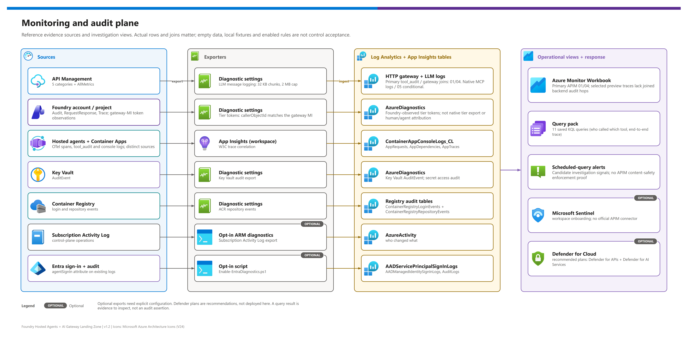
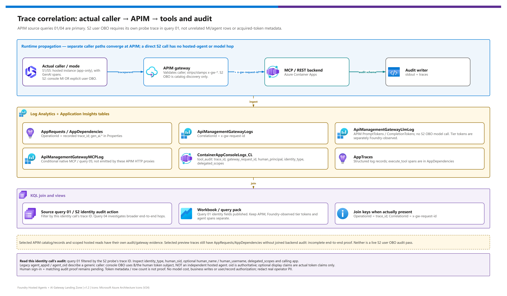

[README](../README.md) › [docs index](./00-reproduce-this-demo.md) › 09 Monitoring and audit

# 09 - Monitoring and audit

<p>
  &nbsp;
  &nbsp;
  &nbsp;
  &nbsp;
  &nbsp;
  &nbsp;
  &nbsp;
  &nbsp;
  &nbsp;
  &nbsp;
  
</p>

   

This is the **audit plane** of the landing zone: how a security, compliance or platform team inspects *which caller or agent called which tool/model, when, what tokens were recorded, and which controls produced evidence*. Human attribution requires an actually delegated flow; the browser console uses its backend MI, and the tier runtime key identifies no human/agent. Missing counters or joins remain unknown, not proof of a complete audit chain. It is written for operators and architects evaluating evidence, not as production certification.

> [!IMPORTANT]
> **The auditor's question.** *"Last Tuesday a work order was created by an agent. Which person asked for it, which agent identity acted, which gateway and tool carried the call, what did the model cost in tokens, and was any control triggered?"*
> This is a target audit question, not a claim that every caller/path supplies all fields. Inspect actual rows and missing joins. S2 has an explicit, opt-in console-to-APIM user OBO flow; default calls and hosted agents remain application-only. The legacy user-invocation sample does not implement OBO. Customer audit/privacy requirements remain unknown / to agree in the [session guide](./11-demo-walkthrough.md#current-state-discovery-scaffold).

## At a glance

| | Item | What it gives you |
|---|---|---|
|  | **One workspace** | Gateway, container, Foundry, Key Vault, registry and (opt-in) Activity Log and Entra data land in a single Log Analytics workspace (`PerGB2018`, `LOG_RETENTION_DAYS`, default 90). |
|  | **Workspace-based Application Insights** | Agent and tool OpenTelemetry spans, plus the structured `tool_audit` record, share the same workspace. |
|  | **11 saved queries** | A query pack named `NN-slug` that answers the audit, usage, denial, trace, identity, control-plane, content-safety and Foundry questions. |
|  | **1 workbook, 17 query panels** | Two token trend charts plus all 11 saved queries, telemetry coverage, gateway latency, hosted-agent content, and Key Vault/registry audit. Seven labeled sections; optional section-specific trace input. |
|  | **Up to 5 alerts** | Scheduled-query rules (severity 2) for throttling spikes, denied tools, 5xx, content-safety blocks and agent sign-in failures. |
|  | **Opt-in SIEM / CSPM path** | Microsoft Sentinel onboarding, Activity Log export and Entra diagnostics are single `azd env set` switches. |

## The audit plane

The picture below shows where each signal is produced and where it is stored. The two lanes - **gateway logs** (what the platform saw) and **application telemetry** (what the agent and tools said about themselves) - are joined on trace and correlation identifiers.

[](./assets/monitoring-audit-plane.png)

<sub>Editable source: [`assets/monitoring-audit-plane.drawio`](./assets/monitoring-audit-plane.drawio) - regenerate with `python scripts/export_diagrams.py docs/assets`.</sub>

[](./assets/trace-correlation.png)

<sub>Editable source: [`assets/trace-correlation.drawio`](./assets/trace-correlation.drawio) - regenerate with `python scripts/export_diagrams.py docs/assets`.</sub>

> [!NOTE]
> Use **APIM queries 01/04 as the primary session proof**: selected fresh catalog/records traces joined backend `tool_audit` with `ApiManagementGatewayLogs`. The pictures describe a correlation design, not every observed hop. Selected fresh preview traces returned `AppRequests` / `AppDependencies` without joined backend `tool_audit`; **preview end-to-end correlation proof is incomplete**. Query 11 adds request/token-source observations, not a missing-hop fallback.

## Sources, categories and tables

Each Azure resource sends a defined set of log categories to the workspace through a diagnostic setting. Categories are the *switch*, tables are what you query. Resource-specific tables are used where the service supports them (`logAnalyticsDestinationType: Dedicated` on API Management).

| Source | Diagnostic setting / path | Categories enabled | Tables you query | Status |
|---|---|---|---|---|
|  **API Management (Standard v2)** | `apim-resource-logs` ([monitor reference](https://learn.microsoft.com/en-us/azure/api-management/monitor-api-management-reference)) | `GatewayLogs`, `GatewayLlmLogs`, `GatewayMCPLogs`, `WebSocketConnectionLogs`, `DeveloperPortalAuditLogs` + `AllMetrics` | HTTP gateway / LLM logs; native `ApiManagementGatewayMCPLog` is **conditional**, not expected from these sample HTTP MCP proxies |  |
|  **Foundry account** | `foundry-account-logs` | `Audit`, `RequestResponse`, `Trace`, `AzureOpenAIRequestUsage`, `ManagedNetworkEvent` + `AllMetrics` | `AzureDiagnostics` (or resource-specific tables, depending on the account's destination type) |  |
|  **Foundry project** | `foundry-project-logs` | `Audit`, `Trace` | `AzureDiagnostics` |  |
|  **Container Apps environment** | `appLogsConfiguration` (workspace shared key) | Console and system logs for catalog MCP, records API and the optional agent-on-ACA | `ContainerAppConsoleLogs_CL` (contains the `tool_audit` JSON lines) |  |
|  **Key Vault** | `keyvault-audit` | `AuditEvent` | `AzureDiagnostics` |  |
|  **Container Registry** | `acr-logs` | `ContainerRegistryLoginEvents`, `ContainerRegistryRepositoryEvents` | `ContainerRegistryLoginEvents`, `ContainerRegistryRepositoryEvents` |  |
|  **Subscription Activity Log** | `modules/activity-log.bicep` ([activity log](https://learn.microsoft.com/en-us/azure/azure-monitor/essentials/activity-log)) | `Administrative`, `Security`, `Policy`, `ResourceHealth`, `Recommendation` | `AzureActivity` |  `ENABLE_ACTIVITY_LOG_EXPORT` |
|  **Microsoft Entra ID** | `scripts/Enable-EntraDiagnostics.ps1` (tenant level; needs a Security Administrator) | Service principal, managed identity and audit logs; agent sign-ins appear as an `agentSignIn` attribute ([Learn](https://learn.microsoft.com/en-us/entra/agent-id/sign-in-audit-logs-agents)) | `AADServicePrincipalSignInLogs`, `AADManagedIdentitySignInLogs`, `AuditLogs` |  `ENABLE_ENTRA_DIAGNOSTICS` |
|  **AI Gateway tier** | Application Insights requests plus identity-attributed Foundry diagnostics | Native token metrics are separate from request logs ([Learn](https://learn.microsoft.com/en-us/azure/api-management/ai-gateway-govern-secure-assets#monitoring)) | `AppRequests` (`AppRoleName` `aigw-*`) for requests; `AzureDiagnostics` `RequestResponse` for **Foundry-observed** tokens; `AppDependencies`, `ApiManagementGatewayMCPLog`; **no** `ApiManagementGatewayLlmLog` | ; request-log token counters can be zero despite real usage |
|  **Hosted agents and tools** | Application Insights exporter (`APPLICATIONINSIGHTS_CONNECTION_STRING`, injected by the Foundry platform for hosted agents) | OTel spans `invoke_agent`, `chat`, `execute_tool`; `tool_audit` log lines | `AppDependencies` (GenAI spans, `AppRoleName` `agent-maf` / `agent-langgraph`), `AppGenAIContent`, `AppTraces`, `AppRequests` |  prompt and hosted agents ([Learn](https://learn.microsoft.com/en-us/azure/foundry/observability/concepts/trace-agent-concept)) |

> [!NOTE]
> There is **no Foundry Agent Service-specific diagnostic category**. Agent-level observability comes from OpenTelemetry traces exported to Application Insights; Foundry export is GA for prompt and hosted agents and Preview for workflow and external agents. The OpenTelemetry GenAI semantic conventions (`chat {model}`, `create_agent`, `invoke_agent {agent}`, `execute_tool {tool}`) are still marked *Development* upstream, so treat attribute names as subject to change ([OpenTelemetry GenAI](https://opentelemetry.io/docs/specs/semconv/gen-ai/)).

APIM's built-in analytics also gains a *Language models* view for token and model usage. It is useful for a quick look, but classic APIM analytics retires in March 2027, so the saved queries and workbook here deliberately rely on Log Analytics instead ([APIM monitoring](https://learn.microsoft.com/en-us/azure/api-management/monitor-api-management)).

**API type matters:** Standard-v2 `catalog-mcp` and `records-mcp` are HTTP APIs (`apiType=http`) proxying backend MCP adapters. Records MCP wraps the same record business functions, not APIM-managed OpenAPI generation. The preview records tool server **is** OpenAPI-generated and dispatches REST. Enabling `GatewayMCPLogs` does not make the sample HTTP APIs emit native MCP-server events; query 05 can legitimately be empty. Use `tool_audit` / HTTP gateway joins in 01/04, and keep native 05 intact and conditional.

## LLM message logging and privacy

 API Management can log the full prompt and completion text of every model call into `ApiManagementGatewayLlmLog` ([LLM logging](https://learn.microsoft.com/en-us/azure/api-management/api-management-howto-llm-logs)). The demo turns it on by default so query 06 has something to show.

| Setting | Value in this demo | Notes |
|---|---|---|
| Switch | `ENABLE_LLM_MESSAGE_LOGGING` (default `true`) | Sets APIM `largeLanguageModel` logging to `logs: enabled` and `messages: all`; `false` sets `disabled` / `none`. |
| Chunking | 32 KB (32,768-byte) chunks with sequence numbers | Large messages are split across rows and re-assembled by `CorrelationId`. |
| Platform cap | 2 MB per message (hard limit) | Separate from generic request/response body logging, which is limited to 8,192 bytes. |
| Demo cap | `maxSizeInBytes: 262144` (256 KB) for requests and responses | Set in `gateway-apimv2.bicep`; lower it further for shared environments. |
| Generic body logging | Disabled (`bytes: 0`) | Tool and REST payloads are not logged by the gateway. |

> [!WARNING]
> **Prompts and completions are customer data.** They can contain personal data, business secrets or confidential identifiers. Enable `ENABLE_LLM_MESSAGE_LOGGING` only in demo or approved audit scopes, restrict workspace access with Azure RBAC (the workspace is configured for resource-permission access), set `LOG_RETENTION_DAYS` deliberately, and set `ENABLE_LLM_MESSAGE_LOGGING=false` for any environment that carries real data. The `tool_audit` record never contains tokens or full payloads by design.

## Token metrics and dimensions

Token accounting has two layers: the **log** (`ApiManagementGatewayLlmLog`, per request) and the **metric** emitted by the gateway policy. The Standard v2 gateway uses the `llm-*` policy family ([llm-emit-token-metric](https://learn.microsoft.com/en-us/azure/api-management/llm-emit-token-metric-policy), [llm-token-limit](https://learn.microsoft.com/en-us/azure/api-management/llm-token-limit-policy)).

| Signal |  Where it is set | Dimensions / key | Used for |
|---|---|---|---|
| `llm-emit-token-metric` | Model API policy | Agent `appid`, user `oid`, API, subscription | Per-agent and per-user consumption in Azure Monitor metrics. The workbook uses logs/spans instead; it does not query this custom metric directly. |
| `llm-token-limit` | Model API policy | Counter key = validated `azp` claim; `TOKEN_LIMIT_TPM_PER_AGENT` (default 20,000 tokens per minute) | Per-agent throttling; a breach returns HTTP 429 and feeds the `token-limit-throttling-spike` alert. |
| `ENABLE_CONTENT_SAFETY` | **Preview-tier policy cards only** in this sample; no implemented APIM `llm-content-safety` policy | Gateway-specific configuration | Inspect actual filtering/block evidence separately. Query 09/alert keyword or 403 matches do not prove APIM enforcement. |
| `ApiManagementGatewayLlmLog` | Diagnostic category `GatewayLlmLogs` | `CorrelationId`, `ModelName`, `PromptTokens`, `CompletionTokens`, `TotalTokens` | Per-request token audit; joined to the tool audit by `gateway_request_id`. |

> [!TIP]
> Attempt caller/token attribution only where actual correlation keys and identity context exist. Queries 01/02 retain the available context; they cannot manufacture a user, agent or relationship between separate model/tool requests. APIM-derived headers identify the authenticated caller; direct console checks identify its MI, and a human field requires actual delegation.

Correlation must be present in the actual source rows. Model and tool requests can have different gateway request IDs; a missing join remains unknown token attribution, not zero spend. Query 02 keeps hosted-agent `agent_name` separate from an actual `agent_appid`. Gateway and agent token observations describe overlapping work and must not be added together.

## The audit record

Every tool backend (catalog MCP server and records API) writes **one JSON line** per call with `event: "tool_audit"`. It goes to `ContainerAppConsoleLogs_CL` and, where the agent exports telemetry, to `AppTraces`.

| Field |  Meaning |
|---|---|
| `timestamp`, `service`, `tool`, `operation` | When, which backend, which tool, which operation. |
| `trace_id`, `span_id`, `traceparent` | W3C trace context forwarded unchanged by the gateway. |
| `decision`, `reason` | `allowed` or `denied`, plus the policy reason. |
| `human_principal` | `{ oid, name, username }` only when validated delegated-user context is present; `null` for console-MI/agent workload calls. Name/username are optional token claims; the object ID is authoritative. |
| `agent_principal` | Legacy field name for `{ appid, oid, actor_facets }` derived from the caller; it identifies the console MI on direct console checks, not necessarily an agent. |
| `identity_type`, `delegated_scopes` | `application`, `delegated_user`, `runtime_key` or `unattributed`; user scopes are recorded only for a delegated subject. A delegated JWT alone does not establish which OAuth grant produced it. |
| `gateway_request_id` | APIM `context.RequestId` - the join key to the gateway tables. |
| `gateway` | `apimv2` when any `x-gw-*` identity header is present, `aigateway` when `x-gw-caller` is present, `null` when called directly. |
| `caller` | `aigw-runtime-key:agents` on the AI Gateway tier path; `null` otherwise. |
| `domain_profile`, `latency_ms`, `status_code` | Workload profile and result. |

Identity travels in the headers `x-gw-agent-appid`, `x-gw-agent-oid`, `x-gw-user-oid`, `x-gw-user-name`, `x-gw-user-username`, `x-gw-delegated-scopes`, `x-gw-actor-facets` and `x-gw-request-id`; `traceparent` is forwarded unchanged. APIM strips incoming values before stamping claims from the validated token; friendly user fields are absent when the token does not provide them.

For the **explicit S2 user OBO probe**, the server first acquires a user access token for the console API, performs the actual OBO exchange to `Gateway.Access`, and discovers catalog MCP tools through APIM. Query 01 exposes the user ID/name/username/scopes and the calling console application separately; the historical `agent_appid` field does not turn that application into a hosted agent. **Read this identity call's audit** filters query 01 to that call's trace. Allow ingestion delay and verify the returned user/caller fields before declaring an audit pass. Acquired-token metadata shown in S2 is not itself audit evidence.

Authentication audit metadata describes a real signed-in operator even when business data is synthetic. Treat user names, usernames and object IDs as privacy-relevant; do not commit them or share unredacted screenshots/log exports. Raw tokens, authorization codes and client secrets are not audit fields. Grant/consent failure, missing configuration, cancelled sign-in or expired state must not silently become a managed-identity call.

Attribution headers describe the verified gateway path, not a production backend trust boundary. The sample's public backend ingress/trust needs separate validation before relying on those headers; JWT validation plus a global tool allowlist is not per-user record authorization ([doc 07](./07-identity-auth-traceability.md#gateway-identity-header-contract)).

> [!NOTE]
> On the AI Gateway tier the runtime key proves *possession* of a gateway-scoped key, not a principal. Expect `gateway = "aigateway"`, `caller = "aigw-runtime-key:agents"` and empty/null fields inside `agent_principal` - an honest limitation, not a defect. See [doc 11](./11-demo-walkthrough.md) for how to present it.

## Correlation join keys

| Key | Left side | Right side | Why it matters |
|---|---|---|---|
| `traceparent` / `trace_id` | Agent spans and `tool_audit` lines | `AppRequests.OperationId`, `AppDependencies.OperationId` | Connects the agent turn to the backend span. |
| `gateway_request_id` | `tool_audit.gateway_request_id` | `CorrelationId` on `ApiManagementGatewayLogs`, `ApiManagementGatewayLlmLog`, `ApiManagementGatewayMCPLog` | Connects the tool decision to the gateway row and the token spend. |
| `SessionId` | `ApiManagementGatewayMCPLog.SessionId` | MCP client session | Groups the calls of one MCP session. |
| Agent `appid` / user `oid` | Audit record and metric dimensions | `AADServicePrincipalSignInLogs.AppId`, `AuditLogs` | Ties a call to an Entra sign-in event when Entra export is enabled. |

## The saved queries

The [browser console S5](./11-demo-walkthrough.md#s5--run-bounded-saved-kql-and-inspect-actual-evidence) runs only the fixed saved-query allowlist **01-11**, with readable labels, using backend managed identity with **Log Analytics Reader** at workspace scope. It supplies a **one-hour API timespan** and appends **`take 200`**; query **04** accepts a trace ID. It displays rows, detailed responses and trace IDs, not a fabricated workbook or alert result. S5 links to the workbook only when `WORKBOOK_ID` is configured; otherwise it shows the missing configuration. No arbitrary KQL is accepted. **“Passed” means the query returned rows, not that an audit assertion was validated.** Review row contents to establish the actual claim.

**Empty results are `not_run`**, with ingestion-delay/no-evidence guidance, never a pass. Response-header trace IDs are advisory correlation handles; actual source rows must establish propagation/tool use. The [2026-10-20 limited follow-up](./04-testing.md#limited-follow-up-2026-10-20) records all 11 queries executing without query errors, with many empty current-hour sources, not new evidence passes. Historical saved-query evidence below comes from the earlier script-driven run.

Eleven queries are deployed to a Log Analytics **query pack** by `modules/querypack.bicep` (names `NN-slug`, loaded with `loadTextContent` from `infra/monitoring/queries/`). Open the workspace in the portal, choose *Queries*, and filter by the pack ([query packs](https://learn.microsoft.com/en-us/azure/azure-monitor/logs/query-packs)). From a terminal, run any query with `python scripts/run_audit_queries.py --query 01` and `--trace-id <id>` for query 04.

The KQL blocks below are quoted verbatim from the files in `infra/monitoring/queries/`.

###  01 - Who called which tool

| | |
|---|---|
| **Saved query** | `01-who-called-which-tool` |
| **Purpose** | Backend caller/tool/decision evidence; native MCP and token joins are conditional on real matching rows, not a guaranteed human/agent/token record. |
| **Tables** | `ContainerAppConsoleLogs_CL`, `AppTraces`, `ApiManagementGatewayMCPLog`, `ApiManagementGatewayLlmLog` |

<details><summary><b>Show KQL</b></summary>

```kusto
// Question: who (human subject + calling workload) called which tool/backend, with tokens, when, and was it allowed? Tables: ContainerAppConsoleLogs_CL, AppTraces, ApiManagementGatewayMCPLog, ApiManagementGatewayLlmLog.
let ToolAudit =
    union isfuzzy=true
        (ContainerAppConsoleLogs_CL | project TimeGenerated, RawLog=tostring(Log_s)),
        (AppTraces | project TimeGenerated, RawLog=tostring(Message))
    | extend audit = parse_json(RawLog)
    | where tostring(audit.event) == "tool_audit"
    | project
        TimeGenerated,
        trace_id = tostring(audit.trace_id),
        service = tostring(audit.service),
        tool = tostring(audit.tool),
        operation = tostring(audit.operation),
        decision = tostring(audit.decision),
        reason = tostring(audit.reason),
        human_oid = tostring(audit.human_principal.oid),
        human_name = tostring(audit.human_principal.name),
        human_username = tostring(audit.human_principal.username),
        identity_type = coalesce(tostring(audit.identity_type), case(isnotempty(tostring(audit.human_principal.oid)), "delegated_user", isnotempty(tostring(audit.agent_principal.oid)), "application", isnotempty(tostring(audit.caller)), "runtime_key", "unattributed")),
        delegated_scopes = tostring(audit.delegated_scopes),
        agent_appid = tostring(audit.agent_principal.appid),
        agent_oid = tostring(audit.agent_principal.oid),
        gateway = tostring(audit.gateway),
        caller = tostring(audit.caller),
        gateway_request_id = tostring(audit.gateway_request_id),
        status_code = toint(audit.status_code);
let GatewayTools =
    ApiManagementGatewayMCPLog
    | project McpTime=TimeGenerated, CorrelationId, ServerName, ToolName, Method, TransportType, Error;
let Tokens =
    ApiManagementGatewayLlmLog
    | summarize PromptTokens=sum(PromptTokens), CompletionTokens=sum(CompletionTokens), TotalTokens=sum(TotalTokens) by CorrelationId;
ToolAudit
| join kind=leftouter GatewayTools on $left.gateway_request_id == $right.CorrelationId
| join kind=leftouter Tokens on CorrelationId
| project TimeGenerated, trace_id, gateway_request_id, gateway, caller, identity_type, human_oid, human_name, human_username, delegated_scopes, agent_appid, agent_oid, service, tool=coalesce(tool, ToolName), operation=coalesce(operation, Method), decision, reason, status_code, PromptTokens, CompletionTokens, TotalTokens, ServerName, TransportType
| order by TimeGenerated desc
```

</details>

###  02 - Token usage by agent and user

| | |
|---|---|
| **Saved query** | `02-token-usage-by-agent-and-user` |
| **Purpose** | Token consumption per gateway lane, agent and model. The APIM LLM log carries no agent identity, so per-agent figures come from the hosted-agent `gen_ai.*` spans; tier tokens are **Foundry-observed**, matched to the gateway managed identity. |
| **Tables** | `ApiManagementGatewayLlmLog`, `AzureDiagnostics`, `AppDependencies`, `AppTraces` |

<details><summary><b>Show KQL</b></summary>

```kusto
// Question: how many LLM tokens were consumed by agent and delegated user? Tables: ApiManagementGatewayLlmLog (Standard v2 APIM), AzureDiagnostics (Foundry-observed tier usage), AppDependencies (hosted-agent GenAI spans), AppTraces.
// The gateway LLM log carries no agent identity, so per-agent attribution comes from the hosted-agent gen_ai spans (gen_ai.agent.name, gen_ai.usage.*); user_oid is only populated when a delegated user is present (see query 01).
// Bind the tier's managed-identity principal ID, not its client ID. Blank means tier attribution is unavailable, never all callers.
let aigwPrincipalId = "";
let AgentContext =
    AppTraces
    | where Message has "agent_appid" or tostring(Properties.agent_appid) != ""
    | project CorrelationId=tostring(Properties.gateway_request_id), agent_appid=tostring(Properties.agent_appid), user_oid=tostring(Properties.user_oid)
    | where isnotempty(CorrelationId)
    | summarize agent_appid=take_any(agent_appid), user_oid=take_any(user_oid) by CorrelationId;
let ApimLlmLog =
    ApiManagementGatewayLlmLog
    | summarize PromptTokens=sum(PromptTokens), CompletionTokens=sum(CompletionTokens), ModelName=take_anyif(ModelName, isnotempty(ModelName)) by ResourceId=tostring(_ResourceId), CorrelationId
    | join kind=leftouter AgentContext on CorrelationId
    | summarize Requests=count(), PromptTokens=sum(PromptTokens), CompletionTokens=sum(CompletionTokens) by agent_appid, user_oid, ModelName
    | extend Source="apim-standard-v2-llm-log", agent_name="";
let TierRequests =
    AzureDiagnostics
    | where Category == "RequestResponse" and ResourceProvider =~ "MICROSOFT.COGNITIVESERVICES"
    | extend p=parse_json(properties_s)
    | where isnotempty(aigwPrincipalId) and tostring(p.callerObjectId) =~ aigwPrincipalId
    | project TimeGenerated, BackendResourceId=tostring(_ResourceId), BackendRequestId=CorrelationId, ModelName=tostring(p.modelDeploymentName), PromptTokens=tolong(p.promptTokens), CompletionTokens=tolong(p.completionTokens)
    | where isnotempty(BackendRequestId) and isnotempty(ModelName) and isnotnull(PromptTokens) and isnotnull(CompletionTokens)
    | summarize arg_max(TimeGenerated, ModelName, PromptTokens, CompletionTokens) by BackendResourceId, BackendRequestId
    | summarize Requests=count(), PromptTokens=sum(PromptTokens), CompletionTokens=sum(CompletionTokens) by ModelName
    | extend Source="aigateway-tier-foundry-observed", agent_appid="", agent_name="", user_oid="";
let AgentSpans =
    AppDependencies
    | extend p=todynamic(Properties)
    | where tostring(p["gen_ai.operation.name"]) == "chat"
    | summarize Requests=count(), PromptTokens=sum(tolong(p["gen_ai.usage.input_tokens"])), CompletionTokens=sum(tolong(p["gen_ai.usage.output_tokens"])) by agent_name=coalesce(tostring(p["gen_ai.agent.name"]), AppRoleName), ModelName=tostring(p["gen_ai.request.model"])
    | extend Source="hosted-agent-genai-span", agent_appid="", user_oid="";
union isfuzzy=true ApimLlmLog, TierRequests, AgentSpans
| extend TotalTokens=PromptTokens + CompletionTokens
| project Source, agent_appid, agent_name, user_oid, ModelName, Requests, PromptTokens, CompletionTokens, TotalTokens
| order by TotalTokens desc
```

</details>

###  03 - Denied and throttled requests

| | |
|---|---|
| **Saved query** | `03-denied-and-throttled-requests` |
| **Purpose** | Every 401/403/429 at the gateway, every MCP denial and every `denied` audit decision in one list. |
| **Tables** | `ApiManagementGatewayLogs`, `ApiManagementGatewayMCPLog`, `ContainerAppConsoleLogs_CL`, `AppTraces` |

<details><summary><b>Show KQL</b></summary>

```kusto
// Question: which gateway requests were denied or throttled? Tables: ApiManagementGatewayLogs, ApiManagementGatewayMCPLog, ContainerAppConsoleLogs_CL, AppTraces.
let AuditDenied =
    union isfuzzy=true
        (ContainerAppConsoleLogs_CL | project TimeGenerated, RawLog=tostring(Log_s)),
        (AppTraces | project TimeGenerated, RawLog=tostring(Message))
    | extend audit=parse_json(RawLog)
    | where tostring(audit.event) == "tool_audit"
    | where tostring(audit.decision) == "denied"
    | project TimeGenerated, Source="tool_audit", CorrelationId=tostring(audit.gateway_request_id), Status=toint(audit.status_code), Reason=tostring(audit.reason), Tool=tostring(audit.tool);
let GatewayDenied =
    ApiManagementGatewayLogs
    | extend ErrorText=tostring(column_ifexists("ErrorMessage", "")), BackendMessage=tostring(column_ifexists("BackendResponseMessage", ""))
    | where ResponseCode in (401, 403, 429) or BackendResponseCode in (401, 403, 429)
    | project TimeGenerated, Source="apim", CorrelationId, Status=coalesce(ResponseCode, BackendResponseCode), Reason=coalesce(ErrorText, BackendMessage), Tool="";
let McpDenied =
    ApiManagementGatewayMCPLog
    | where Error has_any ("Forbidden", "throttl", "Unauthorized") or ErrorType has_any ("Forbidden", "Throttled", "Unauthorized")
    | project TimeGenerated, Source="mcp", CorrelationId, Status=int(null), Reason=Error, Tool=ToolName;
union AuditDenied, GatewayDenied, McpDenied
| order by TimeGenerated desc
```

</details>

###  04 - End-to-end trace

| | |
|---|---|
| **Saved query** | `04-end-to-end-trace` (parameter `traceId`) |
| **Purpose** | Every known hop for a W3C trace id or an APIM correlation id, ordered by time. Powers the workbook trace lookup. |
| **Tables** | `AppRequests`, `AppDependencies`, `AppTraces`, `AppGenAIContent`, `ContainerAppConsoleLogs_CL`, `ApiManagementGatewayLogs`, `ApiManagementGatewayMCPLog`, `ApiManagementGatewayLlmLog` |

<details><summary><b>Show KQL</b></summary>

```kusto
// Question: show evidenced hops for a trace or APIM correlation id. Gateway rows link through tool_audit.gateway_request_id, not the API operation name.
declare query_parameters(traceId:string = "");
let ToolAudit =
    union isfuzzy=true
        (datatable(TimeGenerated:datetime, RawLog:string)[]),
        (ContainerAppConsoleLogs_CL | project TimeGenerated, RawLog=tostring(Log_s)),
        (AppTraces | project TimeGenerated, RawLog=tostring(Message))
    | extend audit=parse_json(RawLog)
    | where tostring(audit.event) == "tool_audit"
    | project TimeGenerated, Source="tool_audit", Name=tostring(audit.tool), OperationId=tostring(audit.trace_id),
        ParentId=tostring(audit.span_id), CorrelationId=tostring(audit.gateway_request_id),
        Message=strcat(audit.decision, " ", audit.status_code), DurationMs=todouble(audit.latency_ms), Properties=audit;
let GatewayIds = ToolAudit
    | where isnotempty(traceId) and (OperationId == traceId or CorrelationId == traceId)
    | where isnotempty(CorrelationId)
    | distinct CorrelationId;
union isfuzzy=true
    ToolAudit,
    (AppRequests | project TimeGenerated, Source="AppRequests", Name, OperationId, ParentId, CorrelationId="", Message=tostring(Success), DurationMs=DurationMs, Properties),
    (AppDependencies | project TimeGenerated, Source="AppDependencies", Name, OperationId, ParentId, CorrelationId="", Message=tostring(Success), DurationMs=DurationMs, Properties),
    (AppTraces | project TimeGenerated, Source="AppTraces", Name=tostring(Properties["span.name"]), OperationId, ParentId, CorrelationId=tostring(Properties.gateway_request_id), Message, DurationMs=real(null), Properties),
    (ApiManagementGatewayLogs | project TimeGenerated, Source="ApiManagementGatewayLogs", Name=ApiId, OperationId="", ParentId="", CorrelationId, Message=strcat(ResponseCode, " ", LastErrorMessage), DurationMs=todouble(TotalTime), Properties=bag_pack("ApiId", ApiId, "LastErrorReason", LastErrorReason)),
    (ApiManagementGatewayMCPLog | project TimeGenerated, Source="ApiManagementGatewayMCPLog", Name=ToolName, OperationId="", ParentId="", CorrelationId, Message=Error, DurationMs=real(null), Properties=bag_pack("ServerName", ServerName, "Method", Method, "SessionId", SessionId)),
    (ApiManagementGatewayLlmLog | project TimeGenerated, Source="ApiManagementGatewayLlmLog", Name=ModelName, OperationId="", ParentId="", CorrelationId, Message=strcat("tokens=", TotalTokens), DurationMs=real(null), Properties=bag_pack("PromptTokens", PromptTokens, "CompletionTokens", CompletionTokens)),
    (AppGenAIContent | project TimeGenerated, Source="AppGenAIContent", Name=AgentName, OperationId=TraceId, ParentId=ParentSpanId, CorrelationId="", Message=strcat("model=", ModelName), DurationMs=real(null), Properties=bag_pack("SpanId", SpanId, "AgentId", AgentId))
| where isempty(traceId) or OperationId == traceId or ParentId == traceId or CorrelationId == traceId or tostring(Properties.trace_id) == traceId or CorrelationId in (GatewayIds)
| order by TimeGenerated asc
```

</details>

###  05 - MCP tool calls

| | |
|---|---|
| **Saved query** | `05-mcp-tool-calls` |
| **Purpose** | Native MCP-server diagnostic events when emitted: tools, transport, client and errors. Not the primary evidence for the sample's APIM HTTP policy proxies. |
| **Tables** | `ApiManagementGatewayMCPLog` |

This query intentionally remains native and **conditional**. The Standard-v2 sample MCP routes are `apiType=http`; no events here is not broken wiring. Use backend `tool_audit` in query 01 and HTTP gateway joins in 04. Do not manufacture fallback events or reinterpret empty query-05 rows as a failed MCP transport.

<details><summary><b>Show KQL</b></summary>

```kusto
// Question: what MCP tools were called through APIM? Tables: ApiManagementGatewayMCPLog.
ApiManagementGatewayMCPLog
| project TimeGenerated, CorrelationId, ServerName, McpServerEndpoint, ToolName, Method, TransportType, SessionId, ClientName, ClientVersion, Error, ErrorType
| order by TimeGenerated desc
```

</details>

###  06 - LLM prompts and completions

| | |
|---|---|
| **Saved query** | `06-llm-prompts-and-completions` |
| **Purpose** | The 100 most recent LLM message logs with token accounting. Sensitive - see the [privacy warning](#llm-message-logging-and-privacy). |
| **Tables** | `ApiManagementGatewayLlmLog` |

<details><summary><b>Show KQL</b></summary>

```kusto
// Question: sample LLM message logs and token accounting. Tables: ApiManagementGatewayLlmLog.
ApiManagementGatewayLlmLog
| extend
    ModelName = tostring(column_ifexists("ModelName", column_ifexists("Model", ""))),
    PromptTokens = toint(column_ifexists("PromptTokens", int(null))),
    CompletionTokens = toint(column_ifexists("CompletionTokens", int(null))),
    TotalTokens = toint(column_ifexists("TotalTokens", int(null))),
    PromptMessages = tostring(column_ifexists("PromptMessages", column_ifexists("RequestMessages", ""))),
    CompletionMessages = tostring(column_ifexists("CompletionMessages", column_ifexists("ResponseMessages", "")))
| project TimeGenerated, CorrelationId, ModelName, PromptTokens, CompletionTokens, TotalTokens, PromptMessages, CompletionMessages
| order by TimeGenerated desc
| take 100
```

</details>

###  07 - Agent identity sign-ins

| | |
|---|---|
| **Saved query** | `07-agent-identity-sign-ins` |
| **Purpose** | Service principal and managed identity sign-ins, plus audit events that mention an agent. Returns rows only after Entra export is enabled (`ENABLE_ENTRA_DIAGNOSTICS`). |
| **Tables** | `AADServicePrincipalSignInLogs`, `AADManagedIdentitySignInLogs`, `AuditLogs` |

<details><summary><b>Show KQL</b></summary>

```kusto
// Question: which agent-related service principal or managed identity sign-ins succeeded/failed? Tables: AADServicePrincipalSignInLogs, AADManagedIdentitySignInLogs, AuditLogs.
union isfuzzy=true
    (datatable(TimeGenerated:datetime, Source:string, ServicePrincipalId:string, ServicePrincipalName:string, AppId:string, ResourceDisplayName:string, ResultType:string, ResultDescription:string, IPAddress:string, ConditionalAccessStatus:string)[]),
    (AADServicePrincipalSignInLogs | project TimeGenerated, Source="ServicePrincipal", ServicePrincipalId, ServicePrincipalName, AppId, ResourceDisplayName, ResultType, ResultDescription, IPAddress, ConditionalAccessStatus),
    (AADManagedIdentitySignInLogs | project TimeGenerated, Source="ManagedIdentity", ServicePrincipalId, ServicePrincipalName, AppId, ResourceDisplayName, ResultType, ResultDescription, IPAddress, ConditionalAccessStatus),
    (AuditLogs | where tostring(TargetResources) has "agent" or OperationName has "agent" | project TimeGenerated, Source="Audit", ServicePrincipalId="", ServicePrincipalName=OperationName, AppId="", ResourceDisplayName=tostring(TargetResources), ResultType=tostring(Result), ResultDescription=tostring(ResultReason), IPAddress="", ConditionalAccessStatus="")
| order by TimeGenerated desc
```

</details>

###  08 - Control-plane changes

| | |
|---|---|
| **Saved query** | `08-control-plane-changes` |
| **Purpose** | Who changed the gateway, Foundry, Key Vault, Container Apps or monitoring resources. Requires `ENABLE_ACTIVITY_LOG_EXPORT`. |
| **Tables** | `AzureActivity` |

<details><summary><b>Show KQL</b></summary>

```kusto
// Question: who changed gateway, Foundry, Key Vault, Container Apps, or monitoring resources? Tables: AzureActivity.
union isfuzzy=true
    (datatable(TimeGenerated:datetime, Caller:string, OperationNameValue:string, ActivityStatusValue:string, ResourceGroup:string, ResourceProviderValue:string, ResourceId:string, CorrelationId:string, Properties:string)[]),
    AzureActivity
| where ResourceProviderValue in~ ("MICROSOFT.APIMANAGEMENT", "MICROSOFT.COGNITIVESERVICES", "MICROSOFT.APP", "MICROSOFT.KEYVAULT", "MICROSOFT.INSIGHTS", "MICROSOFT.OPERATIONALINSIGHTS")
| project TimeGenerated, Caller, OperationNameValue, ActivityStatusValue, ResourceGroup, ResourceProviderValue, ResourceId, CorrelationId, Properties
| order by TimeGenerated desc
```

</details>

###  09 - Content-safety blocks

| | |
|---|---|
| **Saved query** | `09-content-safety-blocks` |
| **Purpose** | Candidate filtering/block signals; inspect source details before attributing an actual gateway or model control. |
| **Tables** | `ApiManagementGatewayLogs` (`LastErrorMessage`), `ApiManagementGatewayLlmLog`, `AppTraces` |

The query matches text and error signals, including possible model filtering. It does not test that a control is configured or effective, and the APIM sample has no implemented `llm-content-safety` policy. A match or empty result must not become an APIM content-safety acceptance claim. The KQL below remains the maintained saved query, not an assertion engine.

<details><summary><b>Show KQL</b></summary>

```kusto
// Question: which requests were blocked by gateway or model content-safety controls? Tables: ApiManagementGatewayLogs, ApiManagementGatewayLlmLog, AppTraces.
union isfuzzy=true
    (ApiManagementGatewayLogs | where LastErrorMessage has_any ("content safety", "content_filter", "jailbreak", "blocked") | project TimeGenerated, Source="APIM", CorrelationId, Detail=LastErrorMessage, ApiId, ResponseCode),
    (ApiManagementGatewayLlmLog | extend Prompt = tostring(column_ifexists("PromptMessages", column_ifexists("RequestMessages", ""))), Completion = tostring(column_ifexists("CompletionMessages", column_ifexists("ResponseMessages", ""))) | where Prompt has_any ("content_filter", "blocked") or Completion has_any ("content_filter", "blocked") | project TimeGenerated, Source="LLM", CorrelationId, Detail=strcat("tokens=", tostring(column_ifexists("TotalTokens", int(null)))), ApiId="", ResponseCode=int(null)),
    (AppTraces | where Message has_any ("content safety", "content_filter", "blocked") | project TimeGenerated, Source="AppTraces", CorrelationId=tostring(Properties.gateway_request_id), Detail=Message, ApiId="", ResponseCode=int(null))
| order by TimeGenerated desc
```

</details>

###  10 - Foundry audit

| | |
|---|---|
| **Saved query** | `10-foundry-audit` |
| **Purpose** | Foundry account and project audit and trace events, plus agent spans in Application Insights. |
| **Tables** | `AzureDiagnostics`, `AppTraces` |

<details><summary><b>Show KQL</b></summary>

```kusto
// Question: what Foundry account/project audit and trace events occurred? Tables: AzureDiagnostics, AppTraces.
union isfuzzy=true
    (AzureDiagnostics | where ResourceProvider == "MICROSOFT.COGNITIVESERVICES" | project TimeGenerated, Source="AzureDiagnostics", Category, OperationName, ResultType, CorrelationId, ResourceId, Detail=properties_s),
    (AppTraces | where tostring(Properties["service.name"]) has_any ("foundry", "agent") or Message has_any ("invoke_agent", "execute_tool", "chat") | project TimeGenerated, Source="AppTraces", Category=tostring(Properties.Category), OperationName=tostring(Properties["span.name"]), ResultType=tostring(Properties.Success), CorrelationId=tostring(Properties.gateway_request_id), ResourceId=tostring(Properties.ResourceId), Detail=Message)
| order by TimeGenerated desc
```

</details>

###  11 - AI Gateway tier telemetry

| | |
|---|---|
| **Saved query** | `11-ai-gateway-tier-telemetry` |
| **Purpose** | Compares tier native requests and **Foundry-observed** tokens with Standard v2 LLM logs and hosted-agent spans, per hour and route. Native `llm-request` and backend `llm` observations overlap; never add their request counts together. |
| **Tables** | `AppRequests`, `AzureDiagnostics`, `ApiManagementGatewayMCPLog`, `ApiManagementGatewayLlmLog`, `AppDependencies` |
| **Status** |  Rewritten over real tables after the v1.2 live run (30 rows). |

<details><summary><b>Show KQL</b></summary>

```kusto
// Question: how do gateway requests, Foundry-observed tier tokens and hosted-agent spans compare? Tables: AppRequests, AzureDiagnostics, ApiManagementGatewayMCPLog, ApiManagementGatewayLlmLog, AppDependencies.
// Tier AppRequests token counters can be zero despite nonzero response usage. Attribute real Foundry RequestResponse counters to the tier's managed identity; never substitute agent totals.
// Bind the principal ID, not a client ID. Blank means tier token attribution is unavailable. Request and token observation rows overlap and are not additive.
let aigwPrincipalId = "";
let Tier =
    AppRequests
    | where AppRoleName startswith "aigw-"
    | extend Surface=case(Name has "/models/", "llm-request", Name has "/toolservers/", "mcp", "other")
    | summarize Requests=count(), Failed=countif(Success == false), InputTokens=long(null), OutputTokens=long(null), AvgDurationMs=avg(DurationMs) by Gateway="aigateway-tier", Surface, Route=Name, TimeGenerated=bin(TimeGenerated, 1h)
    | extend TokenSource="not-reported-in-request-log";
let TierModelUsage =
    AzureDiagnostics
    | where Category == "RequestResponse" and ResourceProvider =~ "MICROSOFT.COGNITIVESERVICES"
    | extend p=parse_json(properties_s)
    | where isnotempty(aigwPrincipalId) and tostring(p.callerObjectId) =~ aigwPrincipalId
    | project TimeGenerated, BackendResourceId=tostring(_ResourceId), BackendRequestId=CorrelationId, ModelName=tostring(p.modelDeploymentName), InputTokens=tolong(p.promptTokens), OutputTokens=tolong(p.completionTokens)
    | where isnotempty(BackendRequestId) and isnotempty(ModelName) and isnotnull(InputTokens) and isnotnull(OutputTokens)
    | summarize arg_max(TimeGenerated, ModelName, InputTokens, OutputTokens) by BackendResourceId, BackendRequestId
    | summarize Requests=count(), InputTokens=sum(InputTokens), OutputTokens=sum(OutputTokens) by Gateway="aigateway-tier", Surface="llm", Route=strcat("model=", ModelName), TimeGenerated=bin(TimeGenerated, 1h)
    | extend Failed=long(null), AvgDurationMs=real(null), TokenSource="Foundry-observed (gateway managed identity)";
let TierMcp =
    ApiManagementGatewayMCPLog
    | summarize Requests=count(), Failed=countif(isnotempty(Error)), InputTokens=long(null), OutputTokens=long(null), AvgDurationMs=real(null) by Gateway="mcp-resource-log", ResourceId=tostring(_ResourceId), Surface="mcp", Route=strcat(McpServerEndpoint, " ", Method), TimeGenerated=bin(TimeGenerated, 1h);
let StandardV2 =
    ApiManagementGatewayLlmLog
    | summarize TimeGenerated=max(TimeGenerated), ModelName=take_anyif(ModelName, isnotempty(ModelName)), InputTokens=sum(tolong(PromptTokens)), OutputTokens=sum(tolong(CompletionTokens)) by ResourceId=tostring(_ResourceId), CorrelationId
    | summarize Requests=count(), Failed=long(null), InputTokens=sum(InputTokens), OutputTokens=sum(OutputTokens), AvgDurationMs=real(null) by Gateway="apim-standard-v2", Surface="llm", Route=strcat("model=", ModelName), TimeGenerated=bin(TimeGenerated, 1h)
    | extend TokenSource="APIM LLM log";
let AgentSpans =
    AppDependencies
    | extend p=todynamic(Properties)
    | where isnotempty(tostring(p["gen_ai.operation.name"]))
    | summarize Requests=count(), Failed=countif(Success == false), InputTokens=sum(tolong(p["gen_ai.usage.input_tokens"])), OutputTokens=sum(tolong(p["gen_ai.usage.output_tokens"])), AvgDurationMs=avg(DurationMs) by Gateway=strcat("hosted-agent:", AppRoleName), Surface=tostring(p["gen_ai.operation.name"]), Route=tostring(p["gen_ai.request.model"]), TimeGenerated=bin(TimeGenerated, 1h);
union isfuzzy=true Tier, TierModelUsage, TierMcp, StandardV2, AgentSpans
| project TimeGenerated, Gateway, Surface, Route, ResourceId, Requests, Failed, InputTokens, OutputTokens, AvgDurationMs, TokenSource
| order by TimeGenerated desc, Gateway asc, Surface asc
```

</details>

## AI Gateway tier telemetry (preview)

   The AI Gateway tier is observed through the Application Insights resource connected to it, not through APIM diagnostic categories. The v1.2 live run showed that it does **not** write `ApiManagementGatewayLlmLog`.

| What you want | Where it lands |
|---|---|
| LLM call (model, duration, success) | `AppRequests`, `AppRoleName` `aigw-<name> <region>`, `Name` `POST /default/models/openai/v1/...` |
| Tokens used by the workbook | **Foundry-observed:** `AzureDiagnostics`, category `RequestResponse`, `properties_s.promptTokens` / `completionTokens`, matched by `callerObjectId` to the tier's managed identity |
| Native tier token metric | Separate `gen_ai_client_token_usage` metric, queried with PromQL; unavailable in the checked destination, not replaced with zero |
| MCP tool call | Tier `AppRequests` / `AppDependencies`, plus native MCP diagnostics where emitted. Selected fresh traces did **not** join backend `tool_audit` hops; do not imply a complete chain. |
| Content-safety and forward-request hops | `AppDependencies` |

> [!CAUTION]
> Native tier request-log counters were **zero despite positive response usage** on 2026-10-19. The workbook therefore labels the verified backend source **AI Gateway - Foundry-observed**. This does not repair or prove native metric export or token-limit enforcement. Runtime `api-key` authentication still does not establish a human/agent identity; the backend's `callerObjectId` establishes the gateway managed identity only.

Queries 02 and 11 require `aigwPrincipalId` to be the tier's **principal/object ID**, not its client/application ID. Bicep binds it into the workbook and query pack; the console receives `AIGW_PRINCIPAL_ID`, and the CLI reads `aigwPrincipalId` from local IDs or that environment variable. Blank binding or missing diagnostics means unavailable attribution, never all callers. Backend rows are deduplicated by resource ID and correlation ID before summing counters. No token values come from agent spans, traffic estimates or the array-valued `AzureOpenAIRequestUsage` billing records.

Query 11 retains native **`llm-request`** rows with null counters and `TokenSource=not-reported-in-request-log`, alongside separate backend **`llm`** rows. These are overlapping request observations, not additional requests to add together. Model requests through APIM are excluded from the tier backend source by the caller-identity match.

Payload logging is off by default. Never read `context.Response.Body` in an MCP policy - it buffers the response and breaks streaming ([MCP in API Management](https://learn.microsoft.com/en-us/azure/api-management/mcp-server-overview)).

## Workbook

 The workbook has **17 query panels**, including **two side-by-side token timecharts** with explicit input/output series and legends. Open it from the `WORKBOOK_ID` output ([workbooks](https://learn.microsoft.com/en-us/azure/azure-monitor/visualize/workbooks-overview)). The top time-range control (default **24 hours**) applies to every section.

| Section | Contents and filter scope |
|---|---|
| **Overview - token usage** | Gateway input/output tokens by lane and hosted-agent chat tokens in separate charts. Time range only; do not add the overlapping layers together. |
| **Token usage details** | Source/identity/model totals and gateway/agent observation tables. Time range only. |
| **Gateway health and tool activity** | Latency/5xx, audit identity/decision, MCP tools and sessions. Time range only. |
| **Security and platform audit** | Denials, content-safety signals, identity export, resource changes, Foundry, Key Vault and registry audit. Time range only. |
| **Trace investigation** | The optional trace input lives here and filters only the timeline and hosted-agent content. Blank shows recent hops. The timeline accepts W3C trace IDs or APIM correlation IDs; hosted-agent content matches W3C trace IDs only. |
| **APIM message sample** | Sensitive prompt/completion sample for the selected time range, not the trace input. Copy a sample's correlation ID into Trace investigation to inspect that request. |
| **Telemetry coverage** | Sources with ingested evidence in the selected time range. |

`infra/monitoring/workbook.json` is the layout, not a standalone import: `modules/workbook.bicep` binds the 11 saved KQL files into their panels at deployment, supplies the workspace scope, and substitutes the escaped trace input for query 04's SDK parameter declaration. Every panel also receives source-level `TimeGenerated {TimeRange:query}` filters, before joins, aggregation, time bins and row limits; filtering a finished totals table or binned timestamp would be too late. This includes inline audit/content/coverage queries. The Overview displays the selected label, start/end and bucket size. The saved KQL remains usable unchanged by the query pack and console, whose callers supply their own time range.

The two overview charts derive series from query 11, filtering gateway LLM and hosted-agent **chat** observations separately; parent `invoke_agent` spans and MCP rows are not added to the agent chart. For the charts only, the hourly source bins become `bin_at` buckets using `{TimeRange:grain}`, anchored at `{TimeRange:start}`. In KQL, Workbook start/end parameters already expand to datetime expressions: use `from {TimeRange:start} to {TimeRange:end}` directly, **not** `datetime({TimeRange:start})`, which produces an invalid nested expression. A single `Tokens` measure is segmented by a `Series` label such as `APIM v2 / input` or `agent-maf / output`, rather than combining two Y measures with grouping.

**APIM labels are not SKU discovery.** The chart uses `APIM v2`; the saved-query lane identifier `apim-standard-v2` remains unchanged for compatibility. The 2026-10-20 APIM-focused validation observed a live **BasicV2** service even though azd requests **StandardV2**. Confirm the actual resource tier before discussing tier-specific networking or other capabilities.

**Count model requests, not diagnostic fragments.** APIM LLM logging can emit multiple records for one `CorrelationId`, with the model name absent on message fragments. Queries 02/11 merge parts by resource/correlation ID, retain the reported model name and sum counters before counting requests; query 11 then bins by the latest observed fragment timestamp. Missing failure/latency measurements remain null; use gateway health logs for those values. The APIM-focused run produced **18 log records for 6 model requests**, with **3,612 input / 374 output tokens** matching the six identity-attributed Foundry requests and the two hosted response totals. This is selected-window reconciliation, not an added cross-layer consumption total or a universal per-request join.

`make-series` fills empty buckets across the selected start/end for each observed series, preventing the time axis from shrinking to the few timestamps that had traffic ([Workbook time-series guidance](https://learn.microsoft.com/en-us/azure/azure-monitor/visualize/workbooks-chart-visualizations#summarize-vs-make-series)). Zero-filled gaps are not new observations or proof of a passing control. If the selected window has no token observations, no synthetic gateway/agent series is created and the no-data message is shown. Each chart limits the intermediate result to **200 series**, then expands the timestamp/token arrays together with `mv-expand` into scalar **datetime `TimeGenerated`**, **long `Tokens`**, and **string `Series`** columns. Do not bind the dynamic arrays directly to chart axes: they can render as JSON category labels with zero numeric totals. The detail-table 200-row limit is not applied to the expanded chart points; for example, four series across seven days at three-hour intervals require all **224 points**. Saved-query detail panels return at most **200 rows**, hosted content **50**, and platform audit **100**, within the selected range. The workbook, query pack and console share maintained KQL rather than hand-copied versions. Updating the layout/KQL requires a workbook deployment; changing console application code alone does not update the workbook.

| Tile | Title | Answers | Backed by |
|---|---|---|---|
| `gateway-token-trend` | Gateway LLM tokens - APIM vs AI Gateway tier | How do input/output tokens compare by gateway lane over the selected window? | Query 11 filtered to gateway LLM observations; timechart |
| `agent-token-trend` | Hosted-agent chat tokens | Which agent chat spans recorded tokens over time? | Query 11 filtered to hosted-agent `chat` spans; separate timechart |
| `telemetry-coverage` | Sources with rows in the selected range | Which sources actually have ingested evidence? | Source table counts and latest timestamps |
| `who-called-which-tool` | Audit identity, tool and decision | What identity/caller was actually recorded? | Query 01 |
| `token-usage` | Token usage by source and recorded identity/model | Which layer recorded token consumption? | Query 02; names and application IDs are distinct |
| `standard-v2-vs-aigw-tier` | Gateway and hosted-agent observations | What did each telemetry layer record? | Query 11; MCP rows include `ResourceId`, not an assumed tier label |
| `tool-calls` | Native MCP methods, tools and sessions (conditional) | Which native MCP diagnostic events were emitted? Empty is legitimate for the sample's APIM HTTP proxies. | Query 05 unchanged; primary sample proof is 01/04 |
| `denied-throttled` | Denied and throttled | Where are controls firing? | Query 03 |
| `latency-5xx` | Gateway latency and 5xx (P95 + failures) | What latency and failures were observed? | APIM `TotalTime` and tier `AppRequests.DurationMs`, both milliseconds |
| `llm-sample` | LLM log sample | What do prompts and completions look like? | Query 06 |
| `hosted-agent-content` | Agent prompts/completions and tool content | What content was exported for an agent trace? | `AppGenAIContent`; sensitive content |
| `trace-lookup` | Trace/correlation timeline | Which hops can actually be linked? | Query 04 plus `tool_audit.gateway_request_id`; blank input is valid |
| `identity-sign-ins` | Entra sign-ins and agent audit | Which identity events were exported? | Query 07; requires Entra diagnostics |
| `control-plane-changes` | Resource changes | Which management operations were exported? | Query 08; requires Activity Log export |
| `content-safety` | Content-safety signals | Are there recorded filtering/block signals? | Query 09; inspect messages before attributing a policy |
| `foundry-audit` | Foundry audit and application traces | What account/project or application events were recorded? | Query 10 |
| `platform-audit` | Key Vault and registry audit | What vault/registry operations and results were logged? | `AzureDiagnostics`, `ContainerRegistryLoginEvents`, `ContainerRegistryRepositoryEvents` |

Empty panels mean **no evidence in the selected range**, not a passing control. Optional identity/Activity Log queries have typed empty inputs to retain a result schema when sources are absent; Azure can still report source-resolution warnings for tables that do not exist. Do not treat partial results as complete evidence. Coverage lists sources with rows, not proof that every diagnostic switch is enabled. Missing cross-system links remain missing: APIM's `OperationId` is an API operation name, not a W3C trace ID. The timeline uses `TotalTime`/`LastErrorMessage` for gateway rows and can link them through an actual tool audit record.

LLM and hosted-agent message panels expose sensitive content already present in the workspace; they do not enable additional logging. The workbook does not deploy Sentinel/Defender, surface custom metric dimensions, or prove alert firing. Use the Azure Monitor metrics and Alerts views for those documented surfaces.

## Alerts

 `modules/alerts.bicep` creates scheduled-query rules ([log search alerts](https://learn.microsoft.com/en-us/azure/azure-monitor/alerts/alerts-types#log-alerts)) when `ENABLE_ALERTS=true`. All rules use **severity 2**, evaluate every 5 minutes (`PT5M`) over a 15-minute window (`PT15M`). An action group `ag-hosted-agent-gateway` is created only when `ALERT_EMAIL` is set; without it the rules still fire and are visible in the portal.

Rule names describe investigation targets, not validated enforcement. In particular, content-related text or a backend 403 can have another origin; the content-safety rule does not prove APIM has a content-safety policy. Confirm source, cause and an actual alert event separately.

| Alert | Icon | Condition | Threshold | Severity |
|---|---|---|---|---|
| `token-limit-throttling-spike` |  | HTTP 429 on an API whose id contains `llm` | 5 or more | 2 |
| `denied-tool-calls` |  | MCP error `Forbidden`, or HTTP 401/403 | 1 or more | 2 |
| `gateway-5xx-rate` |  | HTTP 5xx at the gateway | 3 or more | 2 |
| `content-safety-blocks` |  | Error message mentions `content`, or backend 403 | 1 or more | 2 |
| `agent-sign-in-failures` |  | `ResultType != 0` on service principal or managed identity sign-ins. Created only when `ENABLE_ENTRA_DIAGNOSTICS=true` | 1 or more | 2 |

## Optional: Microsoft Sentinel and Defender for Cloud

 The demo prepares the workspace for a SIEM and recommends - but does not deploy - Defender plans.

| Product | What it adds | Status | In this demo |
|---|---|---|---|
|  **Microsoft Sentinel** ([overview](https://learn.microsoft.com/en-us/azure/sentinel/overview)) | SIEM / SOAR on the same workspace |  | `ENABLE_SENTINEL=true` onboards the workspace (`modules/sentinel.bicep`). |
|  **Sentinel "OpenAI" solution** ([source](https://github.com/Azure/Azure-Sentinel/tree/master/Solutions/OpenAI)) | Content for Azure OpenAI audit data | Content-hub solution | Install manually; not deployed. |
|  **Sentinel "Agent 365" connector** | Agent activity from Microsoft Agent 365 | GA / Preview status not stated in sources checked | Install manually; not deployed. |
|  **APIM connector** | - | There is **no official Sentinel connector for API Management**; only a third-party ISV solution exists. | Query the workspace tables directly instead. |
|  **Defender for APIs** ([intro](https://learn.microsoft.com/en-us/azure/defender-for-cloud/defender-for-apis-introduction)) | API threat detection and posture |  (since 2023) | Recommended subscription plan. |
|  **Defender for AI Services** ([AI threat protection](https://learn.microsoft.com/en-us/azure/defender-for-cloud/ai-threat-protection)) | Runtime threat protection for Foundry / Azure OpenAI |  | Recommended subscription plan. |
|  **Threat protection for AI agents** | Agent-level threat detection |  | Recommended; evaluate before relying on it. |

> [!NOTE]
> Defender plans are **subscription-level** choices with their own cost. The demo does not enable them, so the demo can run in a subscription where you do not own security policy.

## Retention and cost

 Monitoring cost is dominated by ingestion volume ([Azure Monitor pricing](https://azure.microsoft.com/pricing/details/monitor/)). The demo makes the main drivers explicit switches.

| Driver | Control | Default | Cost / risk note |
|---|---|---|---|
| Workspace retention | `LOG_RETENTION_DAYS` | `90` | Longer retention increases storage cost; raise it only to meet an audit requirement. |
| LLM prompt and completion text | `ENABLE_LLM_MESSAGE_LOGGING` | `true` | Largest single ingestion driver and a privacy risk; disable for real workloads. |
| GenAI telemetry from agents and tier | Application Insights sampling | Not configured | Spans per tool call add up under load; sample in production. |
| Activity Log export | `ENABLE_ACTIVITY_LOG_EXPORT` | `false` | Five categories at subscription scope; low volume, high audit value. |
| Entra diagnostics | `ENABLE_ENTRA_DIAGNOSTICS` | `false` | Tenant-wide sign-in logs can be high volume. |
| Sentinel | `ENABLE_SENTINEL` | `false` | Adds per-GB Sentinel analytics cost on top of ingestion. |
| Alerts | `ENABLE_ALERTS`, `ALERT_EMAIL` | `true`, blank | Scheduled-query rules are billed per evaluation. |

## Worked example: "who called which tool?"

Synthetic scenario: a field operator asks an agent to create a work order after checking part availability. The values below are a **conceptual delegated/OBO illustration**, not browser-console evidence or a literal query-01 result. Query 01 starts from backend tool-audit rows; a gateway-denied request may never reach the backend and instead appears in gateway/denial evidence. Token attribution is unknown unless a real model/token join exists.

| Time (UTC) | Human `oid` | Agent `appid` | Gateway | Tool | Decision | Tokens | Trace |
|---|---|---|---|---|---|---|---|
| 14:02:11 | `1111...` | `aaaa...` | `apimv2` | `check_availability` | allowed | unknown unless joined | `4bf9...` |
| 14:02:19 | `1111...` | `aaaa...` | `apimv2` | `create_record` | allowed | unknown unless joined | `4bf9...` |
| 14:03:40 | `1111...` | `aaaa...` | `apimv2` | `delete_record` | **gateway-denied**; inspect query 03 | unknown | `71c2...` |

<table>
<tr>
<td width="56"></td>
<td><b>How to read it.</b> A human column requires actual delegated context (<code>x-gw-user-oid</code>); <code>x-gw-agent-appid</code> identifies the validated caller and is an agent only when that agent called. Paste a real trace value into query 04 to inspect whichever model, MCP, backend and gateway rows actually link. S2 console OBO is a separate read-only console-to-APIM path, not this conceptual hosted-agent/write chain.</td>
</tr>
</table>

1. Run `python scripts/run_audit_queries.py --ids demo-ids.local.json --query 01` and pick a row.
2. Copy its `trace_id`, then run `python scripts/run_audit_queries.py --ids demo-ids.local.json --query 04 --trace-id <trace_id>`.
3. Inspect query 03 for the gateway denial and separately check any `denied-tool-calls` alert. Neither an enabled rule nor missing rows proves firing or enforcement.

> [!TIP]
> If query 01 shows `agent_principal` empty with `caller = aigw-runtime-key:agents`, the call went through the AI Gateway tier - the expected, documented limitation. Switch to query 11 (or 02) for token and model telemetry on that lane.

## Live evidence

The following counts are the preserved **2026-10-02 mixed-gateway report**, not proof that today's APIM HTTP proxies emit native MCP diagnostics or every preview trace joins. Current selected APIM joins and incomplete preview correlation are recorded in the [2026-10-20 limited follow-up](./04-testing.md#limited-follow-up-2026-10-20).

 for **both gateway lanes** (APIM Standard v2 and the AI Gateway tier) and **both agents** (MAF and LangGraph), run `fhagl1002` on 2026-10-02 in `eastus2`. See [04 - Testing](./04-testing.md#live-validation-2026-10-02).

After the live walkthrough, all eleven saved queries were run against the demo workspace with `python scripts/run_audit_queries.py`. Row counts per query:

[](./assets/evidence/audit-query-results.png)

*Source: live run 2026-10-02, eastus2.*

### What each query actually showed

| Query | Rows | Result | Finding |
|---|---|---|---|
| 01 Who called which tool | 75 |  | Allowed MCP calls joined by trace id across both gateways |
| 02 Token usage | 5 | fixed | Rewritten as a union of the APIM LLM log, the tier's `AppRequests` measurements and the hosted-agent `chat` spans, so agent names are populated |
| 03 Denied and throttled | 70 |  | The 429 probe against the AI Gateway tier (183 of 240 throttled) plus APIM 401s |
| 04 End-to-end trace | 104 | fixed | Pass `--trace-id`; the runner now substitutes the parameter. Gateway log rows do **not** join because `ApiManagementGatewayLogs` carries no trace id |
| 05 MCP tool calls | 67 |  | `ApiManagementGatewayMCPLog` rows for `catalog_list_items` and `records_list_records` |
| 06 Prompts and completions | 100 |  | Works with `column_ifexists` fallbacks for schema drift |
| 07 Entra sign-ins | 0 | environment | Needs `ENABLE_ENTRA_DIAGNOSTICS`; off in this run |
| 08 Activity log | 0 | environment | `AzureActivity` was not connected to the workspace |
| 09 Content safety | 0 | fixed | `ErrorMessage` does not exist; now uses `LastErrorMessage`. No content-safety blocks occurred |
| 10 Foundry control plane | 942 |  | Foundry audit and request rows |
| 11 Gateway-tier telemetry | 30 | fixed | Rewritten over `AppRequests`, `ApiManagementGatewayMCPLog`, the LLM log and agent spans |

> [!NOTE]
> Empty results for 07, 08 and 09 reflect the environment (diagnostics off, no blocked content), not defects.

### What the AI Gateway tier recorded

Across the run the tier handled 255 LLM requests (4,489 input and 860 output tokens, 186 failed, almost all from the deliberate 429 probe), 34 catalog MCP calls and 26 records MCP calls.

| Fact | Detail |
|---|---|
| Role name | `aigw-<name> East US 2` in `AppRoleName` |
| LLM route | `POST /default/models/openai/v1/responses` |
| MCP routes | `/default/toolservers/catalog-mcp/mcp`, `/default/toolservers/records/mcp` |
| `ApiManagementGatewayLlmLog` | **No rows from the tier**; every row there is Standard v2 |

> [!CAUTION]
> In this run `agent_oid` and the human principal can be equal on the APIM v2 lane because the validation scripts call the gateway with the operator's own CLI token. That is a harness caveat; hosted agents calling as their instance identity separate the two columns.

### Observed workspace tables and columns

- `ApiManagementGatewayLogs`: `ApiId`, `OperationId`, `Url`, `ResponseCode`, `BackendResponseCode`, `BackendUrl`, `LastErrorMessage`, `LastErrorReason`, `TraceRecords`, `TotalTime`, `CallerIpAddress`. There is no `Properties` or `ErrorMessage` column.
- `ApiManagementGatewayMCPLog`: `CorrelationId`, `ApiType`, `TransportType`, `AuthenticationMethod`, `ServerName`, `McpServerEndpoint`, `ToolName`, `Method`, `ToolCount`, `SessionId`, `Error`, `ErrorType`.
- `ApiManagementGatewayLlmLog`: token columns plus message columns that drift by schema version (`ModelName`/`Model`, `PromptMessages`/`RequestMessages`, `CompletionMessages`/`ResponseMessages`). Queries must tolerate both names.
- Hosted-agent telemetry is **confirmed**: the platform injects `APPLICATIONINSIGHTS_CONNECTION_STRING`. `AppDependencies` hold the GenAI spans (89 MAF, 64 LangGraph) with `gen_ai.operation.name` (`invoke_agent`, `chat`, `execute_tool`), `gen_ai.agent.name`, `gen_ai.request.model`, `gen_ai.usage.input_tokens` and `gen_ai.usage.output_tokens`; `AppRequests` named `invoke_agent` come from role `agentsv2`; `AppGenAIContent` holds the message and tool-call content.

Next: [10 - Enterprise posture and scale](./10-enterprise-posture-and-scale.md) →

---

*Last updated: 2026-10-20*
